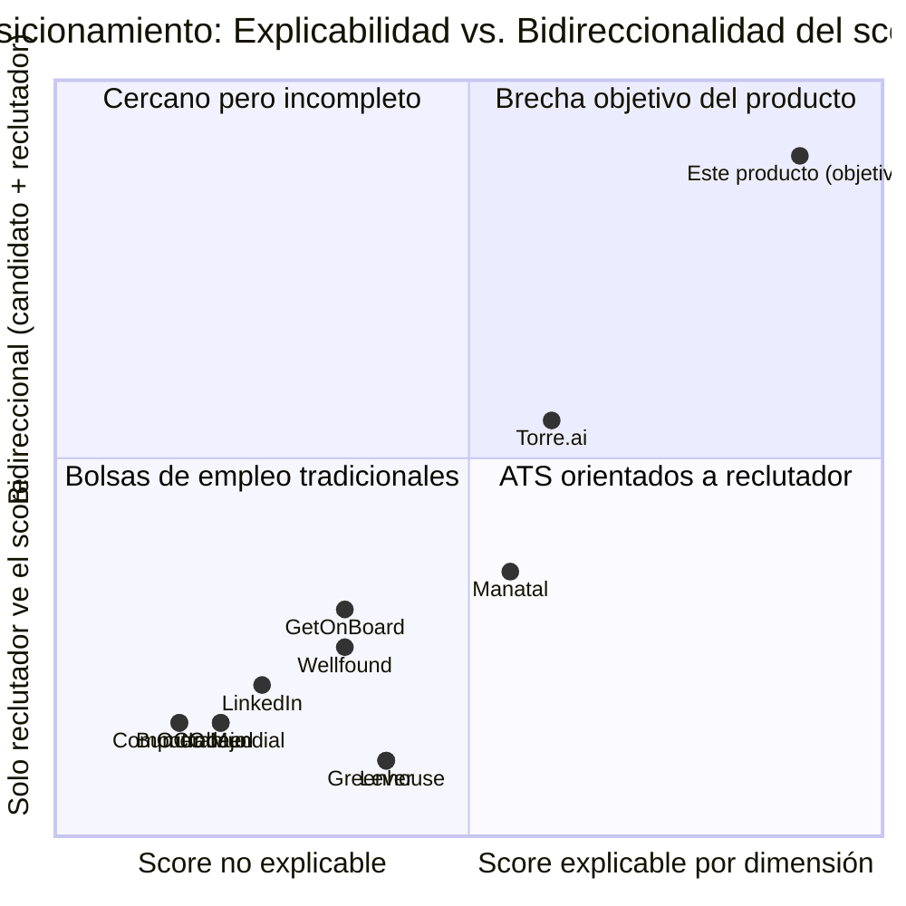

# Market Research & Competitor Analysis
## Sistema Inteligente de Análisis de Compatibilidad CV-Vacante con CRM de Postulaciones

| Campo | Valor |
|---|---|
| **Estado** | 🟡 En revisión |
| **Versión** | 1.0 |
| **Fecha** | Agosto 2026 |
| **Documentos relacionados** | Vision Document, PRD-MVP, PR/FAQ |

---

## 1. Propósito del documento

Formalizar el análisis competitivo que sustenta la propuesta de valor del producto: identificar qué resuelven bien las plataformas existentes, qué dejan sin resolver, y en qué brecha concreta se posiciona este sistema.

## 2. Alcance del análisis

Se agrupan las plataformas analizadas en tres categorías según su función principal:

| Categoría | Plataformas |
|---|---|
| Redes profesionales / bolsas de empleo generalistas | LinkedIn, Computrabajo, Bumeran, OCC Mundial, Indeed |
| Plataformas de matching orientadas a talento tech/startups | Torre.ai, GetOnBoard, Wellfound |
| ATS / CRM de reclutamiento (herramientas para reclutadores) | Greenhouse, Lever, Manatal |

## 3. Análisis por plataforma

| Plataforma | Categoría | Fortalezas | Debilidades / brecha frente a este producto |
|---|---|---|---|
| **LinkedIn** | Red profesional generalista | Base de usuarios masiva, red de contactos, presencia de marca empleadora | Sin score de compatibilidad explicable; el "match" es implícito (algoritmo de feed/recomendación cerrado), no auditable por el usuario |
| **Torre.ai** | Matching de talento | Score de compatibilidad visible y enfoque explícito en "fit"; referencia directa de diseño para este proyecto | Modelo de scoring no expone desglose granular por dimensión de forma consistente; sin generador de CV de marca para agencias de reclutamiento |
| **GetOnBoard** | Matching tech/startups LATAM | Curaduría de vacantes tech, buena experiencia de candidato regional | Alcance limitado a roles tech/startup; sin score bidireccional explicable ni herramientas para agencias de outsourcing |
| **Computrabajo** | Bolsa de empleo generalista LATAM | Altísimo volumen de vacantes y tráfico en la región | Postulación tipo "aplicar y esperar", sin ningún criterio de compatibilidad visible para el candidato |
| **Bumeran** | Bolsa de empleo generalista LATAM | Fuerte presencia regional, herramientas básicas de ATS para reclutadores | Mismo problema que Computrabajo: sin score explicable ni bidireccional |
| **OCC Mundial** | Bolsa de empleo generalista (México/LATAM) | Volumen alto, filtros de búsqueda avanzados para reclutadores | Filtros son búsqueda manual, no un score calculado; sin explicabilidad ni CV de marca |
| **Indeed** | Bolsa de empleo generalista global | Alcance global, agregador de vacantes de múltiples fuentes | "Match" superficial por palabras clave; no hay modelo semántico ni desglose explicable |
| **Greenhouse** | ATS para reclutadores | Pipeline de reclutamiento robusto, buena estructuración de proceso de contratación | Diseñado para el reclutador, no para el candidato; el candidato no ve ningún score; sin generador de CV de marca |
| **Lever** | ATS para reclutadores | CRM de relación con candidatos (nurturing), buena UX de reclutador | Mismo problema que Greenhouse: cero visibilidad de compatibilidad para el candidato |
| **Manatal** | ATS + scoring con IA | Ya ofrece scoring asistido por IA para reclutadores, más cercano en concepto | Scoring orientado únicamente al reclutador (no bidireccional); explicabilidad limitada; sin generador de CV de marca para reenvío a clientes de outsourcing |
| **Wellfound (ex AngelList Talent)** | Matching tech/startups | Buen filtrado por stack tecnológico y cultura de startup | Alcance de nicho (startups); sin score explicable de compatibilidad ni CV de marca |

## 4. Brecha de mercado identificada

Ninguna plataforma revisada combina, simultáneamente:

1. **Score de compatibilidad bidireccional** (visible para candidato *y* reclutador, no solo uno de los dos lados).
2. **Explicabilidad por diseño** (desglose por dimensión, no una caja negra ni un ranking implícito).
3. **Soporte de perfil de propósito general** (no limitado a roles tech/startup ni a candidatos sin experiencia).
4. **Generador de CV de marca para reclutadores de outsourcing**, que reutiliza datos ya cargados del candidato sin duplicar trabajo manual de plantillas.

Torre.ai y Manatal son los competidores más cercanos conceptualmente (scoring de compatibilidad y scoring asistido por IA, respectivamente), pero ninguno cubre los cuatro puntos a la vez.

## 5. Implicaciones para el producto

- El valor diferencial no está en tener *un* score, sino en que sea explicable y visible para ambos lados del mercado laboral a la vez (justifica BR-VIS-01/02 y BR-MATCH-02).
- El generador de CV de marca (sección 6 de PRD-MVP) responde a un dolor real y sin resolver de las empresas de outsourcing, no cubierto por ningún competidor analizado.
- El posicionamiento de propósito general (BR-CAND-03) diferencia el producto de las plataformas de nicho tech/startup (GetOnBoard, Wellfound).

## 6. Preguntas abiertas

- ¿Se dispone de datos cuantitativos (encuestas, entrevistas) de la cohorte USAC que confirmen empíricamente esta brecha, o el análisis es hasta ahora cualitativo/bibliográfico?
- ¿Debe evaluarse alguna plataforma adicional específica del mercado guatemalteco no incluida en esta lista?
