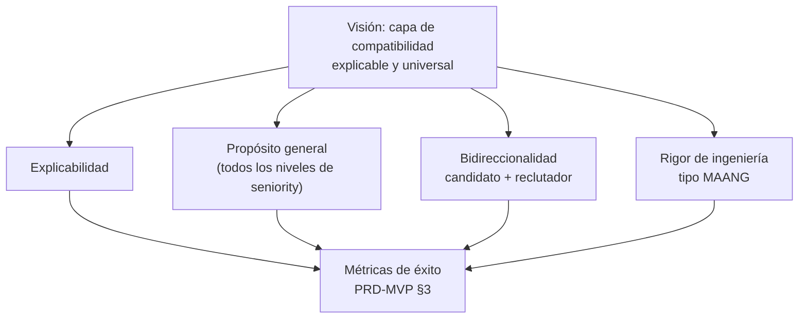

# Vision Document
## Sistema Inteligente de Análisis de Compatibilidad CV-Vacante con CRM de Postulaciones

| Campo | Valor |
|---|---|
| **Estado** | 🟡 En revisión |
| **Versión** | 1.0 |
| **Fecha** | Agosto 2026 |
| **Documentos relacionados** | PRD-MVP, Project Charter, Market Research & Competitor Analysis |

---

## 1. Propósito del documento

Este documento articula la visión de producto a largo plazo: hacia dónde apunta el sistema más allá del alcance del MVP descrito en PRD-MVP. Mientras el PRD acota lo que se construye para la validación de tesis, este documento responde "para qué existe el producto" y "qué tan lejos puede llegar".

## 2. Declaración de visión

Convertirse en la capa de compatibilidad **explicable** y **bidireccional** entre cualquier perfil profesional y cualquier vacante — de forma que ningún candidato postule a ciegas y ningún reclutador priorice sin criterio objetivo, sin importar el nivel de seniority del perfil evaluado.

## 3. El problema, en una frase

Postular y reclutar hoy son procesos de información asimétrica: el candidato no sabe qué tan compatible es realmente antes de aplicar, y el reclutador no tiene un criterio explicable para priorizar entre cientos de postulaciones.

## 4. A quién sirve

| Segmento | Descripción |
|---|---|
| Candidatos | Cualquier perfil profesional, de cualquier nivel de seniority (junior a ejecutivo) — el motor de matching es de propósito general, no exclusivo para perfiles sin experiencia |
| Cohorte de validación | Estudiantes y egresados de la Facultad de Ingeniería, USAC — usada para **validar** el producto empíricamente, no para **limitar** su alcance de diseño |
| Reclutadores | Individuales o pertenecientes a empresas de outsourcing que reenvían candidatos a clientes finales |

## 5. Diferenciador clave

La combinación de tres elementos que, hoy, ningún competidor directo ofrece junta (ver `market-research-and-competitor-analysis.md`):

1. Score de compatibilidad **bidireccional** — visible tanto para candidato como para reclutador, no solo para uno de los dos lados.
2. Score **explicable por diseño** — desglose por dimensión, nunca una caja negra (BR-MATCH-02).
3. Generador de **CV con marca del reclutador**, reutilizando los datos ya cargados del candidato, orientado a empresas de outsourcing que reenvían talento a clientes.

## 6. Panorama más allá del MVP

Elementos actualmente fuera de alcance (ver PRD-MVP sección 4) que representan posibles etapas futuras, no compromisos de esta tesis:

- Integraciones con ATS externos (Workday, SuccessFactors, Greenhouse, Lever) vía API pública.
- Soporte multi-idioma para perfiles y vacantes.
- Aplicación móvil nativa (hoy solo web responsiva).
- Prevención avanzada de fraude/perfiles falsos con modelos dedicados.
- Expansión de la cohorte de validación hacia el mercado laboral abierto de Guatemala y Centroamérica.
- Videoentrevistas o evaluación de habilidades blandas por audio/video.

## 7. Principios rectores

- **Explicabilidad ante todo** — ninguna decisión algorítmica visible al usuario carece de desglose (BR-MATCH-02).
- **Propósito general** — el motor no se diseña ni se calibra exclusivamente para perfiles junior o sin experiencia (BR-CAND-03).
- **Rigor de ingeniería tipo MAANG como diferenciador de tesis** — documentación primero, CI/CD desde el día uno, pruebas estructuradas, observabilidad y ADRs formales, no solo como buenas prácticas sino como parte de la contribución académica evaluable.
- **Arquitectura evolutiva, no descartable** — el modular monolith y el modelo de dominio están diseñados para poder escalar hacia el panorama de la sección 6 sin una reescritura completa.

## 8. Métricas de éxito de la visión

Las métricas que validan si esta visión se está cumpliendo durante la fase de tesis son las definidas en `prd-mvp.md` sección 3 (precisión de matching ≥ 0.85, SUS ≥ 72, NPS ≥ 40, adopción a 30 días ≥ 60%). Este documento no las duplica; las adopta como criterio de éxito de la visión completa, no solo del MVP.

## 9. Preguntas abiertas

- ¿El producto tiene intención de continuidad comercial después de la validación de tesis, o su ciclo de vida concluye en la defensa académica?
- Si hay continuidad, ¿cuál sería el modelo de negocio (freemium, comisión por colocación, licencia B2B a agencias de reclutamiento)?
- ¿Existe un límite de tiempo/alcance definido por el comité de tesis para considerar la expansión de la sección 6, o queda completamente abierto post-graduación?
