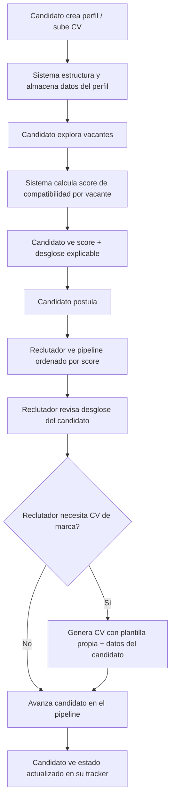

# PRD — Product Requirements Document (MVP)
## Sistema Inteligente de Análisis de Compatibilidad CV-Vacante con CRM de Postulaciones

| Campo | Valor |
|---|---|
| **Estado** | 🟡 En revisión |
| **Versión** | 1.0 |
| **Fecha** | Agosto 2026 |
| **Owner** | Eder — USAC, Ingeniería en Ciencias y Sistemas |
| **Documentos relacionados** | Vision Document, PR/FAQ, Market Research & Competitor Analysis |

---

## 1. Resumen

Plataforma web (ATS + CRM de postulaciones) que calcula un **score de compatibilidad bidireccional** entre perfiles profesionales y vacantes laborales, visible tanto para el candidato como para el reclutador, con un módulo adicional de generación de CV con marca propia para reclutadores.

## 2. Problema

- Los candidatos postulan "a ciegas", sin saber qué tan compatibles son realmente con una vacante antes de aplicar, y sin forma de dar seguimiento estructurado a sus postulaciones.
- Los reclutadores reciben altos volúmenes de candidatos sin un criterio objetivo y explicable para priorizar revisión.
- Las empresas de outsourcing que reenvían candidatos a clientes finales no tienen forma sistemática de generar CVs con su propio formato de marca a partir de los datos ya cargados del candidato.

## 3. Objetivos y métricas de éxito

| Objetivo | Métrica | Meta |
|---|---|---|
| Precisión del matching | Precisión del score vs. evaluación humana | ≥ 0.85 |
| Usabilidad | System Usability Scale (SUS) | ≥ 72 |
| Satisfacción | Net Promoter Score (NPS) | ≥ 40 |
| Adopción | % de usuarios activos a 30 días | ≥ 60% |

## 4. No-objetivos (fuera de alcance del MVP)

- Videoentrevistas o evaluación de soft skills por audio/video
- Integración con ATS externos (Workday, SuccessFactors, Greenhouse, etc.)
- Aplicación móvil nativa (solo web responsiva)
- Prevención avanzada de fraude/perfiles falsos (se evalúa post-MVP)
- Traducción/soporte multi-idioma
- Detección/inferencia automática de "quién es el empleador actual del candidato" — el candidato oculta su estado "Open to Work" manualmente vía lista de exclusión (BR-CAND-05), el sistema no infiere esa relación automáticamente
- Exclusión de estado a nivel de empresa/organización — el MVP no modela una entidad "empresa" independiente de la cuenta; la lista de exclusión (BR-CAND-05) opera por cuenta individual, sea reclutador o candidato
- Una vista de perfil público entre candidatos ("candidato ve el perfil de otro candidato") — la lista de exclusión admite agregar cuentas candidato desde el día uno (BR-CAND-05), pero ese control no tiene, hoy, un canal donde surta efecto visible
- Reglas de elegibilidad basadas en edad, género u otras categorías protegidas — el catálogo de tipos de excepción (BR-ELIG-01) es cerrado y curado por diseño, no un campo de regla arbitrario, para evitar habilitar screening discriminatorio

## 5. Usuarios objetivo (personas)

**Candidato**
- Cualquier perfil profesional (no limitado a estudiantes sin experiencia)
- Cohorte de validación: estudiantes y egresados de la USAC
- Necesita: entender su compatibilidad antes de postular, dar seguimiento a sus postulaciones

**Reclutador**
- Individual o de empresa de outsourcing
- Necesita: priorizar candidatos por compatibilidad objetiva, generar CVs con su propio formato de marca para reenviar a clientes

**Nota — capacidades no excluyentes (ADR-0008)**: una misma cuenta puede tener capacidad de candidato, de reclutador, o ambas a la vez — p. ej. un reclutador que pierde su puesto o quiere cambiar de rol puede habilitar su propia capacidad de candidato sin crear una segunda cuenta, conservando su historial profesional ya cargado (BR-ACCT-01/02).

## 6. Flujo principal de usuario

## 7. Requisitos funcionales del MVP (por módulo)

### 7.1 `auth-module`
- Registro/login con capacidades no excluyentes: candidato, reclutador, o ambas por cuenta (BR-ACCT-01, ADR-0008)
- Habilitación de una segunda capacidad sobre una cuenta ya existente, en cualquier momento (p. ej. un reclutador que habilita su propia capacidad de candidato)
- Autenticación basada en JWT, con las capacidades habilitadas de la cuenta representadas en el token

### 7.2 `cv-module`
- **Perfil profesional compartido** (`ProfessionalProfile`, ADR-0008), común a cualquier capacidad de la cuenta: nombre, titular, biografía, foto, experiencia laboral, formación académica, certificaciones y proyectos (laborales o personales) — creado una sola vez, reutilizado si la cuenta habilita su segunda capacidad (BR-ACCT-02)
- **Perfil de candidato**, construido sobre el perfil profesional: carga y estructuración de CV (datos de contacto, skills), declaración de atributos de elegibilidad (país de residencia, autorización legal de trabajo, modalidad y jornada preferida, idiomas con nivel de dominio, disposición a reubicarse, expectativa salarial — insumo de `job-module`, BR-ELIG-01), generación de CV en PDF (Thymeleaf + openhtmltopdf), control de visibilidad/descubribilidad ante sugerencias de reclutadores (opt-out, BR-DATA-03), estado de disponibilidad ("Open to Work" / "Happy working" / sin declarar, BR-CAND-04), lista de exclusión personalizada (BR-CAND-05)
- **Perfil de reclutador**, construido sobre el mismo perfil profesional: empresa/agencia y áreas de especialización de reclutamiento (opcionales), sin ninguno de los datos de búsqueda de empleo del perfil de candidato (BR-ACCT-07); siempre público y de solo lectura para cualquier usuario autenticado que consulte una vacante propia (BR-ACCT-08)
- Gestión de plantillas de marca por reclutador
- Generación de CV de marca del reclutador (merge plantilla + datos del candidato)

### 7.3 `job-module`
- Creación de vacante como borrador (`DRAFT`) y publicación (título, descripción, requisitos, modalidad, país/ubicación, rango salarial)
- Ciclo de vida completo de la vacante al estilo LinkedIn: `DRAFT → PUBLISHED → CLOSED → ARCHIVED → DELETED`, con reapertura de `CLOSED` a `PUBLISHED` antes del archivado (BR-JOB-03, BR-JOB-06 a 11)
- Pausa/reanudación reversible de recepción de nuevas postulaciones (`acceptingApplications`) sin cerrar la vacante (BR-JOB-10)
- Archivado automático de vacantes cerradas transcurrido un periodo configurable (por defecto 4 días, rango 3-5) — deja de ser visible para cualquier candidato y de todo listado general (BR-JOB-06, BR-JOB-11)
- Eliminación completa de una vacante archivada, exclusiva del reclutador propietario (BR-JOB-09)
- Temporizador opcional, por transición individual, para programar cambios de estado a una fecha/hora futura (p. ej. programar la publicación de un borrador, o el cierre de una vacante) — toda transición sin temporizador configurado se ejecuta manualmente (BR-JOB-12 a 18)
- Etapa de reclutamiento por vacante: "Contratando" / "Analizando CV" (BR-JOB-04), independiente de `acceptingApplications` y activa solo mientras la vacante está publicada
- Configuración de **reglas de elegibilidad** (excepciones) por vacante: país de residencia, autorización legal de trabajo, nivel académico mínimo, años de experiencia mínimos, modalidad, disponibilidad/jornada, nivel de idioma, disposición a reubicarse y expectativa salarial (BR-ELIG-01), cada una activable/desactivable de forma independiente (BR-ELIG-05)
- Toggle independiente por regla para ocultar completamente la vacante a los candidatos que no cumplen (`hideIfNotEligible`, BR-ELIG-04), además del bloqueo de postulación
- Validación de elegibilidad al momento de la postulación: rechazo explícito con el motivo si el candidato incumple alguna regla activa (BR-ELIG-02/03)
- Listado/búsqueda de vacantes para el candidato, filtrado por las reglas con ocultamiento activo (BR-ELIG-04), salvo que el candidato tenga una invitación vigente para esa vacante (BR-VIS-08)
- Vista pública del perfil de reclutador (`RecruiterProfile`, BR-ACCT-08) en la página de cada vacante — nombre, titular, experiencia, empresa/agencia
- Configuración de **preguntas de postulación** por vacante (texto, sí/no, numérica, opción única/múltiple, carga de archivo), con vínculo opcional a un campo del perfil del candidato — manual o por sugerencia asistida de IA que el reclutador debe confirmar — para evitar pedir información que el perfil ya tiene (BR-APPQ-01 a 04)

### 7.4 `matching-module`
- Cálculo de score de compatibilidad (capa semántica + capa estructurada ponderada)
- Desglose explicable por dimensión
- Recalculo automático ante cambios en CV o vacante
- Sugerencia proactiva de candidatos compatibles para una vacante, sin requerir postulación previa (BR-MATCH-06), respetando el estado de descubribilidad del candidato (BR-DATA-03)
- Priorización de candidatos "Open to Work" dentro del listado de sugeridos, sin alterar el score (BR-MATCH-07); pausa de nuevas sugerencias para vacantes en etapa "Analizando CV" (BR-MATCH-08)

### 7.5 `ats-module`
- Pipeline de candidatos por vacante, ordenable y filtrable por score
- Vista de desglose de compatibilidad por candidato
- Vista de candidatos **sugeridos** por compatibilidad (no postulados) para la vacante, al estilo de búsqueda de talento de LinkedIn (BR-VIS-04), con indicador de estado de disponibilidad del candidato (BR-VIS-05) y con el desglose de qué reglas de elegibilidad incumple cada candidato sugerido, si alguna (BR-ELIG-12)
- Invitación directa de un candidato específico a postular pese a incumplir una o más reglas de elegibilidad de la vacante (BR-ELIG-09 a 11), disponible tanto desde el pipeline de postulados como desde la vista de sugeridos
- Control de la etapa de reclutamiento de cada vacante propia (BR-JOB-04)
- Acceso a generación de CV de marca desde el pipeline, extensible a candidatos sugeridos
- Vista de las respuestas de cada postulante a las preguntas de postulación, junto al resto del pipeline, indicando cuáles fueron prellenadas desde el perfil y cuáles escritas por el candidato (BR-APPQ-09)
- Envío de solicitudes de información adicional (una o varias preguntas ad-hoc) sobre una postulación ya recibida, cuando lo recolectado al aplicar no fue suficiente (BR-FUP-01 a 03)

### 7.6 `tracker-module`
- Vista de postulaciones del candidato con estado actual
- Notificación de cambios de estado
- Formulario de postulación: preguntas de la vacante prellenadas desde el perfil donde aplique, mostradas al candidato para confirmar o editar antes de enviar (BR-APPQ-05/06); respuesta directa de las preguntas sin vínculo o sin dato disponible en el perfil (BR-APPQ-07)
- Notificación y respuesta de solicitudes de información adicional enviadas por un reclutador sobre una postulación propia (BR-FUP-04)

## 8. Supuestos y dependencias

- Ollama disponible localmente para embeddings (modelo de ADR-0018) y generación (llama3.2)
- Cohorte de validación (estudiantes USAC) disponible en la fase de pruebas

## 9. Preguntas abiertas

- ¿Se requiere verificación de identidad del reclutador antes de habilitarlo a publicar vacantes?
- ¿Cuál es el volumen esperado de vacantes/candidatos durante la validación, para dimensionar pruebas de carga?
- ¿El candidato recibe alguna notificación cuando su perfil es sugerido a un reclutador (paridad con "un reclutador vio tu perfil" de LinkedIn), o la sugerencia (BR-VIS-04) ocurre de forma silenciosa para el candidato?
- ¿Hay un recordatorio/expiración automática si un reclutador deja una vacante en "Contratando" (BR-JOB-04) por mucho tiempo sin actividad, para evitar que el estado quede desactualizado?
- El candidato agrega cuentas a su lista de exclusión (BR-CAND-05) buscándolas individualmente — ¿se necesita algún mecanismo de descubrimiento (p. ej. "reclutadores que han visto tu perfil recientemente") para facilitar encontrar a quién excluir, o el candidato debe conocer/buscar la cuenta exacta?
- ¿Se necesita definir un caso de uso de "candidato ve el perfil de otro candidato" para que excluir una cuenta candidato (BR-CAND-05) tenga efecto visible, o se mantiene como control preventivo sin canal actual? (misma pregunta abierta de `domain-model.md` §8)
- ¿El candidato ve, en el listado general de vacantes, alguna indicación de que ciertas vacantes existen pero le fueron ocultadas por elegibilidad (BR-ELIG-04), o la ocultación es completamente silenciosa (la vacante simplemente no aparece)?
- ¿El mensaje de rechazo por elegibilidad (BR-ELIG-03) expone el criterio exacto de la regla (p. ej. "requiere autorización de trabajo en Colombia") o un mensaje genérico por categoría, para no exponer del todo la configuración de screening del reclutador?
- ¿Cómo se entera un candidato de que fue invitado (BR-ELIG-09)? ¿Basta la notificación de `tracker-module` (paridad con BR-TRACK-02), o se requiere un canal de contacto/mensajería explícito entre reclutador y candidato, hoy fuera de alcance del MVP?
- ¿El reclutador puede revocar una invitación ya otorgada? Si el candidato ya vio la vacante oculta gracias a ella (BR-VIS-08), ¿pierde el acceso de inmediato al revocarse, o conserva la visibilidad de lo que ya vio?
- ¿El valor por defecto de `archivalDelayDays` (propuesto: 4 días, BR-JOB-06) se calibra empíricamente durante la validación con la cohorte USAC, o se fija de entrada sin revisión posterior?
- ¿El reclutador recibe alguna alerta antes de que una vacante `CLOSED` se archive automáticamente (p. ej. "se archivará en 1 día"), o el archivado ocurre sin aviso previo?
- ¿Se notifica al reclutador si una transición programada se omite (`SKIPPED`, BR-JOB-16) porque el estado cambió por otra vía antes de la fecha programada, incluyendo el caso en que la omisión ocurre por una transición "aguas arriba" de una cadena programada (BR-JOB-19/20), no solo por una acción manual directa?
- ¿Dónde se almacenan los archivos subidos como respuesta a una pregunta `FILE_UPLOAD` (BR-APPQ-01), y aplican los mismos límites de tamaño/formato que la carga del CV del candidato (BR-CAND-01)?
- ¿El candidato puede reutilizar un archivo ya cargado en una postulación anterior (p. ej. una cover letter genérica) para una pregunta `FILE_UPLOAD` de una vacante distinta, o debe cargarlo de nuevo cada vez en el MVP?
- ¿Existe un límite de solicitudes de información adicional (BR-FUP-01) que un reclutador puede enviar sobre una misma postulación, para evitar un uso abusivo del mecanismo?
- ¿Una cuenta puede deshabilitar una capacidad ya habilitada (p. ej. un reclutador que decide dejar de reclutar y deshabilita `RecruiterProfile`)? Si puede, ¿qué pasa con sus vacantes publicadas (ver pregunta equivalente en `domain-model.md` §8)?
- ¿El cambio de "rol activo" en la UI (candidato ↔ reclutador, para una cuenta con ambas capacidades) requiere un nuevo login/token, o el JWT ya representa ambas capacidades y el cambio es puramente de navegación (ver pregunta abierta de seguridad en ADR-0008)?
- ¿El perfil profesional compartido (`ProfessionalProfile`) tiene su propia página pública (p. ej. `/perfil/{id}`, al estilo LinkedIn) visible incluso a usuarios no autenticados, o solo es consultable dentro del flujo de postulación/pipeline?

## 10. Glosario

- **Score de compatibilidad**: valor 0-100% que mide el ajuste entre un perfil y una vacante
- **CV de marca**: CV generado con la plantilla propia de un reclutador, a partir de los datos de un candidato
- **Candidato sugerido**: candidato que un reclutador puede ver para una vacante propia por tener score/skills compatibles, sin haber postulado (BR-VIS-04, BR-MATCH-06)
- **Perfil descubrible**: estado por defecto (opt-out) de un perfil de candidato que lo hace elegible para aparecer como candidato sugerido (BR-DATA-03)
- **Estado de disponibilidad**: declaración opcional del candidato sobre su intención de cambio ("Open to Work" / "Happy working" / sin declarar), independiente del score de compatibilidad (BR-CAND-04)
- **Etapa de reclutamiento**: estado por vacante ("Contratando" / "Analizando CV") que indica qué tan activamente el reclutador busca nuevos candidatos para ese puesto específico (BR-JOB-04)
- **Lista de exclusión de disponibilidad**: lista personalizada y manual de cuentas específicas — reclutadores u otros candidatos — a quienes un candidato oculta su estado "Open to Work" (verán `UNSET`), sin bloquear su capacidad de ver su perfil, score o de recibir su postulación (BR-CAND-05, BR-CAND-06, BR-VIS-06)
- **Regla de elegibilidad (excepción)**: condición dura configurable por el reclutador en una vacante (país, autorización de trabajo, nivel académico, experiencia, modalidad, disponibilidad, idioma, reubicación, expectativa salarial) que determina si un candidato puede postular y, opcionalmente, si ve la vacante; independiente y no bloqueante para el score de compatibilidad (BR-ELIG-01 a 08)
- **Invitación directa**: decisión explícita del reclutador de invitar a un candidato específico a postular a su vacante pese a que incumple una o más reglas de elegibilidad; hace bypass total de la elegibilidad para ese par candidato-vacante, incluyendo el acceso a una vacante que de otro modo estaría oculta (BR-ELIG-09 a 13, BR-VIS-08)
- **Vacante archivada**: vacante `CLOSED` que, tras el periodo de gracia configurable (por defecto 4 días), deja de ser visible para cualquier candidato y de todo listado general; solo el reclutador propietario conserva acceso, exclusivamente para eliminarla por completo (BR-JOB-06, BR-JOB-08, BR-JOB-11)
- **Temporizador de transición**: programación opcional del reclutador para que una transición específica del ciclo de vida de su vacante (publicar, cerrar, reabrir o eliminar) ocurra automáticamente en una fecha/hora futura elegida por él, en vez de ejecutarla manualmente; admite encadenar varias transiciones futuras por adelantado, sin esperar a que cada una ocurra para programar la siguiente (BR-JOB-12 a 20)
- **Pregunta de postulación**: pregunta propia que el reclutador agrega a su vacante (texto, sí/no, numérica, opción única/múltiple, archivo) para conocer mejor al candidato más allá del perfil estructurado; puramente informativa, nunca bloquea el envío salvo por quedar sin responder si es obligatoria (BR-APPQ-01 a 09)
- **Prellenado desde el perfil**: mecanismo por el cual el sistema completa automáticamente la respuesta a una pregunta de postulación vinculada a un dato ya declarado en el perfil del candidato, evitando que lo repita; siempre mostrado al candidato para confirmar o editar antes de enviar (BR-APPQ-05/06)
- **Solicitud de información adicional**: una o más preguntas ad-hoc que el reclutador envía sobre una postulación ya recibida, cuando lo recolectado al aplicar no fue suficiente; responderla es voluntario y nunca afecta el estado ni la elegibilidad de la postulación (BR-FUP-01 a 05)
- **Perfil profesional (`ProfessionalProfile`)**: núcleo de identidad profesional compartido por cualquier capacidad de una cuenta — nombre, titular, biografía, foto, experiencia laboral, formación académica, certificaciones y proyectos; se crea una sola vez por cuenta y nunca se duplica (BR-ACCT-02, ADR-0008)
- **Cuenta multi-rol**: cuenta que puede tener capacidad de candidato, de reclutador, o ambas a la vez, sin ser mutuamente excluyentes; cada capacidad se comporta como si perteneciera a una cuenta exclusiva de ese rol, sin privilegios cruzados (BR-ACCT-01, BR-ACCT-04)
- **Perfil de reclutador (`RecruiterProfile`)**: perfil ligero construido sobre el perfil profesional compartido, con solo empresa/agencia y áreas de especialización — sin datos de búsqueda de empleo; siempre público (BR-ACCT-07/08)
