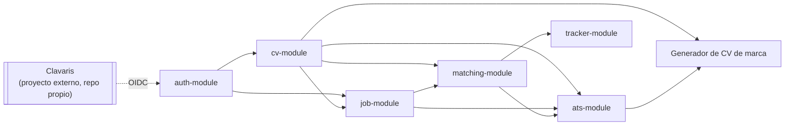

# Roadmap & Release Plan
## Sistema Inteligente de Análisis de Compatibilidad CV-Vacante con CRM de Postulaciones

| Campo | Valor |
|---|---|
| **Estado** | 🟡 En revisión |
| **Versión** | 2.1 — reestructurado en olas de entrega de valor; Sprint 0 y ajuste por la revisión de arquitectura de noviembre de 2026 (§12) |
| **Fecha** | Agosto 2026 · actualizado el 20-nov-2026 |
| **Documentos relacionados** | PRD-MVP, Project Charter (marco de tiempo ajustado, §6) |

---

## 1. Propósito y cambio de modelo de planeación

La meta del proyecto no es solo un entregable académico — es un **producto real que debe aportar valor desde su implementación**, no solo al final de un ciclo de desarrollo cerrado. Por eso este roadmap abandona el modelo de fases académicas secuenciales (F1→F7, donde nada es usable hasta que las siete terminan) y se reestructura en **olas de entrega de valor**: cada ola termina en algo que personas reales — candidatos y reclutadores — pueden usar de extremo a extremo, no en un artefacto interno a medio construir.

Esto no reduce el alcance ya diseñado (sigue siendo el mismo: 86 reglas de negocio, 19 ADRs en JobSeeker (0001–0027) — la autenticación ya no es una de ellas, se movió por completo a Clavaris — todo lo documentado en `business-rules.md`/`domain-model.md`/`data-model.md`). Lo que cambia es el **orden de entrega**: qué se construye primero para empezar a recibir uso y retroalimentación real lo antes posible, y qué se construye después con esa evidencia en la mano. La infraestructura para hacerlo así ya existe (trunk-based development + feature flags, `git-workflow.md` §4) — este roadmap por fin la aprovecha.

Dos decisiones explícitas del negocio para esta versión:

- **Auth completo desde la Ola 1, no una versión básica.** Es la pieza de mayor costo si está mal desde el principio (toca cada verificación de autorización del sistema) — se acepta el tiempo adicional que toma hacerla bien una sola vez.
- **ATS completo en la Ola 2, no repartido entre una versión básica y una posterior.** El pipeline de reclutador no es competitivo a medias — o tiene desglose de elegibilidad, invitación y respuestas de postulación, o no vale la pena mostrárselo a un reclutador real.

## 2. Las tres olas

| Ola | Qué entrega | Quién ya puede usarlo de extremo a extremo | Sprints |
|---|---|---|---|
| **Ola 1 — Cimiento production-grade** | Auth completo, infraestructura transversal no negociable, perfil profesional + de candidato, vacante con ciclo de vida manual, motor de matching completo, postulación y pipeline mínimos | Un candidato puede crear su perfil, ver su score explicado por vacante y postular; un reclutador puede publicar una vacante y ver su pipeline ordenado por score | ~23 (19 + ≈ 4 de la revisión de nov-2026, §12; incluye el Sprint 0) |
| **Ola 2 — Screening + ATS completo** | Reglas de elegibilidad, invitación directa, preguntas de postulación, solicitudes de información adicional, ATS y tracker completos | El producto ya es competitivo frente a un ATS real: filtra candidatos, prellena respuestas desde el perfil, deja invitar pese a una excepción, deja pedir más información sin reabrir el proceso | ~13 (≈ 15 con §12) |
| **Ola 3 — Automatización y profundidad** | Temporizador de transición + archivado automático, perfil de reclutador completo, generador de CV (propio + de marca), calibración operativa con tráfico real | El producto opera con menos intervención manual del reclutador y cubre el caso de uso de las agencias de outsourcing (CV de marca) | ~8 |

**Total: ~45–47 sprints (~10-11 meses) tras el ajuste de noviembre de 2026 (§12).** La estimación original de este documento era ~40 (~9-10 meses). Es más que la estimación de 29 sprints de la versión anterior de este documento — no por alcance nuevo, sino por dos costos reales que antes no se contaban explícitamente: (1) construir auth e infraestructura transversal a nivel de rigor de producto real, no de prototipo académico, y (2) el costo de "costura" de entregar el pipeline/tracker en dos pasadas (una mínima en la Ola 1, la completa en la Ola 2) en vez de una sola vez al final. Ver sección 6 para el desglose de por qué se acepta ese costo.

## 3. Ola 1 — Cimiento production-grade y usable de extremo a extremo

| Bloque | Contenido | Sprints |
|---|---|---|
| Integración de identidad (Clavaris) | JobSeeker deja de construir su propio motor de auth — se integra como cliente OIDC de **Clavaris**, un proveedor de identidad separado y reutilizable (repositorio propio). Cubre: config de cliente OAuth2/OIDC, tabla local `accounts` como espejo (capacidades `is_candidate_enabled`/`is_recruiter_enabled`, que son de negocio de JobSeeker, no de Clavaris), manejo de sesión/logout | 2 |
| Infraestructura transversal | OpenAPI agregado vía springdoc + linting en CI (ADR-0010), rate limiting Bucket4j+Redis (ADR-0011), Actuator+Micrometer+Prometheus+Grafana+Alertmanager (ADR-0012) | 2 |
| Perfil profesional + candidato | `ProfessionalProfile` compartido (experiencia, formación, certificaciones, proyectos), `CandidateProfile` (skills, datos de elegibilidad, disponibilidad, descubribilidad, lista de exclusión) — sin `RecruiterProfile` todavía | 3 |
| Vacante — ciclo de vida manual | `DRAFT → PUBLISHED ⇄ CLOSED → ARCHIVED → DELETED` (BR-JOB-03/08/09) ejecutado manualmente por el reclutador — sin temporizador ni archivado automático todavía (eso es Ola 3) | 2 |
| Motor de matching completo | Score híbrido, desglose explicable, recalculo automático, sugerencia proactiva de candidatos (BR-MATCH-01 a 09) | 5 |
| Postulación y pipeline mínimos | Candidato postula (sin elegibilidad ni preguntas de postulación todavía) y ve su estado; reclutador ve pipeline ordenado y filtrable por score | 3 |
| **Sprint 0 — esqueleto andante** *(revisión de nov-2026)* | Login real contra Clavaris → perfil mínimo → vacante → score *stub* → postular, con CI/CD, Flyway, Actuator/Prometheus y despliegue a staging; orden en `03-lld.md` §10. Incluye el spike R13 | +0.5 neto (el resto se absorbe en «Infraestructura transversal») |
| Arnés de evaluación del matching *(revisión de nov-2026)* | Dataset dorado, métricas P@K/NDCG y prueba contrafactual de equidad en CI (protocolo de 300 pares); sin esto «precisión ≥ 0.85» no puede demostrarse | +1 |
| Notificaciones *(revisión de nov-2026)* | Correo + in-app con *outbox* (ADR-0016); sin ellas el tracker no cumple BR-TRACK-02 | +1 |
| Almacenamiento de archivos *(revisión de nov-2026)* | Subida de CV con antivirus y URLs firmadas (requisito BR-CAND-01) | +0.5 |
| Búsqueda de vacantes *(revisión de nov-2026)* | Texto completo en español + búsqueda híbrida con vector | +0.5 |
| Verificación de reclutador y cuotas *(revisión de nov-2026)* | Verificación de la cuenta reclutadora y cuotas de sugerencias | +0.5 |
| **Cumplimiento y ciclo de vida de cuenta** *(nuevo en esta revisión)* | Política de privacidad y términos de servicio publicados (borrador técnico ya redactado en `docs/06-operational/`, pendiente de revisión legal antes de publicar) con flujo de aceptación en el registro; mecanismo real de eliminación de cuenta — periodo de gracia + anonimización + cascada a Clavaris (ADR-0013, BR-DATA-02 a 06) | 2 |

**Subtotal: ~23 sprints (~5.3 meses)**, es decir, los 19 originales más ≈ 4 de la revisión de nov-2026 (§12); ~22 si se adopta la compensación propuesta allí. En la estimación de 19, el ahorro de mover auth a Clavaris (4→2 sprints) compensó casi exactamente el costo de cumplimiento/borrado de datos (+2 sprints); los ≈ 4 sprints nuevos sí son costo neto.

**Dependencia entre proyectos, ahora explícita:** este bloque de "Integración de identidad" asume que Clavaris ya tiene funcional su núcleo de login/tokens (no su v1 completa — organizaciones, login social y recuperación de contraseña pueden seguir construyéndose en paralelo). Esto es una dependencia de secuencia entre dos roadmaps separados que hoy no está coordinada formalmente — ver preguntas abiertas (sección 11).

Al final de la Ola 1, el producto ya resuelve la propuesta de valor central (score bidireccional explicable) para usuarios reales, con la base legal mínima para tener usuarios reales — es el punto más temprano posible para empezar a recibir uso genuino, antes de invertir en screening y profundidad de ATS.

## 4. Ola 2 — Screening + ATS completo

| Bloque | Contenido | Sprints |
|---|---|---|
| Reglas de elegibilidad | Catálogo completo de 9 tipos + ocultamiento opcional de vacante (BR-ELIG-01 a 08) | 3 |
| Invitación directa | Bypass total de elegibilidad para un candidato específico (BR-ELIG-09 a 13) | 1 |
| Preguntas de postulación | 6 tipos de pregunta, detección híbrida (manual + sugerencia por IA confirmada) (BR-APPQ-01 a 09) | 3 |
| Solicitudes de información adicional | Follow-up post-postulación, nunca bloqueante (BR-FUP-01 a 05) | 1 |
| ATS completo | Pipeline con desglose de elegibilidad por candidato sugerido, invitación desde el pipeline, respuestas de postulación visibles, gestión de follow-up | 3 |
| Tracker completo | Formulario de postulación con prellenado confirmable desde el perfil, respuesta a solicitudes de información adicional | 2 |

**Subtotal: 13 sprints (~3 meses)**; ≈ 15 con el ajuste de noviembre de 2026 (§12).

Al final de la Ola 2, el producto es funcionalmente completo frente a un ATS real — **este es el punto de control natural para una eventual defensa de tesis**, si el calendario académico lo exige: Ola 1 + Ola 2 (~37–38 sprints, ~8.7 meses tras el ajuste de §12; ~32 y ~7.4 meses en la estimación original) entregan un producto íntegro y demostrable, con la automatización y el generador de CV de la Ola 3 pudiendo continuar como desarrollo de producto real después de la defensa, sin la presión de una fecha académica fija.

## 5. Ola 3 — Automatización y profundidad

| Bloque | Contenido | Sprints |
|---|---|---|
| Automatización del ciclo de vida | Archivado automático (`archivalDelayDays`) + temporizador de transición encadenable (BR-JOB-06, BR-JOB-12 a 20) | 2 |
| Perfil de reclutador completo | Empresa/agencia, especialización, vista pública (BR-ACCT-07/08) | 1 |
| Generador de CV | CV propio en PDF, plantillas de marca, CV de marca del reclutador (BR-CVGEN-01 a 03) | 3 |
| Endurecimiento operativo | Calibración de políticas de rate limiting y pesos de scoring con tráfico real, ajuste de dashboards/alertas, revisión de retención y respaldo de datos | 2 |

**Subtotal: 8 sprints (~2 meses).**

## 6. Por qué el total creció frente a la versión anterior (29 → 40 sprints)

Esto no es alcance nuevo — es el mismo alcance, contado con más honestidad:

1. **Auth completo, no básico (+2 sprints netos):** la versión anterior ya incluía auth multi-rol, pero como parte de una fase de fundamentos genérica; aquí se separa y dimensiona explícitamente como el trabajo que es, con margen para hacerlo bien la primera vez.
2. **Costo de costura de entregar pipeline/tracker en dos pasadas (+3 sprints):** construir una versión mínima en la Ola 1 y extenderla a completa en la Ola 2 cuesta más en total que construirla una sola vez al final — ese costo adicional es el precio de tener algo usable por gente real cuatro meses y medio antes, no en el mes nueve. Se considera una inversión, no un desperdicio.
3. **Endurecimiento operativo explícito en Ola 3 (+2 sprints):** calibrar límites de tasa y política de retención contra tráfico real no existía como línea propia en el roadmap anterior — un producto real lo necesita, un entregable académico no.
4. El resto de la diferencia es redistribución sin cambio neto de esfuerzo (p. ej. separar ciclo de vida manual de su automatización).

## 7. Dependencias entre módulos

- `auth-module` ya no construye su propio motor de autenticación — es un **cliente OIDC de Clavaris**, un proyecto externo con repositorio y roadmap propios. Esto es una dependencia entre proyectos, no solo entre módulos: la Ola 1 de JobSeeker asume que el núcleo de login/tokens de Clavaris existe primero (ver sección 3).
- `auth-module` sigue siendo la base dentro de JobSeeker: ningún otro módulo puede desarrollarse en aislamiento sin capacidades de cuenta definidas (BR-ACCT-01) — por eso encabeza la Ola 1, aunque ahora sea principalmente trabajo de integración, no de construcción.
- `job-module` es cliente de `cv-module` (datos de elegibilidad del candidato, `RecruiterProfile` público).
- `matching-module` depende de que `cv-module` y `job-module` tengan datos estructurados reales, no mockeados; no depende del alcance de elegibilidad/screening (Ola 2) para funcionar — por eso vive completo en la Ola 1.
- `ats-module` es cliente directo de `job-module` (elegibilidad, invitaciones, preguntas de postulación) y de `cv-module` (prellenado de respuestas) — de ahí que su versión completa espere a que Ola 2 haya construido esas dependencias, aunque una versión mínima ya exista desde la Ola 1.
- El generador de CV de marca depende de `cv-module` (datos) y se consume desde `ats-module` — por eso vive en la Ola 3, después de que ambos ya estén maduros.

## 8. Estrategia de lanzamiento (release strategy)

- **Ambientes:** desarrollo local → staging (Docker Compose reproducible) → producción real, con usuarios reales desde el cierre de la Ola 1 — no una "cohorte de validación" acotada a una ventana académica, sino el inicio de operación continua.
- **Feature flags:** funcionalidad en progreso (p. ej. elegibilidad mientras se construye en Ola 2) se oculta tras flags y se habilita gradualmente, nunca se desarrolla en ramas largas.
- **Despliegue gradual:** cada bloque de cada ola se valida en staging antes de habilitarse a usuarios reales; dentro de una ola, los bloques se lanzan según van quedando listos, no todos juntos al cierre de la ola.
- **Rollback:** cada release debe ser reversible desplegando la versión anterior de la aplicación (las migraciones son solo hacia adelante, sin `undo`: ADR-0027); sin cambios de esquema irreversibles sin plan de reversión documentado — esto se vuelve más estricto, no menos, una vez que hay datos reales de usuarios en producción desde el cierre de la Ola 1.

## 9. Criterios de salida por ola

| Ola | Criterio de salida |
|---|---|
| Ola 1 | Login funcional vía integración OIDC con Clavaris (capacidades de cuenta gestionadas localmente); OpenAPI agregado sirviéndose y validado en CI; rate limiting activo; métricas y dashboards base visibles en Grafana; perfil profesional/candidato completo; una vacante puede publicarse, cerrarse, reabrirse y eliminarse manualmente; score de compatibilidad calculado y explicado con precisión preliminar medida; un candidato puede postular y un reclutador ver su pipeline ordenado por score — **de extremo a extremo, con usuarios reales, no solo en staging** |
| Ola 2 | Reglas de elegibilidad configurables y evaluadas al postular, con ocultamiento donde aplique; invitación directa como bypass; preguntas de postulación con detección híbrida y prellenado confirmable; pipeline con desglose de elegibilidad, invitación e información de seguimiento; tracker completo — el producto es funcionalmente competitivo frente a un ATS real |
| Ola 3 | Archivado automático y temporizador de transición operando sin intervención manual; CV propio y CV de marca generados correctamente en PDF; políticas de rate limiting y pesos de scoring calibrados contra tráfico real, no solo valores iniciales |

## 10. Medición continua (reemplaza la "fase de validación" única)

Las métricas de éxito (precisión ≥ 0.85, SUS ≥ 72, NPS ≥ 40, adopción a 30 días ≥ 60%, `prd-mvp.md` §3) ya no se miden en una fase final aislada — se empiezan a medir **desde que la Ola 1 tiene usuarios reales** y se revisan en cada cierre de ola. Esto es consistente con la meta de producto real: no hay una fecha única de "validación", hay una práctica continua de medir si el producto está aportando el valor que promete, mientras sigue evolucionando.

## 11. Riesgos y ajuste de cronograma — decisión adoptada

Ver Risk Register del protocolo de tesis (matriz de 8 riesgos) — este documento no duplica el detalle, solo referencia que cada ola debe revisarse contra esa matriz antes de avanzar a la siguiente.

**Decisión:** se adoptó el cronograma completo de ~40 sprints (~9-10 meses), hoy ajustado a ~45–47 (~10-11 meses, §12), para el alcance real diseñado, reestructurado en 3 olas de entrega de valor en vez de 7 fases académicas. No se recorta alcance ya diseñado — se resecuencia para que el producto empiece a aportar valor real (Ola 1) mucho antes de que todo el alcance esté completo (fin de Ola 3).

**Consecuencia sobre el marco del protocolo de tesis:** si existe una fecha de defensa fija, el punto de control recomendado es el cierre de la Ola 2 (~37–38 sprints, ~8.7 meses tras el ajuste de §12) — ahí el producto ya es íntegro y demostrable. La Ola 3 puede continuar como desarrollo de producto real después de la defensa académica, sin acoplar su fecha a un requisito de graduación. Esta es una decisión que corresponde al responsable del proyecto y, si aplica, a su asesor — no se asume aquí.

**Gates de recorte explícitos (ausentes en la versión anterior de este documento):** si al cierre de un bloque dentro de una ola la desviación supera 2 sprints, el siguiente bloque de esa misma ola se recorta a su versión mínima viable antes de tocar el cronograma de la ola siguiente — nunca al revés. Ejemplo: si "Reglas de elegibilidad" en la Ola 2 se atrasa, se reduce el catálogo de 9 tipos a los 3-4 de mayor demanda observada en la Ola 1, no se comprime "ATS completo" para compensar.

**Actualización del 20-nov-2026:** el contrato con Clavaris se verificó contra una instancia real (`06-spike-contrato-clavaris.md`, addenda 1–14): Authorization Code + PKCE, rotación de *refresh tokens*, webhooks firmados, y borrado y lectura de estado con una Secret Key de la organización. El riesgo de que el núcleo de login/tokens no exista queda retirado; sigue abierta la coordinación formal de los dos cronogramas.

**Riesgo nuevo, todavía sin resolver (la coordinación de cronogramas):** la Ola 1 de JobSeeker depende del núcleo de Clavaris (sección 7), un proyecto separado con su propio roadmap (~14-18 sprints estimados para su v1 completa en la conversación de diseño de Clavaris). Los dos roadmaps no están coordinados formalmente todavía — no se ha definido qué subconjunto mínimo de Clavaris (login + tokens, sin organizaciones/login social/recuperación de contraseña) debe estar listo, ni en qué sprint de cuál de los dos proyectos. Hasta que exista esa coordinación explícita, el "Sprints 1-4" de la Ola 1 de JobSeeker es optimista si Clavaris no avanza en paralelo desde antes.

## 12. Ajuste por la revisión de arquitectura (noviembre de 2026)

La revisión de `03-architecture/architecture-review-2026-11/` (resumen en `00-resumen-ejecutivo.md` §4) encontró trabajo que el plan no contaba. El alcance de producto y el orden de las olas no cambian; cambia el costo.

| Cambio | Ola | Δ sprints | Estado |
|---|---|---|---|
| Sprint 0 / esqueleto andante | 1 | +0.5 neto | Adoptado |
| Arnés de evaluación del matching | 1 | +1 | Adoptado |
| Notificaciones (correo + in-app) con *outbox* | 1 | +1 | Adoptado |
| Almacenamiento de archivos + antivirus + URLs firmadas | 1 | +0.5 | Adoptado |
| Búsqueda de vacantes | 1 | +0.5 | Adoptado |
| Verificación de reclutador y cuotas | 1 | +0.5 | Adoptado |
| **Subtotal Ola 1** | | **≈ +4** (19 → ~23) | |
| Diferir a la Ola 2 el efecto visible de `AvailabilityExclusion` para candidatos y el `RecruitingStage` automático (sin canal de uso en la Ola 1) | 1→2 | −1 | **Propuesta**, pendiente de confirmar |
| ATS: etapas configurables, notas, motivos de rechazo, acciones masivas | 2 | +2 | Candidato natural a recorte |
| `Organization`/equipos reutilizando el modelo de Clavaris (el esquema, con `organization_id` nulo, entra en la Ola 1 sin costo) | 2–3 | +2 | Candidato natural a recorte |

**Total revisado: ≈ 45–47 sprints** (40 + 4 − 1 + 2 + 2). El **punto de control de defensa** sigue siendo el cierre de la Ola 2: ≈ 37–38 sprints, unos 8.7 meses (a ~4.3 sprints por mes, la misma razón que usaba la estimación original). Son estimaciones, **no mediciones**: se vuelven a calcular al cerrar el Sprint 0 con la velocidad real.

**Criterio de salida del Sprint 0:** login real contra Clavaris con la cuenta espejada en `accounts`; un caso de uso completo de punta a punta con todas las transversales (límite de tasa, OpenAPI anotado y validado, métrica de negocio, log estructurado y prueba de autorización) que sirva de plantilla; CI en verde con ArchUnit y Testcontainers; las migraciones del ADR-0027 con sus comprobaciones; y el resultado del spike R13 documentado antes de escribir módulos. El despliegue a staging depende de los datos del ADR-0026, aún en revisión.

**Estado del Sprint 0:** el spike R13 se ejecutó el 20-nov-2026 (`03-architecture/architecture-review-2026-11/10-spike-r13-sprint-0.md`): sin bloqueos para Java 25 y con tres ajustes al `pom` del módulo `app` (plugins gestionados, ejecución `repackage` y `--enable-native-access`). Queda pendiente la parte que exige un proyecto real de Supabase. **Paso 1 del Sprint 0 (módulo `app` real y CI de build) completado el 20-nov-2026:** `mvn verify` ejecuta formato, análisis estático, 29 pruebas y las reglas ARCH-01..10, y el CI lo repite en cada push. **Paso 2 (migraciones) completado el 20-nov-2026:** `V1` de extensiones, las tablas iniciales (`accounts`, `outbox_events`, `processed_events`, `idempotency_keys`, `audit_log`) y la validación del SQL en CI en cuatro capas (`test-strategy.md` §9).

**ADRs que deben existir antes de su módulo:** 0017 (matching v2) y 0019 (taxonomía de habilidades) antes del motor de matching; 0021 (almacenamiento de archivos), 0022 (notificaciones) y 0023 (búsqueda) antes de sus bloques de la Ola 1; 0024 (organizaciones) y 0025 (IA responsable) pueden esperar a la Ola 2.
