# Data Model
## Sistema Inteligente de Análisis de Compatibilidad CV-Vacante con CRM de Postulaciones

| Campo | Valor |
|---|---|
| **Estado** | 🟡 En revisión |
| **Versión** | 1.3 — vectores en tablas propias de `matching` (TDD de `matching`, D1): §3, §4.4, §4.6, nueva §4.7.1, §5 y §5.1; 1.2 — perfil de candidato (TDD de `cv`, 23-nov-2026): moneda y periodo del salario, `candidate_skills`, versión de los agregados, catálogos cerrados; 1.1 — embeddings versionados (ADR-0018): §3, §4.4, §4.6, §4.7, §5 y nueva §5.1 |
| **Fecha** | Agosto 2026 · actualizado en noviembre 2026 |
| **Documentos relacionados** | Domain Model, Business Rules, Integration Design, ADR-0018 |

---

## 1. Propósito del documento

Traducir el modelo de dominio (`domain-model.md`) a un modelo de datos relacional concreto: diagrama entidad-relación y diccionario de datos. Este documento es la referencia para escribir las migraciones Flyway — nunca al revés; el esquema de base de datos no se modifica manualmente en ningún ambiente.

## 2. Estrategia de migración

- **Flyway** es la única fuente de verdad del esquema, aplicado de forma idéntica en Docker local y en Supabase (producción).
- Cada cambio de esquema es una migración versionada por marca de tiempo (`V<yyyyMMddHHmmss>__<modulo>_<descripcion>.sql`), nunca una edición manual de tabla existente. Cada módulo guarda las suyas en su `db/migration` y es dueño solo de las tablas de su contexto; una sola instancia de Flyway en `app` las aplica (ADR-0027, aprobado el 20-nov-2026).
- Estrategia de rollback: **solo hacia adelante** — despliegue de la versión anterior de la aplicación y, si el esquema ya cambió, una migración que lo corrige; los cambios incompatibles van en fases expandir/contraer (ADR-0027). No hay migraciones `undo` (Flyway Community no las ejecuta; ver `roadmap-and-release-plan.md` §5).
- Extensión requerida en PostgreSQL: `pgvector` (ADR-0002), habilitada en `V1__enable_extensions.sql` del módulo `app`, antes que cualquier tabla: las tablas de vectores de `matching` (§4.7.1) la necesitan, y `V1` es de `app` para que ninguna migración de un módulo dependa del orden de otro.

## 3. Diagrama entidad-relación

```mermaid
erDiagram
    ACCOUNTS ||--o| PROFESSIONAL_PROFILES : "tiene (candidato y/o reclutador habilitado)"
    ACCOUNTS ||--o| CANDIDATE_PROFILES : "tiene (si is_candidate_enabled)"
    ACCOUNTS ||--o| RECRUITER_PROFILES : "tiene (si is_recruiter_enabled)"
    ACCOUNTS ||--o{ RECRUITER_TEMPLATES : "administra (si is_recruiter_enabled)"
    ACCOUNTS ||--o{ JOB_POSTINGS : "publica (si is_recruiter_enabled)"
    PROFESSIONAL_PROFILES ||--o{ EXPERIENCES : contiene
    PROFESSIONAL_PROFILES ||--o{ EDUCATION_ENTRIES : contiene
    PROFESSIONAL_PROFILES ||--o{ CERTIFICATIONS : contiene
    PROFESSIONAL_PROFILES ||--o{ PROJECTS : contiene
    CANDIDATE_PROFILES ||--o{ CANDIDATE_SKILLS : contiene
    JOB_POSTINGS ||--o{ JOB_REQUIREMENTS : contiene
    CANDIDATE_PROFILES ||--o{ APPLICATIONS : postula
    JOB_POSTINGS ||--o{ APPLICATIONS : recibe
    CANDIDATE_PROFILES ||--o{ COMPATIBILITY_SCORES : es_evaluado
    JOB_POSTINGS ||--o{ COMPATIBILITY_SCORES : evalua_contra
    APPLICATIONS |o--o| COMPATIBILITY_SCORES : "referencia score vigente"
    APPLICATIONS ||--o{ APPLICATION_STATUS_HISTORY : registra
    RECRUITER_TEMPLATES ||--o{ BRANDED_CV_EXPORTS : genera
    CANDIDATE_PROFILES ||--o{ CANDIDATE_AVAILABILITY_EXCLUSIONS : excluye
    ACCOUNTS ||--o{ CANDIDATE_AVAILABILITY_EXCLUSIONS : "es excluido en (cualquier rol)"
    JOB_POSTINGS ||--o{ ELIGIBILITY_RULES : define
    CANDIDATE_PROFILES ||--o{ CANDIDATE_WORK_AUTHORIZATIONS : declara
    CANDIDATE_PROFILES ||--o{ CANDIDATE_LANGUAGES : declara
    JOB_POSTINGS ||--o{ CANDIDATE_INVITATIONS : invita_pese_a_excepcion
    CANDIDATE_PROFILES ||--o{ CANDIDATE_INVITATIONS : es_invitado_en
    ACCOUNTS ||--o{ CANDIDATE_INVITATIONS : "invita (reclutador propietario)"
    JOB_POSTINGS ||--o{ JOB_POSTING_SCHEDULED_TRANSITIONS : programa
    JOB_POSTINGS ||--o{ APPLICATION_QUESTIONS : configura
    APPLICATIONS ||--o{ APPLICATION_ANSWERS : responde
    APPLICATION_QUESTIONS ||--o{ APPLICATION_ANSWERS : es_respondida_en
    APPLICATIONS ||--o{ APPLICATION_FOLLOW_UP_REQUESTS : recibe_solicitud_de
    ACCOUNTS ||--o{ APPLICATION_FOLLOW_UP_REQUESTS : "solicita (reclutador propietario)"
    APPLICATION_FOLLOW_UP_REQUESTS ||--o{ APPLICATION_FOLLOW_UP_ITEMS : contiene

    ACCOUNTS {
        uuid id PK "= sub de Clavaris"
        boolean is_candidate_enabled
        boolean is_recruiter_enabled
        string deletion_status
        timestamptz deletion_requested_at
        timestamptz scheduled_anonymization_at
        timestamptz anonymized_at
        timestamptz created_at
    }
    PROFESSIONAL_PROFILES {
        uuid id PK
        uuid account_id FK
        string full_name
        string headline
        text bio
        string profile_photo_url
        bigint version
        timestamptz updated_at
    }
    CANDIDATE_PROFILES {
        uuid id PK
        uuid account_id FK
        string contact_email
        string contact_phone
        text raw_cv_text
        boolean discoverable
        string availability_status
        string country_of_residence
        string desired_modality
        string preferred_work_schedule
        boolean relocation_willingness
        numeric salary_expectation_min
        numeric salary_expectation_max
        string salary_currency
        string salary_period
        bigint version
        timestamptz updated_at
    }
    RECRUITER_PROFILES {
        uuid id PK
        uuid account_id FK
        string company_name
        jsonb specialization_areas
        timestamptz created_at
    }
    EXPERIENCES {
        uuid id PK
        uuid professional_profile_id FK
        string company
        string title
        date start_date
        date end_date
        text description
    }
    EDUCATION_ENTRIES {
        uuid id PK
        uuid professional_profile_id FK
        string institution
        string degree
        string level
        date completion_date
    }
    CERTIFICATIONS {
        uuid id PK
        uuid professional_profile_id FK
        string name
        string issuing_organization
        date issue_date
        date expiration_date
        string credential_url
    }
    PROJECTS {
        uuid id PK
        uuid professional_profile_id FK
        string name
        text description
        string type
        string role
        date start_date
        date end_date
        string url
    }
    PROFILE_EMBEDDINGS {
        uuid candidate_profile_id PK "sin FK: la tabla es de otro contexto"
        boolean discoverable "copia, la mantiene el evento de cv"
        vector embedding "vector(1024), dimension del modelo vigente"
        string embedding_model
        int embedding_dim
        string embedding_content_hash
        boolean embedding_truncated
        timestamptz embedding_computed_at
    }
    JOB_EMBEDDINGS {
        uuid job_posting_id PK "sin FK: la tabla es de otro contexto"
        boolean published "copia, la mantienen los eventos de job"
        vector embedding "vector(1024), dimension del modelo vigente"
        string embedding_model
        int embedding_dim
        string embedding_content_hash
        boolean embedding_truncated
        timestamptz embedding_computed_at
    }
    CANDIDATE_SKILLS {
        uuid id PK
        uuid candidate_profile_id FK
        uuid skill_id "sin FK hasta el ADR-0019"
        string raw_name
        int proficiency
        string source
    }
    JOB_POSTINGS {
        uuid id PK
        uuid recruiter_account_id FK
        string title
        text description
        string modality
        string country
        numeric salary_min
        numeric salary_max
        string salary_currency
        string salary_period
        string status
        boolean accepting_applications
        string recruiting_stage
        timestamptz created_at
        timestamptz published_at
        timestamptz closed_at
        timestamptz archived_at
        timestamptz deleted_at
    }
    JOB_REQUIREMENTS {
        uuid id PK
        uuid job_posting_id FK
        string requirement_type
        string value
        boolean is_mandatory
    }
    APPLICATIONS {
        uuid id PK
        uuid candidate_profile_id FK
        uuid job_posting_id FK
        string status
        timestamptz applied_at
    }
    APPLICATION_STATUS_HISTORY {
        uuid id PK
        uuid application_id FK
        string previous_status
        string new_status
        timestamptz changed_at
    }
    COMPATIBILITY_SCORES {
        uuid id PK
        uuid cv_profile_id FK
        uuid job_posting_id FK
        numeric overall_score
        jsonb breakdown
        string algorithm_version
        timestamptz computed_at
    }
    RECRUITER_TEMPLATES {
        uuid id PK
        uuid recruiter_account_id FK
        string name
        jsonb branding_config
        timestamptz created_at
    }
    BRANDED_CV_EXPORTS {
        uuid id PK
        uuid recruiter_template_id FK
        uuid candidate_profile_id FK
        timestamptz generated_at
    }
    CANDIDATE_AVAILABILITY_EXCLUSIONS {
        uuid id PK
        uuid candidate_profile_id FK
        uuid excluded_account_id FK
        timestamptz created_at
    }
    ELIGIBILITY_RULES {
        uuid id PK
        uuid job_posting_id FK
        string rule_type
        jsonb criteria
        boolean hide_if_not_eligible
        boolean active
        timestamptz created_at
    }
    CANDIDATE_WORK_AUTHORIZATIONS {
        uuid id PK
        uuid candidate_profile_id FK
        string country
    }
    CANDIDATE_LANGUAGES {
        uuid id PK
        uuid candidate_profile_id FK
        string language
        string proficiency
    }
    CANDIDATE_INVITATIONS {
        uuid id PK
        uuid job_posting_id FK
        uuid candidate_profile_id FK
        uuid invited_by_account_id FK
        timestamptz created_at
    }
    JOB_POSTING_SCHEDULED_TRANSITIONS {
        uuid id PK
        uuid job_posting_id FK
        string from_status
        string to_status
        timestamptz scheduled_at
        string state
        timestamptz created_at
        timestamptz executed_at
    }
    APPLICATION_QUESTIONS {
        uuid id PK
        uuid job_posting_id FK
        string type
        text prompt
        boolean required
        jsonb options
        string profile_field_mapping
        string mapping_parameter
        string mapping_source
        int position
        timestamptz created_at
    }
    APPLICATION_ANSWERS {
        uuid id PK
        uuid application_id FK
        uuid application_question_id FK
        jsonb answer_value
        string source
        boolean confirmed_by_candidate
        timestamptz answered_at
    }
    APPLICATION_FOLLOW_UP_REQUESTS {
        uuid id PK
        uuid application_id FK
        uuid requested_by_account_id FK
        string status
        timestamptz created_at
        timestamptz responded_at
    }
    APPLICATION_FOLLOW_UP_ITEMS {
        uuid id PK
        uuid follow_up_request_id FK
        string type
        text prompt
        boolean required
        jsonb options
        int position
        jsonb answer_value
        timestamptz answered_at
    }
```

## 4. Diccionario de datos

### 4.1 `accounts` (contexto `auth`)

| Columna | Tipo | Restricciones | Descripción |
|---|---|---|---|
| id | uuid | PK | Identificador de cuenta — **es** el `sub` del token emitido por Clavaris, no un id generado localmente; JobSeeker nunca asigna su propio identificador de cuenta |
| is_candidate_enabled | boolean | NOT NULL DEFAULT false | Capacidad de candidato habilitada (BR-ACCT-01) — flag de negocio propio de JobSeeker, no un concepto de Clavaris |
| is_recruiter_enabled | boolean | NOT NULL DEFAULT false | Capacidad de reclutador habilitada (BR-ACCT-01); condición para publicar vacantes (BR-JOB-01) |
| deletion_status | text | NOT NULL DEFAULT 'ACTIVE', CHECK IN ('ACTIVE','PENDING_DELETION','ANONYMIZED') | Ciclo de vida de eliminación de cuenta (`domain-model.md` §4.2, ADR-0013) |
| deletion_requested_at | timestamptz | NULL | Momento de la solicitud de eliminación (BR-DATA-04) |
| scheduled_anonymization_at | timestamptz | NULL | `deletion_requested_at + accountDeletionGracePeriodDays`; el batch de anonimización recorre por esta columna vencida, mismo patrón que `job_postings.closed_at` (BR-JOB-06) |
| anonymized_at | timestamptz | NULL | Momento en que se ejecutó la anonimización (BR-DATA-05) — su presencia marca el estado terminal, análogo a `job_postings.deleted_at` |
| created_at | timestamptz | NOT NULL DEFAULT now() | Auditoría de creación — creada la primera vez que Clavaris notifica (o JobSeeker consulta) una identidad nueva |

CHECK `(is_candidate_enabled OR is_recruiter_enabled)` — toda cuenta debe tener al menos una capacidad activa; ninguna cuenta existe sin rol.

**Esta tabla es un espejo local, no la fuente de identidad.** `email`, `password_hash`, sesiones y tokens ya **no** viven aquí — pertenecen exclusivamente a Clavaris (repositorio separado). JobSeeker resuelve la identidad y el email de un usuario leyendo el token/`userinfo` de Clavaris en cada request, nunca desde una copia local — evita que `accounts` quede desincronizada si el usuario cambia su email o contraseña directamente en Clavaris. Si JobSeeker necesita mostrar el email en una vista, lo pide a Clavaris (`/oauth2/userinfo` o el claim del id_token), no lo persiste aquí.

### 4.2 `professional_profiles` (contexto `cv`)

| Columna | Tipo | Restricciones | Descripción |
|---|---|---|---|
| id | uuid | PK | Identificador del perfil profesional |
| account_id | uuid | FK → accounts.id, UNIQUE | Núcleo compartido 1:1 con la cuenta (BR-ACCT-02); existe independientemente de cuántas capacidades tenga habilitadas |
| full_name | varchar | NOT NULL | Nombre completo (antes vivía en `candidate_profiles`, ahora compartido — ADR-0008) |
| headline | varchar | NULL | Titular profesional (p. ej. "Senior Backend Engineer", "Tech Recruiter @ Acme") |
| bio | text | NULL | Biografía / "acerca de" |
| profile_photo_url | varchar | NULL | Foto de perfil |
| version | bigint | NOT NULL DEFAULT 0 | Bloqueo optimista: dos ediciones simultáneas no se pisan, la segunda recibe `409 STALE_STATE`. Editar una fila hija incrementa la versión de la raíz (`tdd/cv-module.md` §5) |
| updated_at | timestamptz | NOT NULL DEFAULT now() | Fecha de la última edición. El recálculo del score lo dispara el **evento** `ProfileUpdatedEvent` por la bandeja de salida (ADR-0016), no esta columna, y solo si la cuenta tiene capacidad de candidato habilitada (BR-MATCH-03, BR-ACCT-06) |

**Anonimización (BR-DATA-05, ADR-0013):** al ejecutarse `AnonymizeExpiredAccountDeletionsUseCase`, `full_name` → placeholder genérico ("Candidato eliminado"), `bio`/`headline`/`profile_photo_url` → `NULL`. Las filas hijas (`experiences`, `education_entries`, `certifications`, `projects`) se eliminan físicamente — a diferencia de `Application`/`CompatibilityScore`, no hay un tercero con interés legítimo en conservar el detalle de la experiencia laboral de alguien que pidió ser olvidado. `anonymized_at` (nulo mientras el perfil está vivo, migración `V20261124110000`) marca el estado terminal y hace idempotente el proceso; la aplicación trata un perfil con `anonymized_at` como inexistente, y una restricción `CHECK` impide que conserve titular, biografía o foto. Cada anonimización incrementa `version`.

### 4.3 `experiences`, `education_entries`, `certifications`, `projects` (contexto `cv`, hijas de `professional_profiles`)

| Columna | Tipo | Restricciones | Descripción |
|---|---|---|---|
| experiences.id | uuid | PK | Identificador |
| experiences.professional_profile_id | uuid | FK → professional_profiles.id | Perfil profesional dueño (ADR-0008) — antes referenciaba `candidate_profiles.id` |
| experiences.company / title / start_date / end_date / description | — | `end_date` NULL = experiencia actual | Historial laboral, compartido por cualquier capacidad de la cuenta |
| education_entries.id | uuid | PK | Identificador |
| education_entries.professional_profile_id | uuid | FK → professional_profiles.id | Perfil profesional dueño — antes referenciaba `candidate_profiles.id` |
| education_entries.institution / degree / completion_date | — | | Formación académica |
| education_entries.level | varchar | NULL, CHECK IN ('SECONDARY','TECHNICAL','BACHELOR','POSTGRAD_SPECIALIZATION','MASTERS','DOCTORATE') | Nivel académico normalizado, distinto de `degree` (texto libre). El nivel más alto declarado es el valor evaluado por reglas de elegibilidad `ACADEMIC_LEVEL` (BR-ELIG-01) — se agrega normalizado porque `degree` no es un valor confiable contra el que comparar un umbral |
| certifications.id | uuid | PK | Identificador |
| certifications.professional_profile_id | uuid | FK → professional_profiles.id | Perfil profesional dueño |
| certifications.name | varchar | NOT NULL | Nombre de la certificación |
| certifications.issuing_organization | varchar | NOT NULL | Entidad emisora |
| certifications.issue_date | date | NULL | Fecha de emisión |
| certifications.expiration_date | date | NULL | Fecha de expiración — `NULL` si no expira |
| certifications.credential_url | varchar | NULL | Enlace de verificación de la credencial |
| projects.id | uuid | PK | Identificador |
| projects.professional_profile_id | uuid | FK → professional_profiles.id | Perfil profesional dueño |
| projects.name / description | — | NOT NULL el nombre | Proyecto realizado |
| projects.type | varchar | NOT NULL, CHECK IN ('WORK','PERSONAL') | Distingue proyecto laboral de personal, tal como lo pidió el negocio |
| projects.role | varchar | NULL | Rol desempeñado en el proyecto |
| projects.start_date / end_date | date | `end_date` NULL = en curso | Vigencia del proyecto |
| projects.url | varchar | NULL | Enlace al proyecto (repositorio, demo, portafolio) |

### 4.4 `candidate_profiles` (contexto `cv`)

| Columna | Tipo | Restricciones | Descripción |
|---|---|---|---|
| id | uuid | PK | Identificador del perfil |
| account_id | uuid | FK → accounts.id, UNIQUE | Un perfil de candidato por cuenta, solo si `is_candidate_enabled` (BR-ACCT-01); requiere que exista `professional_profiles` para la misma cuenta |
| contact_email | varchar | NOT NULL | Contacto para postulación (BR-CAND-01) — puede diferir del email de acceso de la cuenta |
| contact_phone | varchar | NULL | Contacto opcional adicional |
| raw_cv_text | text | NULL | Texto extraído del CV cargado, insumo para embeddings |
| discoverable | boolean | NOT NULL DEFAULT true | **Fuente de verdad** de la descubribilidad; `matching` guarda una copia en `profile_embeddings` que mantiene el evento `CandidateDiscoverabilityChanged` (§4.7.1). Controla si el perfil es elegible para sugerencia de candidatos a reclutadores sin postulación previa (BR-VIS-04); opt-out del candidato (BR-DATA-03) |
| availability_status | varchar | NOT NULL DEFAULT 'UNSET', CHECK IN ('OPEN_TO_WORK','NOT_LOOKING','UNSET') | Señal de intención de cambio (BR-CAND-04); prioriza el orden de sugerencia (BR-MATCH-07) pero nunca es input del cálculo de `overall_score` |
| country_of_residence | varchar | NULL | País del candidato, evaluado por reglas de elegibilidad de tipo `COUNTRY_OF_RESIDENCE` (BR-ELIG-01) |
| desired_modality | varchar | NULL, CHECK IN ('REMOTE','HYBRID','ONSITE') | Modalidad de trabajo buscada por el candidato, evaluada por reglas de tipo `MODALITY` |
| preferred_work_schedule | varchar | NULL, CHECK IN ('FULL_TIME','PART_TIME','WEEKENDS') | Jornada/disponibilidad preferida, evaluada por reglas de tipo `AVAILABILITY_SCHEDULE` |
| relocation_willingness | boolean | NOT NULL DEFAULT false | Disposición del candidato a reubicarse, evaluada por reglas de tipo `RELOCATION_WILLINGNESS` |
| salary_expectation_min / salary_expectation_max | numeric | NULL, CHECK (min <= max) | Rango de expectativa salarial del candidato, evaluado por reglas de tipo `SALARY_EXPECTATION`. Un solo valor se guarda con `min = max` |
| salary_currency | char(3) | NULL, CHECK (~ '^[A-Z]{3}$') | Moneda ISO 4217 del rango (BR-CAND-07). Obligatoria si hay `min` o `max`, y viceversa: la restricción `ck_cp_salary_complete` exige que moneda, periodo y al menos un importe estén todos presentes o todos ausentes |
| salary_period | varchar | NULL, CHECK IN ('MONTH','YEAR') | Periodo al que se refiere el importe; sin él «3 000» no se puede comparar con una vacante anual (BR-MATCH-10) |
| version | bigint | NOT NULL DEFAULT 0 | Bloqueo optimista, igual que en `professional_profiles` (§4.2) |
| updated_at | timestamptz | NOT NULL DEFAULT now() | Fecha de la última edición. El recálculo (BR-MATCH-03) lo dispara el **evento** `ProfileUpdatedEvent` por la bandeja de salida (ADR-0016), no esta columna |

> Nota: **los vectores ya no viven aquí**: el embedding del perfil lo calcula y guarda `matching` en `profile_embeddings` (§4.7.1) y este contexto no tiene columnas de embedding. `full_name` ya no vive aquí — se lee de `professional_profiles` vía `account_id` (BR-ACCT-02/06, ADR-0008). `country_of_residence`, `desired_modality`, `preferred_work_schedule`, `relocation_willingness` y `salary_expectation_min/max` son datos de **elegibilidad** (BR-ELIG-01), evaluados por `EligibilityRule` — nunca son input directo de `compatibility_scores.overall_score` (BR-ELIG-06), aunque se solapen conceptualmente con dimensiones del scoring ponderado (ubicación/modalidad, salario) que sí son input del score (ver pregunta abierta en `domain-model.md` §8 sobre si es el mismo dato leído por ambos módulos o una proyección propia de `job`).

**Restricción de coherencia:** `ck_cp_salary_complete` (moneda, periodo y al menos un importe: todos o ninguno), la única de esta tabla. Toda restricción nueva sobre una tabla con filas se añade con `NOT VALID` y se valida después (ADR-0027, squawk).

**Anonimización (BR-DATA-05, ADR-0013):** `contact_email`/`contact_phone`/`raw_cv_text` → `NULL`; el vector del perfil lo borra `matching` al recibir `AccountAnonymized` (§4.7.1); `discoverable` → `false` (forzado, para que un perfil anonimizado nunca vuelva a aparecer en sugerencias); `salary_expectation_*`, `salary_currency` y `salary_period` → `NULL` y `availability_status` → `UNSET` (revisión 24-nov-2026: son los datos más sensibles de la fila y nada los lee tras anonimizar); se conservan solo `country_of_residence`, `desired_modality`, `preferred_work_schedule` y `relocation_willingness`, que son gruesos y no permiten reidentificar a nadie por sí solos. `candidate_work_authorizations`, `candidate_languages` y `candidate_skills` se eliminan físicamente (mismo criterio que las tablas hijas de `professional_profiles`). `anonymized_at` marca el estado terminal; `contact_email` pasa a admitir nulo **solo** con `anonymized_at`, y una restricción `CHECK` exige que un perfil anonimizado no tenga contacto, expectativa salarial ni disponibilidad declarada, ni sea descubrible, y que uno vivo sí tenga correo.

### 4.5 `recruiter_profiles` (contexto `cv`)

| Columna | Tipo | Restricciones | Descripción |
|---|---|---|---|
| id | uuid | PK | Identificador del perfil de reclutador |
| account_id | uuid | FK → accounts.id, UNIQUE | Un perfil de reclutador por cuenta, solo si `is_recruiter_enabled`; requiere que exista `professional_profiles` para la misma cuenta |
| company_name | varchar | NULL | Empresa o agencia de outsourcing que representa (opcional) |
| specialization_areas | jsonb | NULL | Áreas de especialización de reclutamiento, formato de lista (p. ej. `["Tech","Finance"]`) — texto libre en el MVP (BR-ACCT-07) |
| created_at | timestamptz | NOT NULL DEFAULT now() | Auditoría de creación |

Deliberadamente **no** incluye ninguna columna de las orientadas a búsqueda de empleo presentes en `candidate_profiles` (`discoverable`, `availability_status`, elegibilidad, expectativa salarial, etc.) — BR-ACCT-07.

**Anonimización (BR-DATA-05, ADR-0013):** `company_name` se conserva — es información de la empresa/agencia, no PII de la persona; la fila queda huérfana de identidad solo a través de `professional_profiles` (nombre/foto ya anonimizados). Si esto no es suficiente para un caso de uso futuro donde `company_name` por sí solo permita reidentificar al reclutador (p. ej. una agencia unipersonal con su propio nombre como razón social), queda como pregunta abierta.

### 4.6 `job_postings` (contexto `job`)

| Columna | Tipo | Restricciones | Descripción |
|---|---|---|---|
| id | uuid | PK | Identificador de vacante |
| recruiter_account_id | uuid | FK → accounts.id | Reclutador propietario (BR-JOB-01) |
| title | varchar | NOT NULL | Título de la vacante (BR-JOB-02) |
| description | text | NOT NULL | Descripción (BR-JOB-02) |
| modality | varchar | NULL | Presencial/remoto/híbrido |
| country | varchar | NULL | País donde se ubica la vacante; base por defecto para evaluar reglas de elegibilidad de tipo `WORK_AUTHORIZATION` cuando la regla no especifica un país distinto en `criteria` |
| salary_min / salary_max | numeric | NULL, CHECK (min <= max) | Rango salarial (dimensión de matching) |
| salary_currency | char(3) | NULL, CHECK (~ '^[A-Z]{3}$') | Moneda ISO 4217 del rango (BR-JOB-21). Obligatoria si hay `salary_min` o `salary_max`, y viceversa: la restricción `ck_jp_salary_complete` exige que moneda, periodo y al menos un importe estén todos presentes o todos ausentes |
| salary_period | varchar | NULL, CHECK IN ('MONTH','YEAR') | Periodo del importe; sin él un importe no se puede comparar con la expectativa del candidato (BR-MATCH-10) |
| status | varchar | NOT NULL DEFAULT 'DRAFT', CHECK IN ('DRAFT','PUBLISHED','CLOSED','ARCHIVED','DELETED') | Máquina de estados del ciclo de vida (BR-JOB-03, BR-JOB-06 a 11; ver diagrama en `domain-model.md` §4.1). Reemplaza el modelo binario `OPEN`/`CLOSED` original |
| accepting_applications | boolean | NOT NULL DEFAULT true | Pausa reversible de recepción de nuevas postulaciones, independiente de `status` (BR-JOB-10); solo tiene efecto mientras `status = 'PUBLISHED'` |
| recruiting_stage | varchar | NOT NULL DEFAULT 'HIRING', CHECK IN ('HIRING','REVIEWING') | Etapa de reclutamiento por vacante, independiente de `accepting_applications` (BR-JOB-04); `REVIEWING` pausa nueva sugerencia de candidatos (BR-MATCH-08); sin efecto salvo `status = 'PUBLISHED'` |
| created_at | timestamptz | NOT NULL DEFAULT now() | Auditoría de creación (estado `DRAFT`) |
| published_at | timestamptz | NULL | Momento de la transición `DRAFT → PUBLISHED` |
| closed_at | timestamptz | NULL | Momento del cierre más reciente (`PUBLISHED → CLOSED`); base para calcular el vencimiento del archivado automático (`closed_at + archivalDelayDays`, BR-JOB-06). Se limpia (`NULL`) si la vacante se reabre (BR-JOB-07) |
| archived_at | timestamptz | NULL | Momento del archivado automático (`CLOSED → ARCHIVED`, BR-JOB-06) |
| deleted_at | timestamptz | NULL | Momento del soft-delete (`ARCHIVED → DELETED`, BR-JOB-09); su presencia es el tombstone — la fila nunca se borra físicamente |

### 4.7 `compatibility_scores` (contexto `matching`)

| Columna | Tipo | Restricciones | Descripción |
|---|---|---|---|
| id | uuid | PK | Identificador del score calculado |
| cv_profile_id | uuid | FK → candidate_profiles.id | Perfil evaluado — **no** requiere que exista una fila correspondiente en `applications` (BR-MATCH-06); un score puede existir solo para fines de sugerencia |
| job_posting_id | uuid | FK → job_postings.id | Vacante evaluada |
| overall_score | numeric(5,2) | NOT NULL, CHECK 0-100 | Score final (0-100%) |
| breakdown | jsonb | NOT NULL | Desglose explicable por dimensión (BR-MATCH-02) — estructura: `{"skills": {...}, "experience": {...}, "education": {...}, "location": {...}, "salary": {...}, "soft_skills": {...}}` |
| algorithm_version | varchar | NOT NULL | Versión del algoritmo que produjo este score (BR-MATCH-04). Se construye como `{código}+{embeddingModel}+{weightsHash}` (`AlgorithmVersion`, LLD §2.1): cambiar de modelo de embeddings, de pesos o de calibración **cambia la versión**, de modo que un score viejo nunca se reutiliza ni se compara con uno nuevo como si fuera equivalente |
| computed_at | timestamptz | NOT NULL DEFAULT now() | Momento del cálculo; un nuevo cálculo inserta una nueva fila en vez de sobrescribir, preservando histórico auditable |

> Nota: se modela como **histórico append-only** (una fila nueva por recálculo) en vez de UPDATE in-place, para que BR-MATCH-04 ("versionado para auditar y comparar precisión entre iteraciones") sea consultable directamente sin tabla de auditoría paralela. La aplicación consulta siempre la fila con `computed_at` más reciente por par `(cv_profile_id, job_posting_id)` como score vigente.

### 4.7.1 `profile_embeddings` y `job_embeddings` (contexto `matching`)

Los vectores los calcula y guarda `matching` (caso de uso `embedentity`), así que son **suyos**: cada contexto es dueño de sus tablas (ADR-0027) y `cv` y `job` no cargan columnas que no escriben. Antes vivían en `candidate_profiles` y `job_postings`; se movieron porque el escritor era otro módulo.

| Columna | Tipo | Restricciones | Descripción |
|---|---|---|---|
| candidate_profile_id / job_posting_id | uuid | PK, **sin FK** | Identificador de la entidad dueña, en otro contexto. No hay clave foránea entre contextos aquí: la consistencia la dan los eventos y la anonimización, y se evita que una tabla de `cv` o de `job` dependa de `matching` |
| discoverable (solo `profile_embeddings`) | boolean | NOT NULL DEFAULT false | **Copia** de `candidate_profiles.discoverable` (BR-DATA-03), necesaria porque el índice HNSW parcial solo puede nombrar columnas de su propia tabla. Se fija al calcular el vector y la mantiene `CandidateDiscoverabilityChanged`. El valor por defecto es `false`: ante la duda, el perfil **no** es descubrible |
| published (solo `job_embeddings`) | boolean | NOT NULL DEFAULT false | **Copia** de `job_postings.status = 'PUBLISHED'`, por la misma razón; la mantienen los eventos de ciclo de vida de `job` |
| embedding | vector(1024) | NULL | Embedding de la representación canónica (`02-hld-system-design.md` §4.3), con el modelo vigente de ADR-0018. La dimensión es **fija por columna** (necesaria para el índice HNSW): 1024 con el valor provisional `qwen3-embedding:0.6b`; un cambio de modelo sigue el procedimiento de §5.1 |
| embedding_model | text | NULL | Modelo que produjo el vector; forma parte de `algorithm_version` (BR-MATCH-04) |
| embedding_dim | integer | NULL | Dimensión declarada; debe coincidir con `vector_dims(embedding)` |
| embedding_content_hash | char(64) | NULL | SHA-256 de la representación canónica embebida; si no cambia, **no se vuelve a llamar a Ollama** (BR-MATCH-03) |
| embedding_truncated | boolean | NOT NULL DEFAULT false | `true` si el texto excedió el contexto y se aplicó una estrategia de reducción registrada (ADR-0018, `truncate=false`) |
| embedding_computed_at | timestamptz | NULL | Momento del cálculo; mide el retraso de frescura (NFR-PERF-07) |
| updated_at | timestamptz | NOT NULL DEFAULT now() | Última escritura de la fila |

**Restricciones `ck_pe_embedding_complete` y `ck_je_embedding_complete`:** el bloque `embedding*` es **todo o nada**: o `embedding`, `embedding_model`, `embedding_dim`, `embedding_content_hash` y `embedding_computed_at` son todas `NULL`, o están todas presentes con `embedding_dim = vector_dims(embedding)`. Así un vector nunca queda sin saber con qué modelo se calculó.

**Quién mantiene las copias.** `embedentity` fija `discoverable` o `published` desde la lectura de `cv` o `job` al crear la fila, y los consumidores de `CandidateDiscoverabilityChanged` y de los eventos de `job` las actualizan después. Mientras una copia no se haya fijado vale `false`: el perfil no aparece en sugerencias y la vacante no se puntúa, que es el lado seguro del error.

**Anonimización (BR-DATA-05):** al recibir `AccountAnonymized`, `matching` anula **todo** el bloque `embedding*` a la vez (la restricción lo exige) y fuerza `discoverable = false`. Nunca se borra la fila, para que una repetición del evento sea idempotente.

**Copias y fotos del score (`matching`, decisión D5 de su TDD, 24-nov-2026).** La copia del perfil canónico que se guarda al postular (`application_profile_snapshots`) contiene texto libre del candidato, que es un dato derivado de la persona: al anonimizar la cuenta, `canonical_text` y `canonical_hash` pasan a `NULL` y la fila se conserva solo como metadato de la postulación. Las fotos del score (`compatibility_score_snapshots`) no guardan texto del candidato —su evidencia se expresa en términos de los requisitos de la vacante—, así que se conservan tal cual: son el historial que BR-DATA-05 manda preservar.

### 4.8 `applications` (contextos `ats` / `tracker`)

| Columna | Tipo | Restricciones | Descripción |
|---|---|---|---|
| id | uuid | PK | Identificador de la postulación |
| candidate_profile_id | uuid | FK → candidate_profiles.id | Candidato postulante |
| job_posting_id | uuid | FK → job_postings.id | Vacante destino |
| status | varchar | NOT NULL | Estado del pipeline (visible al candidato en `tracker`, BR-TRACK-02) |
| applied_at | timestamptz | NOT NULL DEFAULT now() | Fecha de postulación |

Restricción de unicidad `(candidate_profile_id, job_posting_id)` sobre postulaciones activas, para cumplir BR-TRACK-01 (no duplicar postulación a la misma vacante activa).

### 4.9 `recruiter_templates` y `branded_cv_exports` (extensión `cv`, consumida por `ats`)

| Columna | Tipo | Restricciones | Descripción |
|---|---|---|---|
| recruiter_templates.id | uuid | PK | Plantilla de marca |
| recruiter_templates.recruiter_account_id | uuid | FK → accounts.id | Aislamiento por reclutador (BR-CVGEN-01) |
| recruiter_templates.branding_config | jsonb | NOT NULL | Configuración de marca (logo, colores, layout) para render Thymeleaf + openhtmltopdf |
| branded_cv_exports.recruiter_template_id | uuid | FK | Plantilla usada |
| branded_cv_exports.candidate_profile_id | uuid | FK | Candidato cuyos datos se usaron (BR-CVGEN-02 — no altera el perfil original) |

### 4.10 `candidate_availability_exclusions` (contexto `cv`)

| Columna | Tipo | Restricciones | Descripción |
|---|---|---|---|
| id | uuid | PK | Identificador de la exclusión |
| candidate_profile_id | uuid | FK → candidate_profiles.id | Candidato que excluye |
| excluded_account_id | uuid | FK → accounts.id | Cuenta excluida (BR-CAND-05) — **cualquier rol**, reclutador u otro candidato; sin CHECK de rol, la exclusión es por identidad de cuenta, no por rol. Granularidad por cuenta individual, no por empresa (ver pregunta abierta en `domain-model.md` §8) |
| created_at | timestamptz | NOT NULL DEFAULT now() | Auditoría de cuándo se agregó la exclusión |

Restricción de unicidad `(candidate_profile_id, excluded_account_id)` — un candidato excluye a una misma cuenta una sola vez. **Anonimización (BR-DATA-05):** al anonimizar al candidato se eliminan sus filas (es una relación entre personas); si lo anonimizado es la cuenta *excluida*, la fila se conserva, porque no contiene datos de esa persona. Esta tabla **no** tiene relación con `applications` ni con `compatibility_scores` (BR-CAND-06): su único efecto es filtrar la visibilidad de `availability_status` (BR-VIS-06) y el boost de ranking en sugerencias (BR-MATCH-09) — este último únicamente aplica cuando la cuenta excluida actúa como reclutador, dado que la sugerencia (BR-MATCH-06) es un flujo inherentemente impulsado por reclutadores.

### 4.11 `eligibility_rules` (contexto `job`)

| Columna | Tipo | Restricciones | Descripción |
|---|---|---|---|
| id | uuid | PK | Identificador de la regla |
| job_posting_id | uuid | FK → job_postings.id | Vacante dueña de la regla (BR-JOB-05); entidad hija del agregado `JobPosting`, no un agregado propio |
| rule_type | varchar | NOT NULL, CHECK IN ('COUNTRY_OF_RESIDENCE','WORK_AUTHORIZATION','ACADEMIC_LEVEL','YEARS_OF_EXPERIENCE','MODALITY','AVAILABILITY_SCHEDULE','LANGUAGE_PROFICIENCY','RELOCATION_WILLINGNESS','SALARY_EXPECTATION') | Catálogo cerrado de tipos de excepción (BR-ELIG-01); deliberadamente no incluye edad, género ni otras categorías protegidas |
| criteria | jsonb | NOT NULL | Parámetros específicos del tipo de regla — p. ej. `{"allowedCountries":["CO","AR"]}` para `COUNTRY_OF_RESIDENCE`, `{"minYears":3}` para `YEARS_OF_EXPERIENCE`, `{"language":"en","minProficiency":"B2"}` para `LANGUAGE_PROFICIENCY`. Estructura genérica por tipo de regla en vez de columnas dedicadas (ADR-0007) |
| hide_if_not_eligible | boolean | NOT NULL DEFAULT false | Si `true`, oculta la vacante del listado/búsqueda a quien incumple esta regla (BR-ELIG-04); si `false`, solo bloquea el envío de postulación |
| active | boolean | NOT NULL DEFAULT true | Permite desactivar la regla sin eliminarla (BR-ELIG-05) |
| created_at | timestamptz | NOT NULL DEFAULT now() | Auditoría de creación |

> Nota: no hay columna `operator` separada — el operador de comparación (pertenece-a-lista, mayor-o-igual-que, rango, etc.) está implícito en la semántica de cada `rule_type` y se interpreta en la capa de aplicación (`job-module`), no en el esquema. Ver pregunta abierta sobre validación de forma de `criteria`.

### 4.12 `candidate_work_authorizations`, `candidate_languages` y `candidate_skills` (contexto `cv`)

| Columna | Tipo | Restricciones | Descripción |
|---|---|---|---|
| candidate_work_authorizations.id | uuid | PK | Identificador |
| candidate_work_authorizations.candidate_profile_id | uuid | FK → candidate_profiles.id | Candidato |
| candidate_work_authorizations.country | varchar | NOT NULL | País donde el candidato declara tener autorización legal para trabajar; evaluado por reglas de tipo `WORK_AUTHORIZATION`. Relación N:M explícita porque un candidato puede tener autorización en más de un país, a diferencia de `country_of_residence` (un solo valor) |
| candidate_languages.id | uuid | PK | Identificador |
| candidate_languages.candidate_profile_id | uuid | FK → candidate_profiles.id | Candidato |
| candidate_languages.language | varchar | NOT NULL | Código de idioma (p. ej. `en`, `es`) |
| candidate_languages.proficiency | varchar | NOT NULL, CHECK IN ('A1','A2','B1','B2','C1','C2','NATIVE') | Nivel de dominio (escala MCER más `NATIVE`); evaluado por reglas de tipo `LANGUAGE_PROFICIENCY`. También es insumo potencial de la dimensión "soft skills/idiomas" del scoring ponderado (BR-MATCH-01), ver pregunta abierta en `domain-model.md` §8 |

Restricción de unicidad `(candidate_profile_id, country)` en `candidate_work_authorizations` y `(candidate_profile_id, language)` en `candidate_languages`.

| Columna | Tipo | Restricciones | Descripción |
|---|---|---|---|
| candidate_skills.id | uuid | PK | Identificador |
| candidate_skills.candidate_profile_id | uuid | FK → candidate_profiles.id | Candidato |
| candidate_skills.raw_name | text | NOT NULL | Nombre de la habilidad tal como la declara el candidato (texto libre en la Ola 1; ADR-0019 sigue sin escribirse) |
| candidate_skills.skill_id | uuid | NULL, **sin FK por ahora** | Habilidad normalizada contra la taxonomía. Existe desde el principio para que el ADR-0019 no tenga que reescribir la tabla: cuando se cree `skills`, una migración de expansión añade la FK y rellena la columna |
| candidate_skills.proficiency | smallint | NULL, CHECK BETWEEN 1 AND 4 | Nivel declarado: 1 básico, 2 intermedio, 3 avanzado, 4 experto (el significado vive en la aplicación, no en el esquema) |
| candidate_skills.source | varchar | NOT NULL DEFAULT 'DECLARED', CHECK IN ('DECLARED','PARSED_CONFIRMED') | Origen: escrita por el candidato, o extraída de un CV y confirmada por él. Nunca se guarda una habilidad extraída sin confirmar (el análisis de CV llega con el ADR-0021) |

Restricción de unicidad: índice único sobre `(candidate_profile_id, lower(btrim(raw_name)))`, para que «Java» y « java » no sean dos habilidades; cuando exista la taxonomía se añade `(candidate_profile_id, skill_id)` parcial `WHERE skill_id IS NOT NULL`. Definición tomada de `03-lld.md` §4, que ya la había diseñado (hallazgo F4 de la revisión de noviembre) pero nunca llegó a este documento.

**Anonimización (BR-DATA-05):** las habilidades **se eliminan** (revisión 24-nov-2026; antes se conservaban). Mientras son texto libre sin enlace a la taxonomía pueden contener lo que la persona escribió, y conservarlas no sirve a nadie: el perfil anonimizado ya no es descubrible, no tiene embedding y ningún cálculo las lee. El motivo de fondo no es solo el texto libre: un conjunto de habilidades específicas es casi único y, junto con el `account_id` que se conserva para enlazar las postulaciones, funciona como una huella que reidentifica; y conservar un dato que nadie lee carece de finalidad. Si más adelante están enlazadas a la taxonomía (ADR-0019), una estadística agregada se calcularía al anonimizar, no conservando filas por persona.

### 4.13 `candidate_invitations` (contexto `job`)

| Columna | Tipo | Restricciones | Descripción |
|---|---|---|---|
| id | uuid | PK | Identificador de la invitación |
| job_posting_id | uuid | FK → job_postings.id | Vacante para la que se invita; entidad hija del agregado `JobPosting`, no un agregado propio (BR-ELIG-09) |
| candidate_profile_id | uuid | FK → candidate_profiles.id | Candidato invitado pese a incumplir una o más `eligibility_rules` |
| invited_by_account_id | uuid | FK → accounts.id | Reclutador que invita; debe coincidir con `job_postings.recruiter_account_id` de la vacante referenciada (BR-ELIG-11), validado en la capa de aplicación |
| created_at | timestamptz | NOT NULL DEFAULT now() | Auditoría de cuándo se otorgó el bypass |

Restricción de unicidad `(job_posting_id, candidate_profile_id)` — una invitación por candidato y vacante. Su sola existencia hace que `job-module` trate como cumplidas **todas** las `eligibility_rules` activas de esa vacante para ese candidato (BR-ELIG-10), tanto al validar el envío de `Application` como al filtrar el listado de vacantes visibles (BR-VIS-08).

### 4.14 `job_posting_scheduled_transitions` (contexto `job`)

| Columna | Tipo | Restricciones | Descripción |
|---|---|---|---|
| id | uuid | PK | Identificador de la programación |
| job_posting_id | uuid | FK → job_postings.id | Vacante dueña de la programación; entidad hija del agregado `JobPosting` |
| from_status | varchar | NOT NULL, mismo dominio que `job_postings.status` | Estado de origen esperado al momento de ejecutar (BR-JOB-16) |
| to_status | varchar | NOT NULL, CHECK IN ('PUBLISHED','CLOSED','DELETED') | Estado destino programado — catálogo cerrado a las transiciones programables (BR-JOB-12/14); nunca `ARCHIVED` (BR-JOB-14) ni `DRAFT` (no hay transición programable hacia borrador) |
| scheduled_at | timestamptz | NOT NULL | Fecha/hora futura elegida por el reclutador para ejecutar la transición, persistida en UTC |
| state | varchar | NOT NULL DEFAULT 'PENDING', CHECK IN ('PENDING','EXECUTED','CANCELLED','SKIPPED') | Ciclo de vida de la programación en sí (distinto del ciclo de vida de la vacante) — `SKIPPED` cuando `from_status` ya no coincide al ejecutar (BR-JOB-16), `CANCELLED` por acción manual del reclutador o por una transición manual equivalente ya ejecutada (BR-JOB-17/18) |
| created_at | timestamptz | NOT NULL DEFAULT now() | Auditoría de creación/reprogramación |
| executed_at | timestamptz | NULL | Momento real de ejecución (o de cancelación/omisión) |

Restricción de unicidad parcial `(job_posting_id, to_status) WHERE state = 'PENDING'` — a lo sumo una transición pendiente por estado destino y vacante (BR-JOB-15); programar una nueva marca la anterior como `CANCELLED` antes de insertar la nueva fila.

### 4.15 `application_questions` (contexto `job`)

| Columna | Tipo | Restricciones | Descripción |
|---|---|---|---|
| id | uuid | PK | Identificador de la pregunta |
| job_posting_id | uuid | FK → job_postings.id | Vacante dueña de la pregunta; entidad hija del agregado `JobPosting` (BR-APPQ-01) |
| type | varchar | NOT NULL, CHECK IN ('TEXT','YES_NO','NUMBER','SINGLE_CHOICE','MULTIPLE_CHOICE','FILE_UPLOAD') | Catálogo cerrado de tipos de pregunta (BR-APPQ-01) |
| prompt | text | NOT NULL | Texto de la pregunta tal como lo escribe el reclutador |
| required | boolean | NOT NULL DEFAULT false | Si es obligatoria para poder enviar la postulación (BR-APPQ-02) |
| options | jsonb | NULL | Lista de opciones — solo aplica a `SINGLE_CHOICE`/`MULTIPLE_CHOICE`, validado en la capa de aplicación |
| profile_field_mapping | varchar | NULL, CHECK IN ('YEARS_OF_EXPERIENCE','SKILL','LANGUAGE_PROFICIENCY','ACADEMIC_LEVEL','DESIRED_MODALITY','PREFERRED_WORK_SCHEDULE','RELOCATION_WILLINGNESS','SALARY_EXPECTATION','COUNTRY_OF_RESIDENCE','WORK_AUTHORIZATION') | Vínculo opcional a un campo cerrado del perfil (BR-APPQ-03), mismo catálogo conceptual que `eligibility_rules.rule_type` |
| mapping_parameter | varchar | NULL | Parámetro adicional cuando el mapeo lo requiere — p. ej. nombre del skill ("Java") o código de idioma ("en") |
| mapping_source | varchar | NOT NULL DEFAULT 'MANUAL', CHECK IN ('MANUAL','AI_SUGGESTED_ACCEPTED') | Audita si el vínculo lo declaró el reclutador directamente o aceptó una sugerencia por similitud semántica (BR-APPQ-04) |
| position | int | NOT NULL DEFAULT 0 | Orden de despliegue del formulario de postulación |
| created_at | timestamptz | NOT NULL DEFAULT now() | Auditoría de creación |

### 4.16 `application_answers` (contexto `ats`)

| Columna | Tipo | Restricciones | Descripción |
|---|---|---|---|
| id | uuid | PK | Identificador de la respuesta |
| application_id | uuid | FK → applications.id | Postulación a la que pertenece; vive junto a `Application`, no junto a `ApplicationQuestion` (distinto bounded context) |
| application_question_id | uuid | FK → application_questions.id | Pregunta respondida — referencia cross-contexto por id, física a nivel de base de datos (monolito modular, una sola instancia de Postgres) pero nunca vía entidad JPA compartida entre módulos |
| answer_value | jsonb | NOT NULL | Valor de la respuesta, cuya forma depende de `application_questions.type` (string, booleano, numérico, string/array de strings, o `{"fileUrl": "...", "fileName": "..."}` para `FILE_UPLOAD`) |
| source | varchar | NOT NULL, CHECK IN ('CANDIDATE_PROVIDED','AUTO_FILLED_FROM_PROFILE') | Origen de la respuesta (BR-APPQ-05/07) |
| confirmed_by_candidate | boolean | NOT NULL DEFAULT false | El candidato vio y confirmó esta respuesta antes de enviar la postulación (BR-APPQ-06); obligatorio `true` para cualquier respuesta, sea cual sea su `source`, antes de que la `Application` pueda enviarse |
| answered_at | timestamptz | NOT NULL DEFAULT now() | Momento de la confirmación |

Restricción de unicidad `(application_id, application_question_id)` — una respuesta por pregunta y postulación.

### 4.17 `application_follow_up_requests` y `application_follow_up_items` (contexto `ats`)

| Columna | Tipo | Restricciones | Descripción |
|---|---|---|---|
| application_follow_up_requests.id | uuid | PK | Identificador de la solicitud |
| application_follow_up_requests.application_id | uuid | FK → applications.id | Postulación sobre la que se solicita más información |
| application_follow_up_requests.requested_by_account_id | uuid | FK → accounts.id | Reclutador solicitante; debe ser el propietario de la vacante de la postulación (BR-FUP-03), validado en la capa de aplicación |
| application_follow_up_requests.status | varchar | NOT NULL DEFAULT 'PENDING', CHECK IN ('PENDING','ANSWERED') | Estado de la solicitud en conjunto (BR-FUP-04) |
| application_follow_up_requests.created_at / responded_at | timestamptz | | Auditoría |
| application_follow_up_items.id | uuid | PK | Identificador del ítem (pregunta ad-hoc) |
| application_follow_up_items.follow_up_request_id | uuid | FK → application_follow_up_requests.id | Solicitud dueña del ítem |
| application_follow_up_items.type / prompt / required / options / position | — | mismo dominio que `application_questions` | Reutiliza el catálogo de tipos de BR-APPQ-01 (BR-FUP-01/02) |
| application_follow_up_items.answer_value | jsonb | NULL | Respuesta del candidato; `NULL` mientras no responda |
| application_follow_up_items.answered_at | timestamptz | NULL | Momento de la respuesta |

`application_follow_up_items` fusiona pregunta y respuesta en una sola fila (a diferencia de `application_questions`/`application_answers`, separadas) porque cada ítem es de un solo uso, para una sola postulación — no se reutiliza contra otros candidatos.

> **`refresh_tokens` ya no vive en este esquema.** La emisión, rotación y revocación de tokens es responsabilidad exclusiva de Clavaris (repositorio separado, proyecto `Clavaris`) — JobSeeker nunca emite ni almacena sus propios tokens. Lo que antes era ADR-0009 (JWT HS256 propio de JobSeeker) quedó retirado de este repositorio; el diseño equivalente (RS256, rotación de un solo uso, `refresh_tokens` con detección de reutilización) ahora vive como ADR-0002 de Clavaris.

### 4.18 `outbox_events`, `processed_events`, `idempotency_keys` y `audit_log` (módulo `app`)

Infraestructura transversal, sin claves foráneas (ADR-0027): el historial de auditoría y la deduplicación deben sobrevivir a la anonimización de una cuenta. Ninguna guarda PII (BR-DATA-01). Migraciones en `app/src/main/resources/db/migration`.

| Tabla | Para qué | Columnas y restricciones clave |
|---|---|---|
| `outbox_events` | Bandeja de salida transaccional (ADR-0016) | `id` (PK), `aggregate_type`, `aggregate_id`, `aggregate_version`, `event_type`, `event_version`, `payload` (jsonb), `trace_id`, `status` ∈ {`PENDING`, `PROCESSED`, `FAILED`}, `attempts`, `created_at`, `available_at`, `processed_at`. `processed_at` está presente si y solo si `status = 'PROCESSED'`. Índice parcial de pendientes por `available_at` |
| `processed_events` | Deduplicación de consumidores idempotentes y de los webhooks de Clavaris (ADR-0016 decisiones 3 y 11) | PK `(consumer, event_id)`, `processed_at`; se conserva al menos 30 días |
| `idempotency_keys` | Idempotencia de los `POST` que crean recursos | PK `(account_id, key)`, `request_hash` (SHA-256 hexadecimal, `char(64)`), `response` (jsonb), `created_at` |
| `audit_log` | Auditoría de acciones relevantes | `id` (PK), `at`, `actor_account_id`, `organization_id`, `action`, `target_type`, `target_id`, `trace_id`, `details` (jsonb, sin PII) |

## 5. Índices y consideraciones de rendimiento

| Índice | Justificación |
|---|---|
| `idx_pe_embedding_hnsw` — HNSW (`vector_cosine_ops`) sobre `profile_embeddings.embedding`, **parcial** `WHERE discoverable AND embedding IS NOT NULL` | Búsqueda de similitud semántica eficiente (NFR-PERF-01) solo sobre candidatos descubribles (BR-VIS-04); excluye perfiles anonimizados (BR-DATA-05) |
| `idx_je_embedding_hnsw` — HNSW sobre `job_embeddings.embedding`, **parcial** `WHERE published AND embedding IS NOT NULL` | Ídem, lado vacante; una vacante no publicada nunca es candidata a scoring (BR-JOB-06/11) |
| `idx_pe_embedding_model` sobre `profile_embeddings (embedding_model)` parcial `WHERE embedding IS NOT NULL` (y el equivalente de vacantes) | Contar y localizar vectores que no son del modelo vigente durante un cambio de modelo (§5.1) |
| `compatibility_scores (cv_profile_id, job_posting_id, computed_at DESC)` | Recuperar el score vigente sin escanear histórico completo |
| `applications (job_posting_id, status)` | Renderizado del pipeline de reclutador con hasta 200 candidatos (NFR-PERF-02) |
| `candidate_profiles (discoverable)` parcial (`WHERE discoverable = true`) | Acelera la consulta de sugerencia de candidatos (BR-MATCH-06), que filtra primero por descubribilidad antes de rankear por similitud/score |
| `candidate_profiles (availability_status)` | Soporta el `ORDER BY` que prioriza `OPEN_TO_WORK` en el listado de sugeridos (BR-MATCH-07) sin escanear toda la tabla |
| `job_postings (recruiting_stage)` | La consulta de generación de sugerencias (BR-MATCH-06) excluye vacantes en `REVIEWING` (BR-MATCH-08) antes de calcular/rankear |
| `candidate_availability_exclusions (candidate_profile_id, excluded_account_id)` (único) | Lookup directo de "¿esta cuenta está excluida por este candidato?" en cada consulta de sugerencia (BR-MATCH-09) y de visibilidad de estado (BR-VIS-06) |
| `eligibility_rules (job_posting_id, active)` | La validación de postulación (BR-ELIG-02/03) y el filtrado de listado de vacantes (BR-ELIG-04) leen solo las reglas activas de una vacante en cada solicitud |
| `candidate_work_authorizations (candidate_profile_id, country)` (único, ya declarado como restricción) | Lookup directo al evaluar reglas de tipo `WORK_AUTHORIZATION` |
| `candidate_languages (candidate_profile_id, language)` (único, ya declarado como restricción) | Lookup directo al evaluar reglas de tipo `LANGUAGE_PROFICIENCY` |
| `candidate_invitations (job_posting_id, candidate_profile_id)` (único, ya declarado como restricción) | Lookup directo de "¿este candidato tiene bypass para esta vacante?" en cada validación de postulación (BR-ELIG-10) y en cada consulta de listado de vacantes visibles (BR-VIS-08) |
| `job_postings (status, closed_at)` parcial (`WHERE status = 'CLOSED'`) | El batch de archivado automático (BR-JOB-06) recorre solo vacantes cerradas vencidas (`closed_at + archivalDelayDays < now()`) sin escanear toda la tabla |
| `job_postings (status)` | Filtra el listado/búsqueda general de candidatos a solo `PUBLISHED`/`CLOSED` (BR-JOB-11) en cada consulta |
| `job_posting_scheduled_transitions (state, scheduled_at)` parcial (`WHERE state = 'PENDING'`) | El batch de ejecución de transiciones programadas (BR-JOB-16) recorre solo las pendientes vencidas (`scheduled_at <= now()`) sin escanear toda la tabla |
| `application_questions (job_posting_id, position)` | Recupera el formulario de postulación completo en el orden de despliegue configurado por el reclutador |
| `application_answers (application_id)` | Recupera todas las respuestas de una postulación para mostrarlas en el pipeline (BR-APPQ-09) |
| `application_follow_up_requests (application_id, status)` | Filtra solicitudes `PENDING` de una postulación, tanto en el tracker del candidato como en el pipeline del reclutador |
| `experiences (professional_profile_id)`, `education_entries (professional_profile_id)`, `certifications (professional_profile_id)`, `projects (professional_profile_id)` | Cargar el `ProfessionalProfile` completo (perfil de candidato o de reclutador, ADR-0008) en una sola consulta por tabla |
| `accounts (deletion_status, scheduled_anonymization_at)` parcial (`WHERE deletion_status = 'PENDING_DELETION'`) | El batch `AnonymizeExpiredAccountDeletionsUseCase` (ADR-0013) recorre solo cuentas pendientes vencidas, mismo patrón que el índice de archivado de `job_postings` |

### 5.1 Embeddings versionados y cambio de modelo (ADR-0018)

DDL exacto y procedimiento ejecutable en `architecture-review-2026-11/anexos/embeddings-esquema/`. **Medido el 18-nov-2026** en PostgreSQL 16.16 + pgvector 0.8.7 (imagen `pgvector/pgvector:pg16`), con 10.000 candidatos de 1024 dimensiones y 2.000 vacantes. El experimento de recall se repitió el 20-nov-2026 en PostgreSQL 17.12 (la versión de producción, ADR-0028) con el mismo resultado. El Postgres gestionado de Supabase **no** se ha probado (versión de pgvector y `hnsw.iterative_scan` pendientes de comprobar, `07-spike-bibliotecas-java-25.md`).

| Consulta | Plan | Mediana | p95 |
|---|---|---|---|
| Top-20 de candidatos descubribles por similitud coseno | **HNSW** (`idx_pe_embedding_hnsw`) | 4,6 ms | 10 ms |
| Lo mismo con un filtro selectivo adicional (país, ~14 %) | Escaneo exacto + ordenación (el planificador descarta el índice) | 16 ms | 20 ms |
| Vacantes publicadas (2.000 filas) | Escaneo exacto + ordenación | 10 ms | 23 ms |

Tamaños: tabla ≈ 110 MB en total (los vectores van a TOAST) y índice HNSW de 1024 dim ≈ 54 MB; con 768 dim, 27 MB. Para que el índice se use, el vector de consulta debe llegar como **parámetro o literal**, no como columna de otra tabla unida; se fija `hnsw.iterative_scan = relaxed_order` en la sesión que consulta. Con filtros selectivos el escaneo exacto es correcto y rápido a esta escala; se revisa si los perfiles descubribles superan ~10⁵.

**Calidad de la búsqueda (medida el 18-nov-2026 con vectores reales de `qwen3-embedding:0.6b`, `anexos/embeddings-esquema/recall/`):** con el predicado del índice, recall@20 ≈ 0,998 con `ef_search` por defecto. **Con un filtro adicional selectivo y sin `hnsw.iterative_scan` el recall cae a 0,38**; con `relaxed_order` vuelve a ≈ 1,0. Regla: toda consulta de similitud con filtros extra fija `SET LOCAL hnsw.iterative_scan = relaxed_order` (exige pgvector ≥ 0,8.0). Los corpus de 10.000 son semisintéticos (combinaciones de 80 vectores reales): cota optimista; los vectores aleatorios uniformes dan un recall de 0,28 y no sirven para medir calidad.

**Regla:** el modelo es un parámetro, no una constante (ADR-0018). Hay **un slot vigente** (`embedding*`) y, solo durante un cambio de modelo, **un slot siguiente** (`embedding_next*`) con las mismas seis columnas, su propia restricción `ck_*_embedding_next_complete` y su propio índice parcial. Nunca se hace `ALTER COLUMN TYPE` sobre un vector en uso.

**Procedimiento de cambio de modelo** (probado de extremo a extremo, 1024 → 768 dim, 10.000 filas):

| Paso | Qué hace | Medido |
|---|---|---|
| 1. Expandir (Flyway) | `ADD COLUMN embedding_next vector(N2)` y las otras cinco, más su `CHECK`. Solo metadatos, sin reescribir la tabla | 0,44 s |
| 2. Doble escritura | El consumidor `embedentity` calcula con **ambos** modelos y escribe los dos slots; un *job* por lotes rellena las filas con `embedding_next IS NULL` (el hash de contenido evita recalcular lo ya hecho) | 31 s para 10.000 filas (sin contar el tiempo de Ollama) |
| 3. Índice | `CREATE INDEX CONCURRENTLY` sobre `embedding_next` (no bloquea escrituras) | 22 s |
| 4. Sombra y calibración | Se puntúa con el slot siguiente en paralelo, se ajusta la calibración (Platt) del modelo nuevo con pares etiquetados y se compara la precisión; la consulta usa el índice nuevo | — |
| 5. Cambio | Una transacción con `lock_timeout`: borrar el índice y las columnas vigentes, renombrar `embedding_next*` → `embedding*` y el índice y la restricción. Solo metadatos; el índice renombrado sigue usándose | 1,3 s |
| 6. Nueva `algorithm_version` | Pasa a incluir el modelo nuevo; los scores calculados con el anterior se conservan como histórico (BR-MATCH-04) | — |

**Advertencias:**
- **El cambio (paso 5) y la versión de la aplicación deben salir juntos** (medido el 18-nov-2026, `09-verificacion-supabase-hibernate-despliegue.md` §5): la longitud del vector está en la anotación de la entidad (`@Array(length = …)`). Con una instancia v1 trabajando, el cambio produjo **24 operaciones correctas y 104 fallidas** (`column embedding_next does not exist`) hasta reemplazarla, y una v1 que arranca después no arranca (`missing column`). Con **una instancia** (topología de ADR-0026, Flyway al arrancar la versión nueva) la ventana es el reinicio, de segundos. **Con varias instancias el procedimiento actual no es seguro**; en ese caso hay que pasar a un diseño sin renombrado (dos slots permanentes con indicador de slot activo en configuración), que **no se ha probado**.
- **`ddl-auto=validate` no comprueba la longitud del vector:** una aplicación que mapea 768 arrancó sin queja contra una columna de 1024 y falló en la primera escritura. La aplicación **debe comprobar al arrancar** `format_type(atttypid, atttypmod)` de `embedding` contra la dimensión configurada y fallar con un mensaje claro (probado).
- **Mapeo JPA** (probado con Hibernate 7.4.13): `@JdbcTypeCode(SqlTypes.VECTOR) @Array(length = N)` para el vector; el hash `char(64)` exige `@JdbcTypeCode(SqlTypes.CHAR) @Column(length = 64)` (con `columnDefinition` la validación de esquema rompe el arranque); en Boot 4 `@EntityScan` está en `org.springframework.boot.persistence.autoconfigure`. La similitud se escribe en HQL como `cosine_distance(c.embedding, :q)`, que Hibernate traduce al operador `<=>`; `hnsw.iterative_scan` se fija con `SET LOCAL` dentro de la transacción.
- **Planificador:** no fijar `plan_cache_mode=force_generic_plan` (con `LIMIT` parametrizado abandona el índice). A 768 dimensiones y 10.000 filas el planificador eligió escaneo exacto (mediana 40 ms) en vez de HNSW forzado (6,7 ms); ambos caben en NFR-PERF-01, pero conviene saber que la elección cambia con la dimensión.
- **Pooler de Supabase:** la aplicación usa el modo transacción (6543) con `prepareThreshold=0`, solo transacciones y `SET LOCAL`; Flyway usa la conexión directa o el modo sesión (5432) por su bloqueo de sesión (`09-…` §3).
- Cambiar a un modelo de otra **dimensión** es lo que obliga a este procedimiento; entre modelos de la misma dimensión basta recalcular, pero la calibración se rehace siempre (el coseno bruto no es comparable entre modelos, ADR-0018).
- El índice nuevo cuesta tiempo y memoria de construcción proporcionales al número de filas; con ~10⁴ filas es de segundos, no un problema a esta escala.

## 6. Preguntas abiertas

- ¿Cómo se mapean en Hibernate los dos slots de embedding durante un cambio de modelo (`@Array(length = …)` es estático por entidad)? Hay que decidir si el mapeo del slot siguiente vive en una entidad aparte o en la misma durante la fase de expansión, y probarlo en el *walking skeleton* (`@Array(length = 768)` con `ddl-auto=validate` ya se verificó para un único slot, `07-spike-bibliotecas-java-25.md`).
- Recall con un corpus **real** de miles de perfiles distintos: se midió con vectores reales pero sobre corpus semisintéticos (cota optimista, §5.1). Falta repetirlo con los datos de la cohorte o con el corpus del protocolo de 300 pares, con filtros más selectivos que el país.
- **[Resuelta 23-nov-2026: texto libre en la Ola 1 con `skill_id` ya previsto, §4.12; la taxonomía la decide el ADR-0019]** ¿Se requiere una tabla de catálogo de habilidades (`skills_catalog`) normalizada, o `candidate_skills.skill_name` permanece como texto libre en el MVP? (ver pregunta equivalente en `domain-model.md`)
- ¿El histórico completo de `compatibility_scores` se conserva indefinidamente o se define una política de retención/purga?
- ¿`applications.status` usa un conjunto fijo de valores (enum a nivel de aplicación) o una tabla de catálogo `application_statuses` para permitir configurarlos por reclutador?
- ¿La consulta de candidatos sugeridos (BR-MATCH-06) pagina/limita resultados por un top-N configurable, y ese N es el mismo para toda vacante o configurable por reclutador?
- **[Resuelta 23-nov-2026: se valida en la aplicación contra ISO 3166-1 alfa-2, sin tabla de catálogo; `tdd/cv-module.md` §3.1]** ¿`country` (en `job_postings` y `candidate_profiles.country_of_residence`) se valida contra un catálogo normalizado (tabla `countries` con código ISO-3166) o permanece como texto libre validado solo en la capa de presentación en el MVP?
- ¿`eligibility_rules.criteria` (jsonb) se valida con un JSON Schema por `rule_type` a nivel de aplicación antes de persistir, para evitar filas con estructura inconsistente que rompan la evaluación en tiempo de postulación?
- ¿El listado de vacantes filtrado por elegibilidad (BR-ELIG-04) se cachea en Redis por candidato (mismo mecanismo que `score:{cv_hash}:{job_hash}`), invalidado por `JobEligibilityRuleChangedEvent`/`ProfileUpdatedEvent`, o se calcula en cada consulta dado que es una comparación barata (sin llamada a Ollama)?
- ¿`candidate_invitations` necesita una columna de estado (p. ej. `status` revocada/activa) para soportar revocación (BR-ELIG-13), o el MVP la trata como un registro inmutable que solo se elimina (DELETE) si se revoca?
- ¿`archivalDelayDays` (BR-JOB-06) se lee de `application.yml`/variables de entorno (constante de sistema, sin tabla propia) o se modela como tabla de configuración editable en runtime? Determina si `job_postings` es la única tabla nueva de este cambio o si se requiere una tabla `system_configuration` de propósito general.
- ¿El batch de archivado (`ArchiveExpiredClosedJobPostingsUseCase`) corre como `@Scheduled` dentro del propio proceso Spring Boot, o requiere un mecanismo de cron/job runner externo? Afecta si se necesita una tabla de auditoría de ejecuciones del batch (`job_archival_runs`) para observabilidad (NFR-OBS-01).
- ¿El batch de transiciones programadas (`ExecuteScheduledJobPostingTransitionsUseCase`) se unifica con el batch de archivado en un mismo proceso periódico, dado que ambos recorren `job_postings`/entidades hijas por tiempo vencido, o se mantienen como dos casos de uso independientes en `application/usecase/` de `job-module`?
- ¿Dónde se almacenan físicamente los archivos de `answer_value` para preguntas `FILE_UPLOAD` (cover letter, etc.) — sistema de archivos local, bucket compatible S3, o el mismo mecanismo que use `cv-module` para el CV cargado del candidato (BR-CAND-01)? `answer_value` solo guarda la referencia (`fileUrl`/`fileName`), no el binario.
- ¿`application_questions.options` (jsonb) se valida con una constraint `CHECK` que exija no-vacío cuando `type` sea `SINGLE_CHOICE`/`MULTIPLE_CHOICE`, o esa validación queda exclusivamente en la capa de aplicación (mismo criterio que `eligibility_rules.criteria`, ADR-0007)?
- **[Resuelta 23-nov-2026: la fila se conserva y deja de ser descubrible; `tdd/cv-module.md` §5]** ¿Qué ocurre con `candidate_profiles`/`recruiter_profiles` si la cuenta deshabilita esa capacidad — se conservan (`is_candidate_enabled`/`is_recruiter_enabled` en `false` pero la fila permanece, permitiendo reactivar sin perder datos) o requieren su propio soft-delete, análogo a `job_postings.deleted_at` (BR-JOB-09)? `professional_profiles` en cualquier caso permanece mientras exista al menos una capacidad habilitada (CHECK de `accounts`).
- **[Resuelta 23-nov-2026: el disparo es el evento, condicionado a la capacidad de candidato; §4.2]** ¿`professional_profiles.updated_at` dispara `ProfileUpdatedEvent` incluso cuando la cuenta **no** tiene `is_candidate_enabled` (p. ej. solo tiene capacidad de reclutador)? La emisión debería quedar condicionada a esa capacidad para no generar recálculos de score inexistentes (ver fila del evento en `domain-model.md` §6).
- ¿`applications.candidate_profile_id` necesita distinguir, en algún reporte o vista, si el candidato postulante también tiene capacidad de reclutador (BR-ACCT-01), o es una distinción puramente interna sin relevancia para el pipeline del reclutador receptor?
- ¿Cada request de JobSeeker consulta `userinfo` de Clavaris en vivo (más simple, más latencia) o se cachea el perfil básico (nombre, email) por la duración del access token (15 min, menos llamadas, riesgo de mostrar un dato ligeramente desactualizado si cambia a mitad de sesión)?
- `accountDeletionGracePeriodDays` (ADR-0013) — ¿dónde vive esta constante? Mismo patrón de pregunta ya abierto para `archivalDelayDays` (¿`application.yml` o tabla de configuración editable?).
