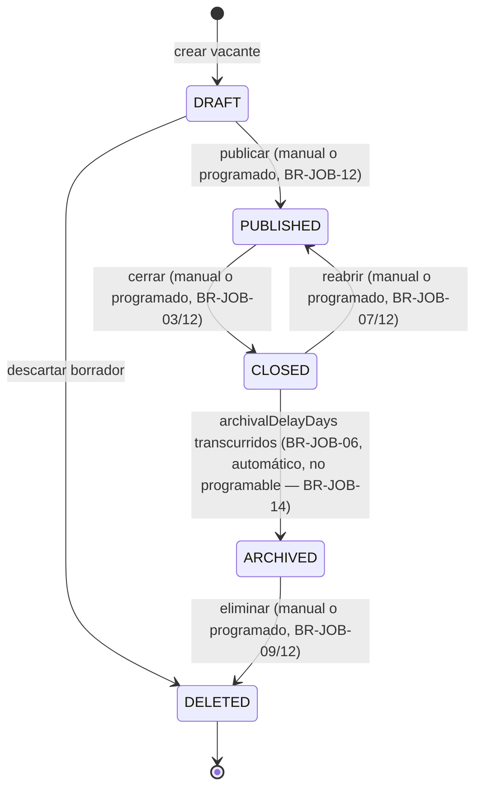
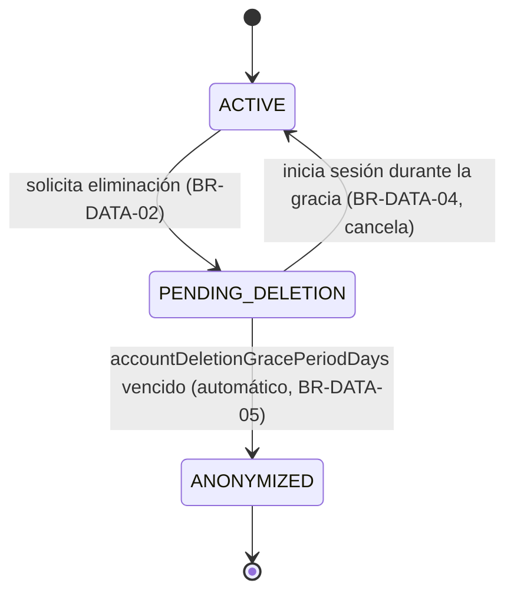

# Domain Model
## Sistema Inteligente de Análisis de Compatibilidad CV-Vacante con CRM de Postulaciones

| Campo | Valor |
|---|---|
| **Estado** | 🟡 En revisión |
| **Versión** | 1.0 |
| **Fecha** | Agosto 2026 |
| **Documentos relacionados** | Business Rules, PRD-MVP, Data Model, System Design Document |

---

## 1. Propósito del documento

Definir el modelo de dominio por contexto delimitado (bounded context): entidades núcleo, agregados, lenguaje ubicuo y relaciones entre módulos. Este documento es la fuente de verdad conceptual sobre la que se implementa `domain/model/` en cada módulo (ver reglas de carpeta y dependencia en `coding-standards.md`).

## 2. Contextos delimitados (bounded contexts)

Cada módulo de negocio es su propio contexto delimitado, con su propio lenguaje ubicuo — un mismo término (p. ej. "perfil") puede significar cosas distintas en `auth-module` (identidad/cuenta) que en `cv-module` (datos profesionales estructurados).

| Contexto | Responsabilidad | Lenguaje ubicuo (términos clave) |
|---|---|---|
| `auth` | Identidad, credenciales, capacidades de rol | Cuenta, Credencial, Capacidad (Candidato/Reclutador, no excluyentes — ADR-0008), Sesión |
| `cv` | Perfil profesional compartido, perfiles por rol (candidato/reclutador) y plantillas de marca | Perfil profesional, Experiencia, Formación, Certificación, Proyecto, Perfil de candidato, Perfil de reclutador, Habilidad, Plantilla de marca |
| `job` | Publicación y ciclo de vida de vacantes | Vacante, Requisito, Modalidad, Rango salarial, Regla de elegibilidad, Excepción de postulación, Invitación directa (bypass), Pregunta de postulación |
| `matching` | Cálculo y explicación del score de compatibilidad | Score de compatibilidad, Desglose, Capa semántica, Capa estructurada, Versión de algoritmo |
| `ats` | Pipeline de reclutamiento por vacante | Postulación, Pipeline, Etapa, Respuesta de postulación, Solicitud de información adicional |
| `tracker` | Seguimiento de postulaciones del lado del candidato | Postulación (vista candidato), Estado, Notificación |
| `shared-kernel` / `common` | Tipos y utilidades compartidas, sin lógica de negocio | Excepciones base, tipos de valor comunes (p. ej. identificadores) |

`shared-kernel` no es un contexto delimitado en sí mismo bajo DDD estricto — es código compartido deliberadamente mínimo (sin lógica de negocio) para evitar acoplar contextos entre sí.

## 3. Entidades y agregados núcleo

| Entidad / agregado | Contexto raíz | Descripción |
|---|---|---|
| **ProfessionalProfile** | `cv` | Agregado raíz, 1:1 con `Account`, con el núcleo de identidad profesional compartido entre capacidades: nombre, titular, biografía, foto, experiencia laboral, formación académica, certificaciones y proyectos (laborales o personales). Creado una sola vez por cuenta, reutilizado por `CandidateProfile` y/o `RecruiterProfile` (BR-ACCT-02, ADR-0008) |
| **Certification** | `cv` (parte del agregado `ProfessionalProfile`) | Certificación profesional del titular de la cuenta (nombre, entidad emisora, fecha de emisión/expiración, credencial) |
| **Project** | `cv` (parte del agregado `ProfessionalProfile`) | Proyecto laboral o personal realizado por el titular de la cuenta |
| **CandidateProfile** | `cv` | Agregado que añade, sobre el `ProfessionalProfile` de la cuenta, los datos exclusivos de búsqueda de empleo: contacto para postulación, CV cargado/embedding, habilidades para matching, elegibilidad, disponibilidad y descubribilidad. Referenciado (no duplicado) por `matching` y `ats` mediante identificador |
| **RecruiterProfile** | `cv` | Agregado que añade, sobre el `ProfessionalProfile` de la cuenta, únicamente empresa/agencia y áreas de especialización — deliberadamente sin datos de búsqueda de empleo (BR-ACCT-07) |
| **JobPosting** | `job` | Agregado raíz de una vacante: título, descripción, requisitos estructurados, modalidad, país/ubicación, rango salarial, estado del ciclo de vida (`JobPostingStatus`: `DRAFT`\|`PUBLISHED`\|`CLOSED`\|`ARCHIVED`\|`DELETED`) |
| **EligibilityRule** | `job` (parte del agregado `JobPosting`) | Regla de screening duro configurable por vacante (país, autorización de trabajo, nivel académico, experiencia, modalidad, disponibilidad, idioma, reubicación, expectativa salarial) que decide si un candidato puede postular y, opcionalmente, si ve la vacante (BR-ELIG-01 a 08) |
| **CandidateInvitation** | `job` (parte del agregado `JobPosting`) | Registro de la decisión explícita del reclutador de invitar a un candidato específico a postular pese a incumplir una o más `EligibilityRule` de su vacante; hace bypass total de la elegibilidad para ese par candidato-vacante (BR-ELIG-09 a 13) |
| **JobPostingScheduledTransition** | `job` (parte del agregado `JobPosting`) | Programación opcional, por transición individual, de un cambio automático de estado de la vacante en una fecha/hora futura elegida por el reclutador (p. ej. `DRAFT → PUBLISHED` el 15 de agosto); toda transición sin programación permanece manual (BR-JOB-12 a 18) |
| **ApplicationQuestion** | `job` (parte del agregado `JobPosting`) | Pregunta de screening cualitativo configurada por el reclutador para su vacante (texto, sí/no, numérica, opción única/múltiple, archivo), opcionalmente vinculada a un campo del perfil del candidato para evitar pedir información ya conocida (BR-APPQ-01 a 09) |
| **CompatibilityScore** | `matching` | Agregado que representa el resultado del cálculo de compatibilidad entre un `CandidateProfile` y un `JobPosting`, con su desglose explicable y versión de algoritmo |
| **RecruiterTemplate** | `cv` (extensión) | Plantilla de marca propiedad de un reclutador, usada para generar el CV de marca |
| **Application** | `ats` / `tracker` | Postulación de un candidato a una vacante; agregado compartido conceptualmente entre la vista de reclutador (`ats`, pipeline) y la vista de candidato (`tracker`), pero cada módulo expone su propia proyección — no se comparte la clase de dominio entre módulos (regla de no fuga de tipos internos entre contextos delimitados) |
| **ApplicationAnswer** | `ats` (junto a `Application`) | Respuesta del candidato a una `ApplicationQuestion` de la vacante a la que postula, capturada al momento de postular; audita si fue prellenada desde el perfil o escrita directamente (BR-APPQ-05 a 07) |
| **ApplicationFollowUpRequest** | `ats` (parte del agregado `Application`) | Solicitud ad-hoc de información adicional, creada por el reclutador sobre una postulación ya recibida, con una o más preguntas propias del mismo catálogo que `ApplicationQuestion` (BR-FUP-01 a 05) |

## 4. Relaciones entre entidades

```mermaid
classDiagram
    class ProfessionalProfile {
        +ProfessionalProfileId id
        +AccountId accountId
        +String fullName
        +String headline
        +String bio
        +String profilePhotoUrl
        +List~Experience~ experiences
        +List~Education~ education
        +List~Certification~ certifications
        +List~Project~ projects
        +Instant updatedAt
    }
    class CandidateProfile {
        +ProfileId id
        +AccountId accountId
        +ContactInfo contact
        +List~Skill~ skills
        +List~LanguageProficiency~ languages
        +boolean discoverable
        +AvailabilityStatus availabilityStatus
        +CountryCode countryOfResidence
        +List~CountryCode~ workAuthorizations
        +Modality desiredModality
        +WorkSchedule preferredWorkSchedule
        +boolean relocationWillingness
        +SalaryRange salaryExpectation
    }
    class RecruiterProfile {
        +RecruiterProfileId id
        +AccountId accountId
        +String companyName
        +List~String~ specializationAreas
        +Instant createdAt
    }
    class JobPosting {
        +JobPostingId id
        +String title
        +String description
        +List~Requirement~ requirements
        +Modality modality
        +CountryCode country
        +SalaryRange salaryRange
        +JobPostingStatus status
        +boolean acceptingApplications
        +RecruitingStage recruitingStage
        +Instant publishedAt
        +Instant closedAt
        +Instant archivedAt
        +Instant deletedAt
        +List~EligibilityRule~ eligibilityRules
        +List~CandidateInvitation~ invitations
        +List~JobPostingScheduledTransition~ scheduledTransitions
        +List~ApplicationQuestion~ applicationQuestions
    }
    class ApplicationQuestion {
        +ApplicationQuestionId id
        +JobPostingId jobPostingId
        +QuestionType type
        +String prompt
        +boolean required
        +List~String~ options
        +ProfileFieldMapping profileFieldMapping
        +String mappingParameter
        +MappingSource mappingSource
        +int position
    }
    class EligibilityRule {
        +EligibilityRuleId id
        +JobPostingId jobPostingId
        +EligibilityRuleType ruleType
        +jsonb criteria
        +boolean hideIfNotEligible
        +boolean active
        +Instant createdAt
    }
    class CandidateInvitation {
        +InvitationId id
        +JobPostingId jobPostingId
        +ProfileId candidateProfileId
        +AccountId invitedByAccountId
        +Instant createdAt
    }
    class JobPostingScheduledTransition {
        +ScheduledTransitionId id
        +JobPostingId jobPostingId
        +JobPostingStatus fromStatus
        +JobPostingStatus toStatus
        +Instant scheduledAt
        +ScheduledTransitionState state
        +Instant createdAt
        +Instant executedAt
    }
    class CompatibilityScore {
        +ScoreId id
        +ProfileId candidateProfileId
        +JobPostingId jobPostingId
        +Percentage overallScore
        +ScoreBreakdown breakdown
        +AlgorithmVersion algorithmVersion
        +Instant computedAt
    }
    class RecruiterTemplate {
        +TemplateId id
        +RecruiterId ownerId
        +BrandingConfig branding
    }
    class Application {
        +ApplicationId id
        +ProfileId candidateProfileId
        +JobPostingId jobPostingId
        +ApplicationStatus status
        +Instant appliedAt
        +List~ApplicationAnswer~ answers
        +List~ApplicationFollowUpRequest~ followUpRequests
    }
    class ApplicationAnswer {
        +AnswerId id
        +ApplicationId applicationId
        +ApplicationQuestionId applicationQuestionId
        +jsonb answerValue
        +AnswerSource source
        +boolean confirmedByCandidate
        +Instant answeredAt
    }
    class ApplicationFollowUpRequest {
        +FollowUpRequestId id
        +ApplicationId applicationId
        +AccountId requestedByAccountId
        +List~FollowUpItem~ items
        +FollowUpStatus status
        +Instant createdAt
        +Instant respondedAt
    }
    class AvailabilityExclusion {
        +ExclusionId id
        +ProfileId candidateProfileId
        +AccountId excludedAccountId
        +Instant createdAt
    }

    CandidateProfile "1" --> "0..*" Application : postula con
    JobPosting "1" --> "0..*" Application : recibe
    CandidateProfile "1" --> "0..*" CompatibilityScore : es evaluado en
    JobPosting "1" --> "0..*" CompatibilityScore : evalúa contra
    Application "0..1" --> "0..1" CompatibilityScore : referencia score vigente
    RecruiterTemplate "1" --> "0..*" Application : puede generar CV de marca para
    CandidateProfile "1" --> "0..*" AvailabilityExclusion : oculta su estado a
    JobPosting "1" --> "0..*" EligibilityRule : define
    JobPosting "1" --> "0..*" CandidateInvitation : invita pese a excepción
    CandidateProfile "1" --> "0..*" CandidateInvitation : es invitado en
    JobPosting "1" --> "0..*" JobPostingScheduledTransition : programa
    JobPosting "1" --> "0..*" ApplicationQuestion : configura
    Application "1" --> "0..*" ApplicationAnswer : responde
    Application "1" --> "0..*" ApplicationFollowUpRequest : recibe solicitud de
    ProfessionalProfile "1" --> "0..1" CandidateProfile : extiende (mismo accountId)
    ProfessionalProfile "1" --> "0..1" RecruiterProfile : extiende (mismo accountId)
```



`CompatibilityScore` se relaciona directamente con `CandidateProfile` y `JobPosting`, **no** con `Application` — la asociación con `Application` es opcional (`"0..1"`). Esta independencia es lo que permite BR-MATCH-06/BR-VIS-04: el sistema calcula y expone un score entre un candidato y una vacante sin que exista una postulación de por medio, habilitando la sugerencia proactiva de candidatos (modelo tipo LinkedIn). El atributo `CandidateProfile.discoverable` (opt-out, BR-DATA-03) es el único filtro adicional que determina si ese score puede mostrarse al reclutador cuando no hay `Application`.

**`ProfessionalProfile`**, **`CandidateProfile`** y **`RecruiterProfile`** son tres agregados distintos que conviven sobre una misma cuenta (ADR-0008, BR-ACCT-01 a 08). `ProfessionalProfile` es 1:1 con `Account` y contiene el núcleo compartido de identidad profesional (nombre, titular, biografía, foto, experiencia, formación, certificaciones, proyectos) — se crea una sola vez, la primera vez que la cuenta habilita cualquiera de sus dos capacidades, y **nunca se duplica** al habilitar la segunda (BR-ACCT-02). `CandidateProfile` y `RecruiterProfile` no heredan de `ProfessionalProfile` en sentido de herencia de clases — lo **referencian** por el mismo `accountId`, y cada uno añade exclusivamente los datos propios de su capacidad: `CandidateProfile` suma todo lo orientado a búsqueda de empleo (skills para matching, elegibilidad, disponibilidad, descubribilidad — secciones 3.1 y 5), `RecruiterProfile` suma solo empresa/agencia y áreas de especialización, deliberadamente sin ninguno de esos datos (BR-ACCT-07). Editar `ProfessionalProfile` se refleja de inmediato en ambas capacidades que lo consulten (BR-ACCT-06) — no hay copias independientes que sincronizar.

**`AvailabilityStatus`** (`OPEN_TO_WORK` | `NOT_LOOKING` | `UNSET`, valor por defecto `UNSET`) es una señal de intención del candidato, deliberadamente **externa** a `CompatibilityScore` — nunca es un input de su cálculo (BR-MATCH-01), solo un criterio de orden al listar candidatos sugeridos (BR-MATCH-07). Vive en `CandidateProfile`, no en `CompatibilityScore`, para que un mismo cambio de intención no dispare un recálculo de score (evita confundir el disparador de BR-MATCH-03, que es cambio de contenido, con un cambio de intención).

**`RecruitingStage`** (`HIRING` | `REVIEWING`, valor por defecto `HIRING`) es una propiedad de `JobPosting`, independiente de `JobStatus` (abierto/cerrado, BR-JOB-03) — una vacante `OPEN` puede estar en cualquiera de las dos etapas; una vacante `CLOSED` ignora la etapa. Gobierna si `matching-module` sigue generando nuevas entradas de sugerencia para esa vacante (BR-MATCH-08), sin afectar postulaciones directas ya existentes.

**`AvailabilityExclusion`** es una entidad propia (no un atributo de `CandidateProfile`) porque modela una relación **N:M** entre un candidato y las **cuentas** que excluye — de cualquier rol, reclutador u otro candidato (BR-CAND-05) — cada exclusión gestionada independientemente (agregar/quitar una por una). Por eso referencia `AccountId` genérico de `auth` (no `RecruiterId`): la exclusión es por identidad de cuenta, no por rol, y el rol de una cuenta podría no ser estático. Se referencia por identificador, nunca el agregado completo de `auth`, respetando la regla de dependencia hexagonal. Su existencia para el par `(candidateProfileId, excludedAccountId)` es lo único que evalúan BR-VIS-06 y BR-MATCH-09 — no tiene otro efecto sobre `Application` ni sobre `CompatibilityScore` (BR-CAND-06).

Nótese que, con el modelo actual, `BR-VIS-05` solo expone `availabilityStatus` en canales impulsados por un reclutador (postulación o sugerencia, sección 4). Excluir una cuenta con rol candidato no tiene hoy un canal concreto donde surta efecto — no existe una vista de "candidato ve el perfil de otro candidato" en el dominio actual. Se modela igual porque BR-CAND-05 lo exige explícitamente, dejando la entidad lista para cuando exista tal canal o para el caso de una cuenta que cambia de rol (ver pregunta abierta, sección 8).

**`EligibilityRule`** es una entidad hija del agregado `JobPosting` (no un agregado propio) — su ciclo de vida está atado a la vacante que la define, y toda modificación pasa por la raíz del agregado. Se modela con un **criterio genérico** (`ruleType` + `criteria` en formato clave-valor) en vez de una columna dedicada por tipo de regla, para permitir agregar nuevos tipos de excepción (BR-ELIG-01) sin migración de esquema — ver ADR-0007. `hideIfNotEligible` y `active` son independientes por regla (BR-ELIG-04/05): una vacante puede tener varias reglas activas, cada una decidiendo por separado si bloquea silenciosamente o también oculta la vacante.

La evaluación de una `EligibilityRule` requiere leer atributos del `CandidateProfile` que antes no existían en el dominio (`countryOfResidence`, `workAuthorizations`, `desiredModality`, `preferredWorkSchedule`, `languages`, `relocationWillingness`, `salaryExpectation`) — se agregan como atributos de preferencia/elegibilidad del candidato, análogos a `availabilityStatus`: nunca son input del cálculo de `CompatibilityScore` (BR-ELIG-06), solo del filtro binario de elegibilidad. `JobPosting.country` se agrega por la misma razón: sin ubicación de la vacante, una regla de tipo autorización de trabajo no tiene contra qué evaluarse.

**`CandidateInvitation`** es, igual que `EligibilityRule`, una entidad hija del agregado `JobPosting` (no un agregado propio ni una entidad de `ats`) — deliberadamente, para evitar una dependencia circular: el caso de uso de validación de elegibilidad (`job`, consumido por `ats` al postular, BR-ELIG-02/03) necesita comprobar la existencia de una invitación como parte de esa misma evaluación; si `CandidateInvitation` viviera en `ats`, `job` tendría que depender de `ats` para esa comprobación, mientras `ats` ya depende de `job` para validar elegibilidad — un ciclo que viola la regla de dependencia hexagonal (sección 5). La acción de invitar se **dispara** desde la vista de candidatos sugeridos de `ats-module` (BR-VIS-04), pero el registro y la invariante ("bypass total de elegibilidad para este par candidato-vacante", BR-ELIG-10) los posee `job`.

### 4.1 Ciclo de vida de `JobPosting` (máquina de estados)

Reemplaza el modelo binario original (abierta/cerrada) por una máquina de estados de cinco valores, inspirada en el ciclo de vida de una vacante en LinkedIn — con un periodo de gracia antes del archivado definitivo (BR-JOB-06 a 11):



Las transiciones marcadas "manual o programado" admiten una `JobPostingScheduledTransition` opcional (BR-JOB-12/13); `CLOSED → ARCHIVED` es la única transición automática que **no** admite programación del reclutador, al tener ya su propio mecanismo dedicado (`archivalDelayDays`, BR-JOB-06/14). `DRAFT → DELETED` tampoco es programable — descartar un borrador es siempre una acción manual e inmediata.

| Estado | Visible para candidatos | Acepta postulaciones | Quién puede actuar |
|---|---|---|---|
| `DRAFT` | No (ni en listado ni en búsqueda) | No | Reclutador propietario: publicar o descartar |
| `PUBLISHED` | Sí | Según `acceptingApplications` (BR-JOB-10) | Reclutador propietario: pausar/reanudar solicitudes, cerrar |
| `CLOSED` | Sí, marcada como cerrada (BR-JOB-03) | No | Reclutador propietario: reabrir (BR-JOB-07); sistema: archiva automáticamente (BR-JOB-06) |
| `ARCHIVED` | No, para ningún candidato ni en la página general (BR-JOB-11) | No | Reclutador propietario: solo eliminar (BR-JOB-08/09) |
| `DELETED` | No (tombstone) | No | Ninguna — estado terminal |

`acceptingApplications` (BR-JOB-10) y `recruitingStage` (BR-JOB-04) son ejes independientes entre sí y del estado del ciclo de vida, y solo tienen efecto mientras `status = PUBLISHED`: el primero gobierna si un candidato puede enviar una `Application` nueva; el segundo, si `matching-module` sigue generando sugerencias proactivas (BR-MATCH-08). Cerrar la vacante (`CLOSED`) implica `acceptingApplications = false` de forma permanente para ese ciclo de publicación, distinto de pausarlo temporalmente sin cerrar.

**`JobPostingScheduledTransition`** es, igual que `EligibilityRule` y `CandidateInvitation`, una entidad hija del agregado `JobPosting`. `fromStatus`/`toStatus` fijan el par de estados exacto que se ejecutará — no basta con guardar solo `toStatus`, porque al momento de la ejecución el sistema debe comprobar que la vacante sigue en `fromStatus` (BR-JOB-16); si no, la transición se omite (`state = SKIPPED`) en vez de forzarse. `state` (`PENDING`\|`EXECUTED`\|`CANCELLED`\|`SKIPPED`) audita qué ocurrió con cada programación, incluyendo las canceladas automáticamente por una acción manual equivalente (BR-JOB-17). Al igual que con `EligibilityRule`/`CandidateInvitation`, esta entidad solo tiene sentido dentro del ciclo de vida que ya posee `JobPosting` — no se modela como agregado propio.

Programar una transición **no exige** que la vacante esté hoy en el `fromStatus` correspondiente (BR-JOB-19) — el reclutador puede encadenar por adelantado toda la planeación de su vacante (p. ej. publicar el 15 de agosto y cerrar el 15 de septiembre, programado el mismo día de creación). Esto convierte la validación de orden cronológico entre transiciones encadenadas (BR-JOB-20) en una **invariante propia del agregado `JobPosting`**, no de `JobPostingScheduledTransition` de forma aislada: solo la raíz del agregado, que conoce la lista completa de `scheduledTransitions`, puede comprobar que una nueva programación no contradice el orden de una cadena existente — un ejemplo directo de por qué esta entidad vive dentro del agregado y no como registro independiente.

**`ApplicationQuestion`** es, igual que `EligibilityRule`, una entidad hija del agregado `JobPosting` — el reclutador la configura como parte de su vacante (BR-APPQ-01). Su vínculo opcional a un campo del perfil (`profileFieldMapping` + `mappingParameter`) reutiliza el mismo catálogo cerrado que `EligibilityRule.ruleType` (ADR-0007): años de experiencia, un skill puntual, idioma, nivel académico, modalidad/jornada deseada, reubicación, expectativa salarial, país de residencia o autorización de trabajo. La detección **híbrida** acordada con el negocio combina dos mecanismos: (1) el reclutador vincula manualmente la pregunta al crearla (mecanismo primario, BR-APPQ-03), o (2) si no lo hace y la pregunta es de texto libre, el sistema sugiere un vínculo por similitud semántica (embeddings `nomic-embed-text`, mismo motor que ya usa `matching-module`) que el reclutador debe aceptar explícitamente para que se convierta en un vínculo estructurado (BR-APPQ-04, campo `mappingSource = AI_SUGGESTED_ACCEPTED` para auditar el origen). La IA nunca decide ni completa una respuesta en nombre del candidato — solo asiste al reclutador en tiempo de configuración, preservando la explicabilidad exigida en el resto del sistema (BR-MATCH-02).

**`ApplicationAnswer`** vive junto a `Application`, no junto a `ApplicationQuestion` — pertenece al contexto `ats` (donde se crea la `Application` al postular, ver mapa de contextos), y referencia `ApplicationQuestion` únicamente por identificador, igual que `CompatibilityScore` referencia `CandidateProfile`/`JobPosting` por id. Al iniciar una postulación, `ats` resuelve cada `ApplicationQuestion` vinculada contra el perfil del candidato (leído vía puerto de `cv`, ver mapa de contextos) y, si el dato existe, prellena la respuesta (`source = AUTO_FILLED_FROM_PROFILE`) — pero **siempre** exige confirmación del candidato antes de aceptar el envío (`confirmedByCandidate = true`, BR-APPQ-06); nunca se envía una respuesta prellenada sin que el candidato la haya visto para esa postulación específica.

**`ApplicationFollowUpRequest`** es una entidad hija de `Application` (no de `JobPosting`): es ad-hoc y específica de una postulación ya recibida, no una plantilla reutilizable como `ApplicationQuestion`. Sus `items` (`FollowUpItem`) fusionan pregunta y respuesta en un mismo objeto embebido — a diferencia de `ApplicationQuestion`/`ApplicationAnswer`, que están separadas porque una pregunta de vacante se reutiliza contra muchos candidatos, un ítem de seguimiento es de un solo uso para una sola postulación, por lo que separar pregunta y respuesta no aporta valor adicional.

### 4.2 Ciclo de vida de eliminación de cuenta (BR-DATA-02 a 06, ADR-0013)

Espejo deliberado del ciclo de vida de `JobPosting` (§4.1): un periodo de gracia reversible, seguido de una transición automática ejecutada por un proceso programado — mismo patrón, aplicado ahora a la cuenta en vez de a la vacante.



| Estado | Qué puede hacer el titular | Qué ven los demás |
|---|---|---|
| `ACTIVE` | Todo, con normalidad | Perfil visible según las reglas de visibilidad ya existentes (sección 5 de `business-rules.md`) |
| `PENDING_DELETION` | Solo iniciar sesión para cancelar; no puede postular, publicar ni ser descubierto (suspendido, no eliminado) | Deja de aparecer en sugerencias/listados nuevos; las relaciones ya existentes (`Application`, pipeline) no cambian todavía |
| `ANONYMIZED` | Nada — no puede volver a activarse; para volver a usar el sistema requiere una cuenta nueva | El registro sigue existiendo por integridad referencial, pero sin PII directa — `Application`/`CompatibilityScore` conservan su historial apuntando a un perfil anonimizado |

La transición `PENDING_DELETION → ANONYMIZED` la ejecuta un proceso programado nuevo (`AnonymizeExpiredAccountDeletionsUseCase`), del mismo tipo que los batches de `job-module` (`system-design-document.md` §4.6) — mismo principio de recorrer por condición vencida, no por "tick" exacto. Al ejecutarse, además de anonimizar los campos de PII en `ProfessionalProfile`/`CandidateProfile`/`RecruiterProfile`, llama a la API de administración de Clavaris para eliminar la identidad real (BR-DATA-06) — la única salida de este ciclo que cruza el límite del sistema.

## 5. Mapa de contextos (context map)

```mermaid
flowchart LR
    Auth[auth] -->|provee identidad/rol a| CV[cv]
    Auth -->|provee identidad/rol a| Job[job]
    CV -->|CandidateProfile| Matching[matching]
    Job -->|JobPosting| Matching
    Matching -->|CompatibilityScore| ATS[ats]
    Matching -->|CompatibilityScore| Tracker[tracker]
    CV -->|CandidateProfile: datos de elegibilidad| Job
    CV -->|RecruiterProfile: identidad pública del reclutador| Job
    Job -->|valida/expone desglose de EligibilityRule + ApplicationQuestion| ATS
    ATS -->|solicita CandidateInvitation (bypass)| Job
    CV -->|CandidateProfile: datos para prellenar ApplicationAnswer| ATS
    CV -->|RecruiterTemplate + datos de perfil| CVGen["Generador de CV de marca\n(extensión de cv)"]
    ATS -->|solicita generación| CVGen
    Auth -.->|tipos base compartidos| Shared[shared-kernel]
    CV -.-> Shared
    Job -.-> Shared
    Matching -.-> Shared
    ATS -.-> Shared
    Tracker -.-> Shared
```

Relación de integración: `matching` es **cliente** de `cv` y `job` (consume sus datos estructurados vía puertos, nunca sus entidades JPA internas — regla de dependencia hexagonal, ver `coding-standards.md` §2), nunca al revés. La misma regla aplica a las nuevas relaciones: `job` es **cliente** de `cv` para leer los atributos de elegibilidad del candidato (BR-ELIG-01) al evaluar sus `EligibilityRule`; `ats` es **cliente** de `job` tanto para validar elegibilidad antes de crear una `Application` (BR-ELIG-03) como para obtener el desglose de reglas incumplidas por candidato sugerido (BR-ELIG-12), la lista de `ApplicationQuestion` a presentar al postular (BR-APPQ-01) y para solicitar la creación de una `CandidateInvitation` (BR-ELIG-09); `ats` es también **cliente directo** de `cv` para leer los datos de perfil del candidato con los que prellena `ApplicationAnswer` (BR-APPQ-05) — ninguna de estas relaciones es bidireccional; ni `job` ni `cv` dependen nunca de `ats` ni de `matching`.

## 6. Eventos de dominio relevantes

| Evento | Emitido por | Consumido por | Regla de negocio asociada |
|---|---|---|---|
| `ProfileUpdatedEvent` | `cv` — emitido tanto por cambios en `ProfessionalProfile` (experiencia, formación, certificaciones, proyectos) como en los datos propios de `CandidateProfile` (skills, elegibilidad), siempre que la cuenta tenga capacidad de candidato habilitada | `matching` | BR-MATCH-03 / BR-ACCT-06 — recalcula el score cuando cambia cualquier dato que lo alimenta, sin importar si vive en el núcleo compartido o en `CandidateProfile` |
| `JobPostingUpdatedEvent` | `job` | `matching` | BR-MATCH-03 — recalcula el score cuando cambia la vacante |
| `JobPostingPublishedEvent` | `job` | `matching` (habilita cálculo de score/sugerencias) | BR-JOB-06/11 — una vacante `DRAFT` no es candidata a scoring ni a listado hasta publicarse |
| `JobPostingClosedEvent` | `job` | `ats` | BR-JOB-03 — vacante cerrada no acepta nuevas postulaciones, conserva historial, inicia el conteo de archivado (BR-JOB-06) |
| `JobPostingReopenedEvent` | `job` | `ats` | BR-JOB-07 — cancela el conteo de archivado; la vacante vuelve a aceptar postulaciones |
| `JobPostingArchivedEvent` | `job` (emitido por el batch de archivado) | `ats`, `matching` (deja de evaluarse en sugerencias) | BR-JOB-06/11 — deja de ser visible para cualquier candidato y de todo listado general |
| `JobPostingDeletedEvent` | `job` | `ats`, `tracker` (proyección) | BR-JOB-09 — soft-delete; el tracker del candidato conserva su `Application` histórica pese al tombstone de la vacante |
| `JobPostingTransitionScheduledEvent` | `job` | `job` (auditoría propia) | BR-JOB-12/15 — se programa o reprograma (reemplazando la anterior) una transición futura |
| `JobPostingTransitionExecutedEvent` | `job` (emitido por el batch de transiciones programadas) | mismos consumidores que el evento de la transición que ejecuta (p. ej. `JobPostingPublishedEvent`, `JobPostingClosedEvent`) | BR-JOB-16 — una transición programada que se ejecuta produce el mismo efecto que su equivalente manual |
| `JobPostingTransitionSkippedEvent` | `job` (emitido por el batch de transiciones programadas) | `job` (auditoría propia, posible alerta al reclutador) | BR-JOB-16 — el estado actual ya no coincidía con `fromStatus` esperado; no se fuerza la transición |
| `JobPostingTransitionCancelledEvent` | `job` | `job` (auditoría propia) | BR-JOB-17/18 — cancelación manual o automática (por transición manual equivalente ya ejecutada) |
| `ApplicationFollowUpRequestedEvent` | `ats` | `tracker` (proyección, notificación al candidato) | BR-FUP-04 — el candidato debe ver y poder responder la solicitud desde su tracker de inmediato |
| `ApplicationFollowUpAnsweredEvent` | `ats`/`tracker` (candidato responde desde tracker) | `ats` (proyección, visible en el pipeline) | BR-FUP-04 — el reclutador ve la respuesta junto al resto de la postulación en su pipeline |
| `ApplicationStatusChangedEvent` | `ats` | `tracker` | BR-TRACK-02 — todo cambio de estado es visible para el candidato |
| `CompatibilityScoreCalculatedEvent` | `matching` | `ats`, `tracker` (proyección) | BR-MATCH-04 — score versionado disponible para consulta |
| `CandidateDiscoverabilityChangedEvent` | `cv` | `matching` | BR-DATA-03 — si el candidato desactiva su descubribilidad, deja de aparecer en sugerencias (BR-VIS-04) de inmediato, no en el siguiente ciclo de recalculo |
| `CandidateAvailabilityChangedEvent` | `cv` | `matching`, `ats` (proyección) | BR-CAND-04 / BR-MATCH-07 — cambia el orden de prioridad en futuras consultas de sugerencia; no dispara recálculo de score |
| `JobPostingRecruitingStageChangedEvent` | `job` | `matching` | BR-JOB-04 / BR-MATCH-08 — al pasar a `REVIEWING`, detiene la generación de nuevas entradas de sugerencia para esa vacante |
| `CandidateAvailabilityExclusionChangedEvent` | `cv` | `matching`, `ats` (proyección) | BR-CAND-05 / BR-VIS-06 / BR-MATCH-09 — al agregar una exclusión, el reclutador excluido deja de ver el estado (y su boost de ranking) de inmediato |
| `JobEligibilityRuleChangedEvent` | `job` | `job` (invalida caché de listados propios, si existe) | BR-ELIG-04/05 — al crear, activar, desactivar o modificar una regla, el listado de vacantes visibles por candidato debe reflejar el cambio de inmediato, no en el siguiente ciclo |
| `CandidateInvitedEvent` | `job` | `tracker` (proyección, notificación al candidato) | BR-ELIG-09/10 — al crearse la invitación, el candidato debe poder verla y ver la vacante antes oculta (BR-VIS-08) de inmediato, no en el siguiente ciclo |
| `AccountDeletionRequestedEvent` | `auth` (o `cv`, según dónde viva el caso de uso — ver pregunta abierta) | `matching`, `ats`, `tracker` (proyección) | BR-DATA-04 — la cuenta pasa a `PENDING_DELETION`; deja de aparecer en sugerencias, listados y nuevas postulaciones de inmediato |
| `AccountDeletionCancelledEvent` | `auth`/`cv` | `matching`, `ats`, `tracker` (proyección) | BR-DATA-04 — la cuenta vuelve a `ACTIVE`; revierte el efecto del evento anterior |
| `AccountAnonymizedEvent` | `cv` (emitido por `AnonymizeExpiredAccountDeletionsUseCase`) | `matching` (invalida cualquier score cacheado con PII derivada), `ats`/`tracker` (proyección — el pipeline/tracker deben mostrar el perfil como anonimizado, no como si no existiera) | BR-DATA-05/06 — transición terminal `PENDING_DELETION → ANONYMIZED`, dispara además la cascada hacia Clavaris |

## 7. Reglas de negocio con impacto directo en el modelo de dominio

- BR-ACCT-01 a 08 → invariantes de `ProfessionalProfile`/`CandidateProfile`/`RecruiterProfile` (ADR-0008): capacidades no excluyentes por cuenta, núcleo profesional compartido y creado una sola vez, cada perfil por capacidad añade solo lo propio de su rol, sin privilegios cruzados, sin autopostulación, `RecruiterProfile` siempre público.
- BR-CAND-01, BR-CAND-03 → invariantes de `CandidateProfile` (datos mínimos requeridos; sin distinción de elegibilidad por seniority).
- BR-CAND-07, BR-JOB-21, BR-MATCH-10 → el valor `SalaryRange` lleva **moneda** (ISO 4217) y **periodo** (mensual/anual), con `mínimo ≤ máximo`; dos rangos solo son comparables si tienen la misma moneda (no hay conversión en el MVP).
- BR-CAND-04 → invariante de `CandidateProfile.availabilityStatus` (enum de 3 valores, por defecto `UNSET`).
- BR-CAND-05, BR-CAND-06 → invariantes de `AvailabilityExclusion` (relación N:M candidato-cuenta, sin restricción de rol; no afecta `Application` ni `CompatibilityScore`).
- BR-JOB-02 → invariante de `JobPosting` (datos mínimos para publicar).
- BR-JOB-03, BR-JOB-06 a 11 → invariantes de la máquina de estados de `JobPosting.status` (§4.1): transiciones válidas, periodo de gracia antes de `ARCHIVED`, reapertura antes del archivado, eliminación exclusiva del propietario vía soft-delete.
- BR-JOB-04 → invariante de `JobPosting.recruitingStage` (enum de 2 valores, por defecto `HIRING`, independiente de `acceptingApplications`; solo activo mientras `status = PUBLISHED`).
- BR-JOB-10 → invariante de `JobPosting.acceptingApplications` (booleano independiente del estado del ciclo de vida).
- BR-JOB-12 a 20 → invariantes de `JobPostingScheduledTransition`: catálogo cerrado de transiciones programables (excluye `CLOSED → ARCHIVED` y `DRAFT → DELETED`), una `PENDING` a lo sumo por estado destino, validación de `fromStatus` en ejecución (fail-safe hacia `SKIPPED`), cancelación automática ante una transición manual equivalente, y — al permitirse encadenar por adelantado (BR-JOB-19) — validación de orden cronológico entre transiciones encadenadas (BR-JOB-20) como invariante del agregado `JobPosting`.
- BR-APPQ-01 a 09 → invariantes de `ApplicationQuestion`/`ApplicationAnswer`: catálogo cerrado de tipos, vínculo estructurado opcional a un campo del perfil (manual o por sugerencia de IA siempre confirmada por el reclutador), prellenado desde el perfil siempre sujeto a confirmación del candidato, carácter puramente informativo (nunca bloqueante).
- BR-FUP-01 a 05 → invariantes de `ApplicationFollowUpRequest`: exclusiva del reclutador propietario, catálogo de tipos compartido con `ApplicationQuestion`, sin efecto sobre el estado de la postulación ni sobre la elegibilidad si no se responde.
- BR-JOB-05, BR-ELIG-01 a 08 → invariantes de `EligibilityRule` (entidad hija de `JobPosting`; catálogo cerrado de `ruleType`, evaluación AND de todas las reglas activas, `hideIfNotEligible`/`active` independientes por regla, fail-closed ante datos de candidato faltantes, no retroactiva).
- BR-VIS-07 → distingue la ocultación de `JobPosting` ante el candidato (BR-ELIG-04) de la ocultación de `CandidateProfile`/`CompatibilityScore` ante el reclutador (BR-VIS-01 a 06); ambas viven en capa de aplicación, no en el dominio puro.
- BR-ELIG-09 a 13, BR-VIS-08 → invariantes de `CandidateInvitation` (entidad hija de `JobPosting`; bypass total no selectivo por par candidato-vacante, exclusiva del reclutador propietario, no retroactiva al revocarse).
- BR-MATCH-01 a BR-MATCH-09 → invariantes y ciclo de vida de `CompatibilityScore` y de la sugerencia de candidatos, incluyendo su cálculo independiente de `Application` (BR-MATCH-06), la priorización por `availabilityStatus` sin tocar el score (BR-MATCH-07), la pausa por `recruitingStage` (BR-MATCH-08) y la supresión del boost para reclutadores excluidos (BR-MATCH-09).
- BR-VIS-01 a BR-VIS-06 → reglas de autorización aplicadas en la capa de aplicación/infraestructura, no en el dominio puro (el dominio modela el score; la visibilidad es una decisión de la capa de aplicación según el rol del solicitante, `CandidateProfile.discoverable` para BR-VIS-04, y la existencia de una `AvailabilityExclusion` para BR-VIS-06).
- BR-CVGEN-01 a BR-CVGEN-03 → invariantes de `RecruiterTemplate` y su relación con `Application`.
- BR-DATA-03 → invariante de `CandidateProfile.discoverable` (opt-out, por defecto `true`).
- BR-DATA-04 a 06 → invariantes del ciclo de vida de eliminación de cuenta (§4.2, ADR-0013): periodo de gracia reversible, anonimización nunca borrado físico, cascada obligatoria hacia Clavaris.

## 8. Preguntas abiertas

- ¿`Application` debe modelarse como un agregado único compartido por infraestructura (una tabla) con dos proyecciones de lectura (`ats`, `tracker`), o como dos agregados independientes sincronizados por eventos? Impacta directamente `data-model.md`.
- ¿El histórico de versiones de `CompatibilityScore` (BR-MATCH-04) se modela como filas adicionales versionadas o como una tabla de auditoría separada?
- ¿`Skill` y `Requirement` deben normalizarse contra un catálogo compartido (taxonomía de habilidades) o permanecen como texto libre estructurado en el MVP?
- ¿La sugerencia de candidatos (BR-MATCH-06) se calcula bajo demanda cuando el reclutador abre la vista de sugeridos, o se pre-calcula periódicamente por vacante activa? Afecta el diseño del caso de uso en `application/usecase/` de `matching-module` y el presupuesto de rendimiento (ver `nfr-quality-attributes.md`).
- ¿Existe un mecanismo de recordatorio/expiración si una vacante permanece en `HIRING` (BR-JOB-04) sin actividad por un periodo largo, para evitar que la etapa quede desactualizada? (misma pregunta abierta de `prd-mvp.md` §9)
- `AvailabilityExclusion` opera por `AccountId` individual (BR-VIS-06, nota de `business-rules.md` §5) — si en el futuro se modela una entidad `Company`/`Organization` compartida por varias cuentas de reclutador, ¿la exclusión debería heredarse a nivel de empresa? No se resuelve en el MVP.
- BR-CAND-05 exige poder excluir cuentas con rol candidato, pero el dominio actual no tiene ningún caso de uso donde un candidato consulte el perfil de otro candidato (BR-VIS-05 solo cubre canales impulsados por reclutador). ¿Se necesita definir ese caso de uso (p. ej. una vista de perfil público entre candidatos) para que la exclusión de otro candidato tenga efecto real, o se documenta como control preventivo sin canal actual?
- ¿El listado de vacantes visibles por candidato (filtrado por BR-ELIG-04) se evalúa bajo demanda en cada consulta, o se cachea por candidato (similar al cacheo de `score:{cv_hash}:{job_hash}` en Redis) invalidado por `JobEligibilityRuleChangedEvent`/`ProfileUpdatedEvent`? Afecta el diseño del caso de uso de búsqueda en `job-module` y el presupuesto de rendimiento.
- `EligibilityRule.criteria` es genérico (jsonb, ADR-0007) — ¿se valida su forma con un JSON Schema por `ruleType` a nivel de aplicación, o basta la validación de la capa de presentación (formulario del reclutador) al crear/editar la regla?
- Los nuevos atributos de elegibilidad de `CandidateProfile` (país, autorizaciones de trabajo, modalidad/jornada deseada, idiomas, reubicación, expectativa salarial) se solapan parcialmente con dimensiones ya usadas por el scoring ponderado (BR-MATCH-01: ubicación/modalidad 10%, salario 10%, soft skills/idiomas 5%). ¿Deben ser el mismo dato leído por ambos módulos (`matching` y `job` como clientes de `cv`), o `job` necesita su propia copia/proyección por autonomía del contexto?
- ¿Una `CandidateInvitation` puede revocarse (BR-ELIG-13), o el MVP la trata como permanente una vez creada (sin caso de uso de eliminación)? Si es revocable, ¿quién más además del reclutador propietario puede verla — p. ej. aparece en el pipeline de `ats` como una marca visible junto al candidato?
- ¿El candidato necesita confirmar/aceptar la invitación para que surta efecto, o basta la acción unilateral del reclutador (BR-ELIG-09)? Dado que no existe hoy un módulo de mensajería, ¿la notificación de `CandidateInvitedEvent` (tracker) es el único medio por el que el candidato se entera de que fue invitado?
- ¿`CandidateInvitation` tiene un límite de vigencia (expira si el candidato no postula en N días) o permanece indefinidamente mientras la vacante esté abierta (BR-JOB-03)?
- El archivado automático (BR-JOB-06) requiere un proceso batch/programado (`ArchiveExpiredClosedJobPostingsUseCase`) que recorra vacantes `CLOSED` vencidas. ¿Se implementa con `@Scheduled` dentro del propio monolito (paridad con el resto del stack, sin infraestructura adicional) o con un mecanismo de cron externo? Impacta `nfr-quality-attributes.md` (disponibilidad del batch) y `system-design-document.md`.
- `archivalDelayDays` (BR-JOB-06, valor por defecto propuesto: 4 días, rango operativo 3-5) — ¿dónde vive esta constante de configuración (`application.yml`, tabla de configuración editable por un futuro rol admin) y quién puede calibrarla fuera de un despliegue de código?
- ¿Una vacante `DELETED` (tombstone, BR-JOB-09) tiene una política de retención/anonimización de sus datos de negocio (título, descripción) a largo plazo, o el tombstone conserva todos los campos indefinidamente para no romper la vista histórica del candidato en su tracker?
- ¿El batch que ejecuta `JobPostingScheduledTransition` vencidas (BR-JOB-16) es el mismo proceso programado que archiva vacantes `CLOSED` vencidas (BR-JOB-06), o son dos batches independientes? Unificarlos evita duplicar la infraestructura de `@Scheduled`/cron, pero acopla dos preocupaciones distintas (limpieza automática vs. planeación del reclutador).
- Con la programación encadenada confirmada (BR-JOB-19), ¿qué ocurre con una transición programada "aguas abajo" de la cadena si la de "aguas arriba" termina en `SKIPPED` (p. ej. el reclutador publicó manualmente antes de tiempo con una fecha que rompe el supuesto de la siguiente)? BR-JOB-17 cubre el caso exacto (misma transición ejecutada manualmente → se cancela), pero no el caso en que una transición previa distinta invalida la premisa de la siguiente sin ser la misma transición.
- ¿Qué umbral de similitud semántica (BR-APPQ-04) dispara una sugerencia de vínculo al reclutador? ¿Es una constante de sistema configurable (mismo criterio que `archivalDelayDays`) o se calibra empíricamente junto con los pesos del scoring (BR-MATCH-05) durante la validación?
- Las preguntas de tipo `FILE_UPLOAD` (p. ej. cover letter, BR-APPQ-01) no tienen hoy un campo equivalente en `CandidateProfile` contra el cual auto-detectar (BR-APPQ-03/04) — ¿el candidato puede guardar un archivo "general" en su perfil (p. ej. una carta de presentación por defecto) para que este tipo de pregunta también admita prellenado a futuro, o permanece siempre como `CANDIDATE_PROVIDED` en el MVP?
- ¿El reclutador puede editar o eliminar una `ApplicationQuestion` después de que la vacante ya recibió postulaciones? Si la elimina, ¿qué ocurre con las `ApplicationAnswer` ya capturadas para esa pregunta — se conservan como historial huérfano (paridad con BR-JOB-09) o se eliminan en cascada?
- ¿Una `ApplicationFollowUpRequest` tiene fecha límite de respuesta (expira si el candidato no contesta en N días), o permanece `PENDING` indefinidamente mientras la postulación exista?
- ¿Cómo representa el JWT (`security-architecture.md`) las capacidades de una cuenta multi-rol (ADR-0008) — un claim de array de roles, o un token distinto por "rol activo" elegido al iniciar sesión? Pendiente de una pasada específica sobre ese documento.
- **[Resuelta (23-nov-2026): se calcula de los datos estructurados; `matching` construye la representación canónica a partir de la lectura de `cv` (`tdd/cv-module.md` §7)]** ¿El embedding de `candidate_profiles` se recalcula a partir de `raw_cv_text` (archivo cargado) o de los datos estructurados de `ProfessionalProfile`, ahora que este es la fuente compartida del historial profesional (ADR-0008)?
- ¿`RecruiterProfile.specializationAreas` es texto libre, o se normaliza contra un catálogo compartido (misma pregunta ya abierta para `Skill`/`Requirement` en la sección de `job`/`cv`)?
- **[Parcialmente resuelta (23-nov-2026): el perfil se conserva y deja de ser descubrible (`tdd/cv-module.md` §5); lo que ocurre con las vacantes publicadas sigue abierto]** Al deshabilitar una capacidad de cuenta (p. ej. un reclutador que dejó de reclutar y desactiva `RecruiterProfile`), ¿qué pasa con sus vacantes publicadas — deben cerrarse/archivarse automáticamente, o permanecen bajo su gestión hasta que él mismo las transicione (sección 3, máquina de estados)? No se resolvió en esta sesión.
- `scheduledAt` se captura en la zona horaria que el reclutador ve en su UI — ¿se persiste siempre en UTC con conversión en la capa de presentación (recomendado, consistente con `computed_at`/`created_at` en todo el resto del modelo), o existe algún caso de uso que requiera guardar la zona horaria original de la vacante?
- ¿En qué módulo vive el caso de uso de solicitud/cancelación de eliminación de cuenta (§4.2, ADR-0013) — `auth-module` (dueño de la cuenta y su relación con Clavaris) o `cv-module` (dueño de `ProfessionalProfile`, que es lo que realmente se anonimiza)? Afecta dónde vive `AnonymizeExpiredAccountDeletionsUseCase`.
- ¿Qué pasa si una cuenta con ambas capacidades (BR-ACCT-01) pide eliminar solo una — p. ej. deshabilitar `RecruiterProfile` sin eliminar `CandidateProfile`? BR-DATA-02 lo permite en principio, pero el ciclo de vida de §4.2 está descrito para la cuenta completa; falta el caso de una sola capacidad.
- Especificación columna por columna de qué constituye "PII directa" a anonimizar (ADR-0013, pregunta abierta) — pendiente de completar en `data-model.md` §4.
- ¿La cascada hacia Clavaris (BR-DATA-06) es síncrona dentro del mismo batch, o asíncrona con reintento si Clavaris no responde? Afecta si `AccountAnonymizedEvent` se emite antes o después de confirmar el borrado en Clavaris.
- ¿El reclutador recibe alguna notificación cuando una `JobPostingScheduledTransition` se omite (`SKIPPED`, BR-JOB-16) porque el estado ya había cambiado por otra vía? Sin ella, podría creer que su programación sigue vigente cuando en realidad nunca se ejecutó.
