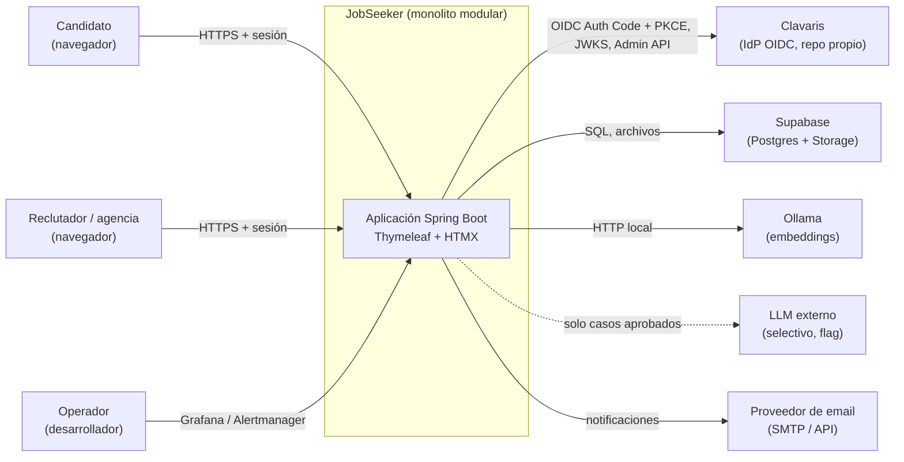
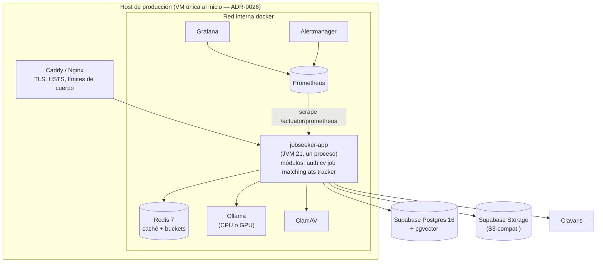
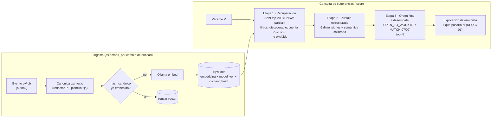

# 02 — HLD y System Design

| Campo | Valor |
|---|---|
| **Estado** | 🟡 En revisión |
| **Versión** | 1.0 · 13-nov-2026 |
| **Relacionado** | `docs/03-architecture/system-design-document.md`, ADR-0001..0013, `01-competencia-y-requerimientos.md`, `03-lld.md` |
| **Principio** | Se conserva todo ADR bloqueado. Lo que sigue **completa** el diseño (lo que falta) y señala **dónde un ADR nuevo es necesario** |

---

## 1. Contexto del sistema (C4 nivel 1)



Observaciones respecto a lo documentado: (1) aparecen **email** y **almacenamiento** como dependencias externas que hoy no figuran en el SDD; (2) el navegador interactúa por **sesión** (no por Bearer) — ver `04` §1.

## 2. Contenedores (C4 nivel 2) y topología recomendada

**Un solo desplegable** (ADR-0001) — se corrige la contradicción del `docker-compose` (F12): los módulos Maven son *bibliotecas*; un módulo `app` aporta `@SpringBootApplication`, la configuración transversal y el único `Dockerfile`.



### 2.1 Decisiones de topología (propuestas para ADR-0026)

| Tema | Recomendación | Justificación |
|---|---|---|
| Hospedaje del monolito + Redis + Ollama + observabilidad | **Una VM** (p. ej. 4–8 vCPU / 16 GB) con Docker Compose y Caddy | Un solo desarrollador, presupuesto de tesis; costo predecible. Evita Kubernetes |
| Ollama | Misma VM al inicio, **limitado en CPU/RAM** (cgroups) para que no estrangule la app; solo embeddings en la ruta crítica | `llama3.2` (3B) en CPU es lento y de calidad modesta en español; la explicación será *determinista* (§4.5) |
| Base de datos | Supabase (decisión previa). Usar **conexión directa o pooler en modo sesión** para Flyway y para `SELECT … FOR UPDATE SKIP LOCKED` (el pooler en modo transacción puede romper `SET LOCAL` y bloqueos de sesión) | Detalle operativo típico con pgBouncer; verificar el modo del pooler contratado |
| Backups / PITR | Validar el plan de Supabase contratado: la recuperación a un punto en el tiempo suele ser un complemento de pago; si no está, `pg_dump` programado a Storage + **prueba de restauración trimestral** | NFR RTO/RPO (`01` §3.2) |
| Segunda instancia de la app | **No ahora**. Diseñar *como si* hubiera 2 (locks en BD, caché en Redis, sin estado en memoria) | Barato hoy, caro mañana (§6.3) |
| Redis | Persistencia **no necesaria** para caché; los buckets de rate limit pueden perderse sin riesgo. `maxmemory` con política `volatile-lru`: toda clave de caché lleva TTL y los buckets expiran por inactividad | Una sola política para ambos namespaces evita que la caché desplace buckets activos sin añadir una segunda instancia (ADR-0011 ya fija una instancia) |
| Secretos | Variables de entorno desde GitHub Actions Secrets (ratificado) + rotación documentada | Sin Vault; coherente con la escala |

## 3. Vista de módulos y reglas de dependencia

| Capa | Módulo | Notas de revisión |
|---|---|---|
| Arranque | `app` (nuevo) | Configuración, seguridad web, filtros de rate limit/traceId, bean wiring, Flyway runner |
| Kernel | `common` | Excepciones base, `Clock`, tipos de ID, `Result`, contrato de eventos. **Sin lógica de negocio** |
| Dominio puro | `cv`, `job` | No dependen de `matching`/`ats` (regla ya documentada) |
| Orquestación | `matching`, `ats`, `tracker` | Clientes de `cv`/`job` vía puertos |
| Identidad | `auth` | Cliente OIDC; **no** posee credenciales |

**Verificación automática (ADR-0015):** hoy la regla de dependencia se valida "con un checklist del DoD". Recomendado, sin cambiar el stack: (1) **ArchUnit** para reglas hexagonales (`domain` sin `org.springframework.*`/`jakarta.persistence.*`; `application` solo depende de `domain`); (2) **Spring Modulith** `ApplicationModules.verify()` para prohibir dependencias cíclicas y accesos a tipos internos entre contextos, y como soporte de registro de publicación de eventos (§6). Spring Modulith 2.0 GA salió el 21-nov-2025 y 2.1 GA el 11-jun-2026 (fuente: blog oficial de Spring) → es una dependencia viva. Alternativa mínima si se prefiere no adoptar Modulith: solo ArchUnit.

## 4. Diseño del motor de compatibilidad (el núcleo)

### 4.1 Principios

1. **Embeddings por entidad, no por par.** El único paso caro (Ollama) se ejecuta cuando cambia el *contenido* de un perfil o vacante; el puntaje de un par es aritmética sobre vectores y estructuras ya calculadas (milisegundos).
2. **Pipeline en tres etapas** (patrón de recuperación → reordenamiento) para sugerencias.
3. **Todo número mostrado está calibrado y es explicable**; las explicaciones son plantillas determinísticas sobre el desglose (no texto generado por un LLM pequeño).
4. **Frescura con SLO explícito**, no "instantánea" (BR-MATCH-03 se reinterpreta como *eventual con límite*, §4.6).
5. **Versionado completo**: `algorithm_version` = (versión de código, versión del modelo de embeddings, hash de pesos/umbrales).

### 4.2 Pipeline



### 4.3 Canonicalización y minimización (equidad y estabilidad de caché)

El texto que se embebe **no** es el CV crudo sino una **representación canónica** generada de forma determinista desde `ProfessionalProfile`+`CandidateProfile` (responde la pregunta abierta de `domain-model.md` §8 sobre `raw_cv_text` vs. datos estructurados):

```
[Titular] {headline}
[Skills] {skill_norm_1}, {skill_norm_2}, …
[Experiencia] {rol}@{sector} ({años}) – {descripción truncada}
[Formación] {nivel} en {campo}
[Idiomas] {idioma:nivel}
[Modalidad/Ubicación] {país}, {modalidad}
```

Excluye **nombre, foto, email, teléfono, URLs personales, género/pronombres, fechas de nacimiento y nombre de la institución** (el nivel y campo basta; el nombre de la universidad es un proxy conocido de sesgo). Beneficios: (a) mitiga el sesgo de nombre documentado en embeddings; (b) hash estable → clave de caché estable; (c) menos PII viaja a Ollama/LLM externo (BR-DATA-01); (d) el mismo texto sirve a la explicación.

Riesgo a medir: perder señal útil al excluir institución → se evalúa en la ablación (`01` §6.2).

### 4.4 Almacenamiento de scores: de "histórico por recálculo" a "actual + snapshots"

| Aspecto | Diseño actual (data-model §4.7) | Problema | Propuesta |
|---|---|---|---|
| Granularidad | Una fila nueva por cada recálculo de cada par | Cada edición de perfil × cada par abierto añade ~1 KB; con 10⁷ pares posibles (10 000 × 1 000) el almacenamiento total no cabe en un plan pequeño (~10 GB sin multiplicar por recálculos) | **Nunca materializar todos los pares.** Materializar solo pares *con motivo*: postulados, vistos por el candidato, y top-N sugeridos recientes |
| Vigente | Última fila por `computed_at` | Lectura necesita índice descendente y escanear versiones | Tabla `compatibility_scores_current` (PK `(candidate_profile_id, job_posting_id)`) con **upsert** |
| Auditoría BR-MATCH-04 | Todo el histórico | Crecimiento ilimitado | Tabla `compatibility_score_snapshots` solo en: **postulación**, **cambio de etapa**, **cambio de `algorithm_version`** y **muestras periódicas** para estudiar deriva |
| Retención | Sin definir | — | Snapshots 24 meses; `current` sin límite mientras el par exista; purga por anonimización (BR-DATA-05) |

DDL propuesto en `03` §4.

### 4.5 Cálculo del puntaje (resumen; fórmulas en `03` §2)

- **Estructurado** (pesos configurables, BR-MATCH-05): skills 35, experiencia 25, educación 15, ubicación/modalidad 10, salario 10, idiomas/soft 5 — se conserva.
- **Semántico**: similitud coseno *calibrada* a [0,1] por una función monótona aprendida (sigmoide de Platt o regresión isotónica) sobre el conjunto etiquetado. **El coseno bruto no se muestra** (F2).
- **Combinación visible** (resuelve la pregunta abierta de ADR-0003): `overall = (1−α)·estructurado + α·semántico_calibrado`, con **α expuesto en el desglose** como una dimensión más ("Afinidad semántica") — no un ajuste oculto. Valor inicial α=0.30; se calibra (rejilla + validación) y se versiona.
- **Datos faltantes**: la dimensión se **excluye** y los pesos se **renormalizan** entre las dimensiones disponibles; el desglose marca "dato no declarado" y la respuesta incluye `completeness` ∈ [0,1] (honestidad ante el usuario). Distinto de BR-ELIG-08 (*fail-closed*), que es un filtro binario; el score es comparativo.
- **Explicación**: plantillas determinísticas ("Coinciden 5 de 7 skills requeridas; faltan: Kubernetes, Terraform"), con evidencia citada (qué skill del candidato cubrió cuál requisito). El LLM generativo queda **fuera de la ruta crítica**: no alucina, no cuesta, es testeable.

### 4.6 Frescura y consistencia (reinterpretación de BR-MATCH-03)

| Escenario | Qué ocurre | SLO propuesto |
|---|---|---|
| Candidato edita su perfil | Se coalescen ediciones en una ventana de 30–60 s (*debounce*); se re-embebe una vez; se recalculan solo pares con motivo | Frescura p95 ≤ 90 s; la UI muestra "actualizando…" si el par está pendiente |
| Reclutador edita la vacante | Re-embebe la vacante; recalcula ≤ 200 postulados (barato) e invalida sugerencias cacheadas | p95 ≤ 60 s |
| Calibración de pesos / nueva `algorithm_version` | Migración en lotes por prioridad (postulados activos primero), con `algorithm_version` visible por fila | Completar lote principal ≤ 24 h |
| Ollama caído | Se acumulan tareas en la cola; la UI sirve el último score con aviso (NFR-AVAIL-02) | Tras recuperación, vaciado ≤ 15 min con backpressure |

Mecanismo: una **cola en Postgres** (tabla de trabajos + `FOR UPDATE SKIP LOCKED`) alimentada por el outbox (§6). Sin broker adicional.

## 5. Búsqueda, sugerencias y listados

### 5.1 Búsqueda de vacantes (ADR-0023)

Ruta recomendada, sin motor nuevo: `tsvector` con diccionario `spanish` (+ `unaccent`) sobre título/descripción/skills, `pg_trgm` para tolerar errores tipográficos, y **fusión por rango recíproco (RRF)** con los vecinos más cercanos del embedding de la consulta/perfil. Filtros de visibilidad (estado `PUBLISHED`/`CLOSED`, `hideIfNotEligible`, invitaciones) se aplican en SQL, **no** post-filtrado en memoria. Elasticsearch/OpenSearch se rechaza por costo operativo con la escala declarada (10⁴ perfiles / 10³ vacantes).

### 5.2 Sugerencia de candidatos con filtros (pgvector)

Un problema conocido de ANN con filtros: con HNSW el filtro se aplica *después* del escaneo y puede devolver menos filas de las pedidas; pgvector 0.8 introdujo **iterative scan** (desactivado por defecto) para seguir escaneando hasta reunir resultados. Recomendaciones:

- **Índice HNSW parcial** sobre el subconjunto elegible: `… USING hnsw (embedding vector_cosine_ops) WHERE discoverable AND embedding IS NOT NULL`. Reduce el espacio de búsqueda y evita depender del post-filtro para el caso dominante.
- Para filtros residuales (exclusiones, cuenta `ACTIVE`, modelo de embedding vigente): `SET LOCAL hnsw.iterative_scan = relaxed_order` dentro de la transacción de la consulta, más un `LIMIT` holgado (200) antes del reordenamiento exacto.
- Con ~10⁴ vectores de 768 dims (≈ 34 MB crudos) el costo es trivial; **HNSW es un acierto, `halfvec` es innecesario** en esta escala.
- El *boost* `OPEN_TO_WORK` se aplica como **desempate/orden estable** en la etapa 3, nunca modifica el puntaje (BR-MATCH-07) y se anula por candidato para reclutadores excluidos (BR-MATCH-09) dentro de la misma consulta, no en la capa de presentación.

### 5.3 Anti-scraping (parte de ADR-0025)

Controles combinados (ninguno suficiente por sí solo):

1. Solo `VERIFIED` (REQ-R-10) con vacante `PUBLISHED` ≥ 24 h obtiene sugerencias.
2. Cuota diaria de **perfiles únicos** vistos por cuenta/organización (p. ej. 150/día, configurable) y por vacante (top-N máx. 50 por consulta, paginación con tope).
3. **Contacto enmascarado** hasta postulación o aceptación del candidato (REQ-C-07).
4. Auditoría de vistas (REQ-R-11) + alerta Prometheus por patrones atípicos (muchas vacantes nuevas + muchas vistas).
5. Marca de agua de sesión en PDFs de CV de marca (opcional) y detección de descargas masivas.

## 6. Eventos, consistencia y trabajos en segundo plano

### 6.1 Entrega de eventos (ADR-0016)

El diseño actual enumera 24 eventos de dominio, pero **no define su entrega**. Con `ApplicationEventPublisher` ordinario, un fallo entre el commit y el listener pierde el evento (F9). Propuesta:

- **Outbox transaccional**: el caso de uso escribe el cambio de dominio **y** una fila en `outbox_events` en la *misma transacción*. Spring Modulith ofrece un *event publication registry* que implementa exactamente este patrón (y reintentos de eventos incompletos); si no se adopta Modulith, una tabla propia + *poller* con `SKIP LOCKED` (≈ 150 líneas).
- **Consumidores idempotentes** (clave: `event_id`; tabla `processed_events` o `INSERT … ON CONFLICT DO NOTHING`).
- **Orden**: no se garantiza global; se garantiza por agregado (campo `aggregate_version`) — suficiente porque los consumidores recalculan desde el estado actual (nivel-disparado, no nivel-aplicado).
- Los eventos que cruzan a Clavaris (borrado de cuenta, BR-DATA-06) usan el mismo outbox con **reintentos exponenciales** y estado visible (`DELETION_CASCADE_PENDING`) — responde la pregunta abierta de `domain-model.md` §8 (síncrono vs. asíncrono): **asíncrono con reintento**, `AccountAnonymizedEvent` se emite al *confirmar* la cascada.

### 6.2 Batches y planificadores

| Batch | Riesgo con la implementación ingenua | Diseño |
|---|---|---|
| Archivado automático (BR-JOB-06) | `@Scheduled` en dos instancias ejecuta dos veces | Una sola sentencia atómica: `UPDATE job_postings SET status='ARCHIVED', archived_at=now() WHERE id IN (SELECT id FROM job_postings WHERE status='CLOSED' AND closed_at + make_interval(days => :delay) <= now() FOR UPDATE SKIP LOCKED LIMIT :batch) RETURNING id` + eventos al outbox, en la misma transacción |
| Transiciones programadas (BR-JOB-16) | Carrera con transición manual | *Compare-and-set* del estado: `UPDATE … SET status=:to WHERE id=:id AND status=:from`; 0 filas ⇒ `SKIPPED` |
| Anonimización de cuentas (BR-DATA-05) | Operación larga, cruza a Clavaris | Pasos idempotentes con máquina de estados por cuenta, reintentos, y límite de lote |
| Recálculo de scores | Tormenta tras editar | Debounce + cola (§4.6) |
| Frecuencia | Preguntas abiertas | Archivado/transiciones: cada **1 min** (consulta barata con índices parciales ya definidos); anonimización: cada **1 h**; todos configurables |

**Reloj inyectable (`Clock`) y UTC en todas partes** (resuelve la pregunta de zona horaria: persistir UTC, convertir en presentación con la zona del usuario).

### 6.3 Preparación para una segunda instancia

Checklist de "stateless": sesión en Redis (Spring Session) o cookie firmada; caché y buckets en Redis; archivos en Storage; locks en BD; sin `static` mutables; trabajos con `SKIP LOCKED`. Se valida con una prueba de integración que levanta **dos** instancias contra el mismo Postgres/Redis.

## 7. Integración con Clavaris (cierre del riesgo F19)

Estado verificado: Clavaris (repo hermano) ya tiene Authorization Code + PKCE con login alojado, JWKS por emisor con rotación, rate limiting en dos capas, auditoría y rotación de refresh con detección de reuso; documentó un spike de multitenencia con resultado GO. Lo que **sí** falta definir (contrato, no capacidad):

| Contrato | Pregunta a cerrar en el Sprint 1 (spike) |
|---|---|
| Registro de cliente | `client_id`, redirect URIs (`/login/oauth2/code/clavaris`), scopes mínimos (`openid profile email`), logout (RP-initiated), *front-channel* vs *back-channel logout* |
| Aprovisionamiento perezoso | `accounts` se crea en el **primer login** (upsert por `sub`) — sin webhook obligatorio |
| Cambios de email/estado en Clavaris | ¿Evento/webhook? Si no, JobSeeker lee `userinfo` por sesión con caché corta (≤ 15 min) |
| Borrado | API admin de Clavaris: idempotente, devuelve 404 como éxito; credenciales de servicio (client credentials) con scope mínimo |
| Organizaciones | Reutilizar el modelo `Organization`/`Workspace` de Clavaris para equipos (ADR-0024) en lugar de duplicarlo, pero **la pertenencia de negocio** (quién es dueño de una vacante) vive en JobSeeker |
| Entorno | Clavaris y JobSeeker en el mismo host/red en staging para pruebas de extremo a extremo con Testcontainers/compose |

**Primer hito (walking skeleton, Sprint 0–1):** login real contra Clavaris → `accounts` upsert → página protegida con rol de capacidad → CI verde → despliegue a staging con métricas visibles.

## 8. Capacidad y puntos de ruptura

Supuestos marcados *(A)* = aún sin medir; **medir en Sprint 0–2** con k6/Gatling.

| Magnitud | Cálculo | Implicación |
|---|---|---|
| Vectores | (10 000 + 1 000) × 768 × 4 B ≈ **34 MB** (+ HNSW ~1.5–2×) | Cabe en memoria de Postgres pequeño; sin `halfvec`, sin base vectorial dedicada (ADR-0002 confirmado) |
| Pares posibles | 10 000 × 1 000 = **10⁷** | No materializar (§4.4) |
| Fila de score | ~1 KB *(A)* | 10⁷ filas ≈ 10 GB → descartar; con pares "con motivo" (≈ 10⁵) ≈ 100 MB |
| Embeddings/hora (carga normal) | ediciones de perfil/vacante ≈ unidades por segundo en pico | Ollama CPU ≈ 0.1–0.5 s por texto canónico *(A)* ⇒ holgado; el cuello de botella real es la **carga en frío** del modelo → `OLLAMA_KEEP_ALIVE` alto y *warm-up* en el arranque |
| Contexto del modelo | Un texto canónico bien resumido cabe; CV largos pueden truncarse en silencio *(A)* | Verificar `num_ctx` efectivo de Ollama por modelo; truncar *explícitamente* y registrar `truncated=true` |
| Pipeline de 200 postulados | 200 puntajes estructurados ≈ ms c/u | NFR-PERF-02 (≤ 3 s) holgado; cuidado con N+1 en JPA (usar proyecciones) |
| Concurrencia | 100 usuarios (NFR-SCAL-01) | Una JVM con pool Hikari ~20 conexiones es suficiente; **Supabase limita conexiones** → dimensionar el pool y usar pooler |
| Disponibilidad 99 % | ≈ 7,2 h/mes de presupuesto | Una VM sin redundancia es realista **solo** con alertas, backups probados y despliegues con *health check* |
| **Primer cuello de botella esperado** | (1) Ollama en frío/CPU compartida, (2) conexiones a Supabase, (3) renderizado SSR de pipelines grandes sin paginar | Paginación obligatoria, caché de fragmentos HTMX, métricas de cola |
| Ruta de crecimiento (10×) | 100 000 perfiles → HNSW sigue válido (~340 MB); separar Ollama a su propia máquina/GPU; segunda instancia de app tras un balanceador | Sin rediseño |
| Ruta de crecimiento (100×) | 10⁶ perfiles | Evaluar particionado, `halfvec`, cuantización; extraer `matching` a servicio sería la primera costura (ya hay puertos) |

## 9. Modos de falla y degradación

| Fallo | Detección | Comportamiento esperado |
|---|---|---|
| Ollama no responde / lento | Métrica de latencia, `circuit breaker` (Resilience4j) | Servir último score + aviso; encolar; sugerencia de vínculo (BR-APPQ-04) se omite |
| Redis caído | Health check | Caché → directo a BD; **rate limiting falla abierto o cerrado según política**: login/escritura sensible *fail-closed* en el borde (Caddy), lectura *fail-open* con alerta |
| Clavaris caído | Health + timeout JWKS | Sesiones existentes siguen válidas hasta expirar (JWKS en caché con TTL); no se pueden iniciar sesiones nuevas; páginas públicas siguen |
| Supabase/Postgres caído | Health | Modo mantenimiento (página estática), alerta crítica |
| Storage / ClamAV caídos | Health | Subida de archivos deshabilitada con mensaje; el resto opera |
| Cola de recálculo atascada | Profundidad y edad del mensaje más antiguo | Alerta; UI muestra "recalculando" |
| Correo falla | Reintentos con *backoff*; DLQ lógica | Notificación in-app sigue funcionando |

Todas las integraciones salientes: timeouts explícitos, reintentos acotados con *jitter*, *circuit breaker*, y métrica por dependencia.

## 10. Observabilidad aplicada a este diseño (extiende ADR-0012)

**SLIs/SLOs sugeridos**

| SLI | SLO | Alerta |
|---|---|---|
| Latencia de lectura de score (p95) con caché / sin caché | ≤ 2 s / ≤ 5 s (NFR-PERF-01) | > umbral 5 min |
| Frescura de score tras edición (p95) | ≤ 90 s | > 5 min |
| Profundidad de cola de recálculo / edad máxima | < 500 / < 10 min | edad > 15 min |
| Tasa de error de embeddings | < 1 % | > 5 % 10 min |
| *Lag* del outbox | < 30 s | > 5 min |
| Batches (archivado, transiciones) — retraso del último éxito | < 5 min | > 15 min |
| Rechazos por rate limit (429) | informativo | pico anómalo (scraping) |
| Vistas únicas de perfil por cuenta | cuota | > 80 % de cuota |
| Errores 5xx | < 0.5 % | > 2 % |

Métricas de negocio para las metas de tesis: registros completados, perfiles completos, postulaciones/usuario, tiempo hasta primera postulación, ratio sugerido→contactado→postulado, NPS/SUS respondidos, usuarios activos a 30 días.

## 11. Línea base tecnológica (ADR-0014)

| Elemento | Estado en las reglas del proyecto | Hallazgo | Propuesta |
|---|---|---|---|
| Spring Boot 3.4 | Bloqueado | Soporte OSS terminó el 31-dic-2025 (mayoría de fuentes; una indica 20-nov-2025); Boot 4.0 GA 30-nov-2025 | Antes del primer commit decidir **Boot 4.x** (proyecto *greenfield*, cero costo de migración) o, como mínimo, la última 3.5.x con fecha de migración. Verificar el calendario oficial |
| Spring AI 1.0 | Bloqueado | Fuentes reportan Spring AI 2.0 publicado (jun-2026) | Reevaluar con la versión de Boot elegida; el uso de Spring AI se limita al adaptador `infrastructure/adapter/out/ai` (dependencia aislada) |
| JJWT 0.12.6 | Bloqueado | JobSeeker **no emite** tokens; valida RS256 vía JWKS | Usar `spring-boot-starter-oauth2-resource-server`/`oauth2-client`; **eliminar JJWT** |
| GraalVM Native | "considerado" | openhtmltopdf/PDFBox/fuentes y Hibernate exigen configuración de *reflection*; Spring AI añade más | No comprometer imagen nativa en MVP. Mantener JVM 21 (+ AppCDS) y revisar tras Ola 2 |
| `nomic-embed-text` | Bloqueado (ADR-0004) | v1.x centrado en inglés | ADR-0018: *bake-off* en español contra `nomic-embed-text-v2-moe`, `bge-m3`, `qwen3-embedding` (0.6B/4B). Fuentes indican que v2-moe es multilingüe (~100 idiomas) y con contexto corto (512 tokens), bge-m3 contexto 8 192, Qwen3-Embedding líder en MMTEB multilingüe: **decidir con datos propios**, no con *leaderboards* |
| Vector `vector(768)` | Implícito | Cambiar de modelo cambia dimensión | Columnas `embedding_model`, `embedding_dim`, `content_hash`; migración con *dual-write* y reindexación; **no** acoplar el esquema a un modelo |
| Feature flags | Pregunta abierta | Spring profiles no cambian en runtime | Tabla simple `feature_flags` + caché, o FF4J (ADR menor) |
