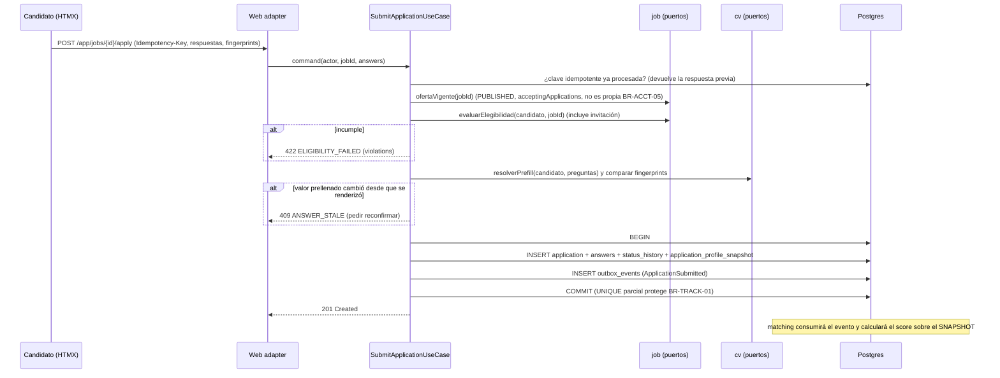

# 03 — Low-Level Design (LLD)

| Campo | Valor |
|---|---|
| **Estado** | 🟡 En revisión |
| **Versión** | 1.0 · 13-nov-2026 |
| **Relacionado** | `02-hld-system-design.md`, `docs/02-domain/*`, `docs/05-engineering/coding-standards.md` |

> **Importante — alcance de este documento.** Es un diseño de referencia para los TDD de cada módulo. Los nombres de casos de uso y paquetes que aparecen aquí son **propuestas**: las reglas del proyecto §7.1 prohíbe crear carpetas `usecase/` especulativamente; cada nombre se materializa cuando el TDD de su módulo lo apruebe. Los fragmentos de código son ilustrativos (Java 21), no se han añadido al repo. Respetan la regla de dependencia: `domain/` sin Spring ni JPA.

---

## 1. Convenciones transversales

| Tema | Convención |
|---|---|
| IDs | `UUID` v7 (ordenables por tiempo, mejor localidad de índice B-tree que v4); tipos de valor (`record JobPostingId(UUID v)`) en `common` |
| Tiempo | Todo `Instant`/`timestamptz` en UTC; `Clock` inyectado como puerto; **nunca** `Instant.now()` en dominio |
| Dinero | `BigDecimal` + `currency` ISO-4217 + `period` (`MONTH`/`YEAR`); **falta hoy en el modelo de datos** (salary_min/max sin moneda) → corregir |
| Resultados esperables | Errores de negocio como valores (`Result<T, DomainError>`/excepciones de dominio tipadas), no `RuntimeException` genéricas; mapeados a HTTP en el adaptador web |
| Transacciones | Una transacción por caso de uso (frontera en `application/`), nunca en controladores ni dominio; eventos a *outbox* en la misma transacción |
| Concurrencia | `@Version` (bloqueo optimista) en agregados con hijos (`JobPosting`, `Application`); *compare-and-set* para transiciones en batch |
| Idempotencia | `Idempotency-Key` en `POST` que crean (postular, invitar, solicitud de seguimiento); tabla `idempotency_keys` (24 h) |
| Comentarios | Estándar de las reglas del proyecto §8: *por qué*, 1–3 líneas, con ID `BR-*` |

---

## 2. `matching-module` — diseño detallado

### 2.1 Modelo de dominio (puro)

```java
// domain/model — sin Spring, sin JPA
public record DimensionScore(Dimension dimension, double score01, boolean available,
                             double weight, List<Evidence> evidence) {}

public record ScoreBreakdown(List<DimensionScore> dimensions, double semanticCalibrated01,
                             double alpha, double completeness01) {}

public record CompatibilityScore(CandidateProfileId candidate, JobPostingId job,
                                 BigDecimal overall0to100, ScoreBreakdown breakdown,
                                 AlgorithmVersion version, String inputFingerprint,
                                 Instant computedAt) {}

// BR-MATCH-04: la versión incluye código + modelo de embeddings + hash de pesos,
// para que un cambio de calibración nunca reutilice un score viejo.
public record AlgorithmVersion(String code, String embeddingModel, String weightsHash) {}
```

### 2.2 Puertos (`application/usecase/calculatecompatibilityscore/`)

| Puerto de salida | Responsabilidad | Adaptador |
|---|---|---|
| `CandidateSignalsReader` | Devuelve `CandidateSignals` (skills normalizadas, años relevantes, nivel educativo, idiomas, ubicación, expectativa salarial) — **proyección propia de `matching`**, no entidades de `cv` (anti-corruption layer) | `infrastructure/adapter/out/cv` → consulta de lectura/API pública de `cv` |
| `JobSignalsReader` | Idem para la vacante (`JobSignals`) | `…/out/job` |
| `EmbeddingVectorPort` | `Optional<Vector> forEntity(EntityRef, contentHash)` — lee el vector ya calculado | `…/out/persistence` (pgvector) |
| `ScoreStorePort` | `upsertCurrent`, `appendSnapshot`, `findCurrent` | persistence |
| `ScoreCachePort` | `get/put` por `inputFingerprint` | Redis |
| `WeightsProvider` | `Weights current()` — desde configuración versionada (BR-MATCH-05) | config |
| `CalibrationProvider` | Parámetros `(a, b)` de la sigmoide por `embeddingModel` | config / tabla |
| `ClockPort` | Tiempo | `common` |

El caso de uso **no** invoca Ollama: lee vectores ya existentes. La generación de vectores es otro caso de uso (`EmbedEntityUseCase`) disparado por el outbox (§2.5). Si falta el vector, el score se marca `PENDING_EMBEDDING` y se reintenta (no se calcula con un vector parcial).

### 2.3 Fórmulas por dimensión

Notación: `R` = requisitos de la vacante, `C` = skills del candidato, `norm(·)` = normalización a taxonomía (§ADR-0019).

| Dimensión (peso base) | Fórmula | Datos faltantes | Notas de equidad |
|---|---|---|---|
| **Skills (35 %)** | `Σ_r w_r · m(r) · f_r / Σ_r w_r`, con `w_r = 2` si obligatoria, `1` si deseable; `m(r) = 1` si `skill_id` coincide; `0.8·sim` si `sim ≥ τ_skill` (τ=0.80, vía grafo/embedding de skills); `0` si no. `f_r = min(1, nivel_c / nivel_min_r)` si hay nivel mínimo, si no `1` | Sin requisitos de skills ⇒ excluida | La obligatoriedad **pondera**, no elimina (el filtro binario es la elegibilidad, BR-ELIG-06) |
| **Experiencia (25 %)** | `min(1, años_relevantes / años_requeridos)`; `años_relevantes` = suma de solapamientos de experiencias cuyo rol/skills tienen similitud ≥ τ_exp con la vacante | Sin años requeridos ⇒ excluida | **Sin penalización por sobrecalificación** (penalizarla es un proxy de edad) — coherente con BR-CAND-03 |
| **Educación (15 %)** | `ord = 1` si `nivel_c ≥ nivel_req`, si no `max(0, 1 − 0.35·(nivel_req − nivel_c))`; `score = ord · (0.8 + 0.2·simCampo)` | Sin nivel requerido ⇒ excluida | No se usa el *nombre* de la institución |
| **Ubicación/modalidad (10 %)** | Tabla: vacante REMOTE → `1.0` (candidato acepta remoto/híbrido) / `0.6` (prefiere presencial); vacante HYBRID/ONSITE → `1.0` mismo país y modalidad compatible, `0.6` mismo país modalidad distinta, `0.6` otro país con `relocationWillingness`, `0.0` si no | Sin dato ⇒ excluida | — |
| **Salario (10 %)** | Con moneda/periodo normalizados: `ov = max(0, min(hi_j,hi_c) − max(lo_j,lo_c))`; `score = ov / (hi_c − lo_c)` si el rango del candidato tiene amplitud > 0; si es un punto `x`: `1` si `lo_j ≤ x ≤ hi_j`, si no `0`. Si la vacante no publica salario ⇒ excluida | Sin rango en cualquiera ⇒ excluida | Se muestra como "compatible/no compatible" sin revelar el rango oculto de la otra parte |
| **Idiomas/soft (5 %)** | `Σ min(1, nivel_c/nivel_req) / |idiomas_requeridos|` | Sin idiomas requeridos ⇒ excluida | — |

**Semántica calibrada.** `s = cos(e_candidato, e_vacante)`; `p = σ(a·(s − b))`, con `(a, b)` ajustados por regresión logística (Platt) sobre pares etiquetados (relevante ≥ 2). Alternativa si `p` no es monótona respecto a la etiqueta: regresión isotónica. Los parámetros se guardan por `embeddingModel`.

**Agregación.**

```
ŵ_d = w_d / Σ_{d disponible} w_d            (renormalización por datos faltantes)
estructurado = Σ_d ŵ_d · score_d
overall      = 100 · ((1 − α) · estructurado + α · p)     α inicial = 0.30
completeness = Σ_{d disponible} w_d / Σ_d w_d
```

Propiedades verificables con *property-based testing* (jqwik): `0 ≤ overall ≤ 100`; **monotonía** (añadir una skill que cubre un requisito nunca baja el score); **idempotencia** (mismos insumos ⇒ mismo `inputFingerprint` y mismo score); **suma de pesos = 1** tras renormalizar.

### 2.4 Clave de caché y huella de entrada

```
inputFingerprint = SHA-256( candidateContentHash ‖ jobContentHash ‖ algorithmVersion.code
                            ‖ embeddingModel ‖ weightsHash ‖ calibrationHash )
Redis key        = score:v1:{inputFingerprint}          (TTL de saneamiento, p. ej. 7 d)
```

Corrige F8: tras calibrar pesos o cambiar el modelo, la clave cambia sola. `candidateContentHash` se calcula sobre la **representación canónica** (`02` §4.3), no sobre campos crudos, de modo que una edición irrelevante (p. ej. cambiar la foto) no invalida nada.

### 2.5 Casos de uso propuestos (para el TDD de `matching`)

| Caso de uso | Disparo | Qué hace |
|---|---|---|
| `calculatecompatibilityscore` (ya existe la carpeta) | Lectura bajo demanda o evento | Resuelve señales, aplica dimensiones, agrega, hace `upsert` en `scores_current`, escribe snapshot si corresponde, cachea |
| `embedentity` | Outbox: `ProfileContentChanged`, `JobPostingContentChanged` | Canonicaliza → compara `content_hash` → llama a Ollama solo si cambió → guarda vector con `embedding_model`, `embedding_truncated` |
| `recomputescoresforentity` | Tras `embedentity` | Selecciona pares *con motivo* (postulados activos, vistos recientes) y encola `calculatecompatibilityscore` |
| `suggestcandidatesforjob` | Reclutador abre sugeridos | Etapas 1–3 (`02` §4.2) con cuotas y auditoría |
| `explainscore` | Candidato/reclutador abre desglose | Plantillas determinísticas + qué-pasaría-si (REQ-C-01) |
| `migratealgorithmversion` | Operación | Reprocesa por lotes priorizados (`02` §4.6) |

### 2.6 Qué-pasaría-si (REQ-C-01)

```java
// Solo para skills/datos que el candidato puede declarar con veracidad; nunca sugiere
// "inventar" experiencia. Cada simulación es una llamada pura al ScoreAggregator.
List<WhatIf> topGaps = missingRequirements.stream()
    .map(req -> new WhatIf(req, aggregator.score(signals.withSkill(req)).delta(current)))
    .sorted(comparing(WhatIf::delta).reversed()).limit(3).toList();
```

Al ser aritmética pura (sin Ollama), cuesta microsegundos.

---

## 3. `job-module` — diseño detallado

### 3.1 Agregado `JobPosting` y máquina de estados

```java
// domain/model
public final class JobPosting {
    private static final Map<Status, Set<Status>> ALLOWED = Map.of(
        DRAFT,     Set.of(PUBLISHED, DELETED),
        PUBLISHED, Set.of(CLOSED),
        CLOSED,    Set.of(PUBLISHED, ARCHIVED),
        ARCHIVED,  Set.of(DELETED),
        DELETED,   Set.of());

    // BR-JOB-03/06..11: una sola puerta de entrada para cambiar de estado, para que
    // ni un batch ni un controlador puedan producir una transición inválida.
    public List<DomainEvent> transition(Status to, Actor actor, Trigger trigger, Clock clock) {
        if (!ALLOWED.get(status).contains(to)) throw new InvalidTransition(status, to);
        if (to == PUBLISHED) requirePublishable();              // BR-JOB-02
        if (to == DELETED && status == ARCHIVED) requireOwner(actor);   // BR-JOB-09
        cancelPendingScheduledTo(to);                           // BR-JOB-17
        status = to; stamp(to, clock.instant());
        return List.of(eventFor(to));
    }

    // BR-JOB-19/20: la raíz del agregado conoce toda la cadena, por eso valida el orden aquí.
    public void schedule(Status from, Status to, Instant at) {
        requireProgrammable(from, to);                          // BR-JOB-12/14
        replacePending(to, new ScheduledTransition(from, to, at));  // BR-JOB-15
        requireChronologicalChain();                            // BR-JOB-20
    }
}
```

`requireChronologicalChain`: para todo par de transiciones pendientes `(a, b)` con `a.to == b.from`, exige `b.at > a.at`. Complejidad O(n²) con n ≤ 4 (catálogo cerrado): trivial.

**Persistencia:** JPA entity separada del modelo de dominio (regla de dependencia); `@Version` sobre la fila de `job_postings`. Un conflicto de versión ⇒ `409 CONFLICT_STALE_STATE` (el usuario recarga).

### 3.2 Evaluación de elegibilidad (ADR-0007 con tipos fuertes)

`criteria` sigue siendo `jsonb` en BD, pero **dentro del dominio es un tipo cerrado**, lo que responde la pregunta abierta "¿JSON Schema por `ruleType`?": se valida al *deserializar* a `sealed interface`, sin esquema paralelo.

```java
public sealed interface RuleCriteria
    permits CountryCriteria, WorkAuthCriteria, AcademicLevelCriteria, YearsExperienceCriteria,
            ModalityCriteria, ScheduleCriteria, LanguageCriteria, RelocationCriteria, SalaryCriteria {}

public record CountryCriteria(Set<CountryCode> allowed) implements RuleCriteria {}
public record LanguageCriteria(LanguageCode language, CefrLevel minLevel) implements RuleCriteria {}
// …

public record EligibilityResult(boolean eligible, List<Violation> violations) {}
public record Violation(EligibilityRuleId rule, RuleType type, ReasonCode reason, MissingField missing) {}

// BR-ELIG-02: AND de todas las reglas activas; BR-ELIG-08: dato ausente => incumple (fail-closed);
// BR-ELIG-10: la invitación omite todo el chequeo para ese par.
public EligibilityResult evaluate(EligibilitySnapshot candidate, List<EligibilityRule> rules, boolean invited) {
    if (invited) return EligibilityResult.ok();
    var violations = rules.stream().filter(EligibilityRule::active)
        .map(r -> evaluators.of(r.type()).check(r, candidate))   // switch exhaustivo sobre RuleCriteria
        .flatMap(Optional::stream).toList();
    return new EligibilityResult(violations.isEmpty(), violations);
}
```

El **mensaje al candidato** se compone en el adaptador web a partir de `ReasonCode` + `MissingField` (i18n); nivel de detalle recomendado (cierra la pregunta abierta): *categoría + acción* ("Esta vacante requiere autorización de trabajo en el país indicado; completa tu perfil → Autorizaciones"), **sin** exponer umbrales numéricos (p. ej. rango salarial). Las razones se guardan como código para auditoría.

**Años de experiencia**: dato **derivado** de `experiences` (no declarado libremente), calculado por una función pura y cacheado en la proyección `EligibilitySnapshot`.

### 3.3 Planificadores

```sql
-- Archivado (BR-JOB-06): atómico, seguro con N instancias, con eventos al outbox en la misma transacción
WITH due AS (
  SELECT id FROM job_postings
   WHERE status = 'CLOSED'
     AND closed_at + make_interval(days => :archival_delay_days) <= now()
   ORDER BY closed_at
   FOR UPDATE SKIP LOCKED
   LIMIT :batch)
UPDATE job_postings j SET status = 'ARCHIVED', archived_at = now(), version = version + 1
  FROM due WHERE j.id = due.id
RETURNING j.id;   -- el caso de uso inserta JobPostingArchivedEvent en outbox_events por cada id
```

```sql
-- Transiciones programadas (BR-JOB-16): compare-and-set, nunca fuerza
UPDATE job_postings
   SET status = :to, version = version + 1
 WHERE id = :id AND status = :from;     -- 0 filas => marcar la programación como SKIPPED
```

### 3.4 Visibilidad de vacantes con elegibilidad (BR-ELIG-04, BR-VIS-08)

Consulta de listado (una sola SQL, sin post-filtrado en memoria):

```sql
SELECT j.* FROM job_postings j
WHERE j.status IN ('PUBLISHED','CLOSED')                                  -- BR-JOB-11
  AND NOT EXISTS (                                                        -- BR-ELIG-04
        SELECT 1 FROM eligibility_rules r
         WHERE r.job_posting_id = j.id AND r.active AND r.hide_if_not_eligible
           AND NOT rule_satisfied(r, :candidate_profile_id)               -- función SQL o CTE por tipo
           AND NOT EXISTS (SELECT 1 FROM candidate_invitations i         -- BR-VIS-08
                            WHERE i.job_posting_id = j.id AND i.candidate_profile_id = :candidate_profile_id))
```

Si evaluar `rule_satisfied` en SQL resulta incómodo por la diversidad de tipos, alternativa: precomputar una **proyección** `candidate_eligibility_facts` (una fila por candidato con campos normalizados) y expresar cada regla como predicado sobre ella. Se decide en el TDD de `job`; medir con 1 000 vacantes × 20 reglas (NFR-SCAL-03).

---

## 4. `ats-module` y esquema — cambios propuestos

### 4.1 Caso de uso `SubmitApplication` (secuencia)



Decisiones incrustadas:

1. **Snapshot inmutable** (F6): al postular se guarda `application_profile_snapshots(application_id, canonical_profile jsonb, content_hash, taken_at)`. El reclutador evalúa **ese** snapshot y su score; el perfil vivo se muestra solo como "el candidato actualizó su perfil desde entonces" (con opción de refrescar el score a petición del reclutador, auditada). Impide inflar el perfil tras postular y garantiza que el CV de marca refleje lo evaluado.
2. **`ANSWER_STALE`**: el formulario lleva un `fingerprint` del valor prellenado; si cambió entre render y envío, se pide reconfirmar (cumple el espíritu de BR-APPQ-06).
3. **Unicidad (BR-TRACK-01)**: `CREATE UNIQUE INDEX uq_app_active ON applications (candidate_profile_id, job_posting_id) WHERE status <> 'WITHDRAWN';` — repostular solo tras retirar (REQ-C-03) y mientras la vacante lo permita.
4. **Estados**: `status` grueso (`ACTIVE|HIRED|REJECTED|WITHDRAWN`) + `stage_id` configurable (REQ-R-01); `application_status_history` registra ambos y el `rejection_reason` codificado (REQ-R-03).

### 4.2 DDL propuesto (migraciones Flyway; ilustrativo)

```sql
-- Embeddings versionados (F5, ADR-0018). La dimensión DEBE ser fija para indexar con HNSW.
ALTER TABLE candidate_profiles
  ADD COLUMN embedding_model        varchar,
  ADD COLUMN embedding_content_hash char(64),
  ADD COLUMN embedding_truncated    boolean NOT NULL DEFAULT false;
-- (igual en job_postings). ACTUALIZADO el 18-nov-2026: la columna es vector(1024) (valor provisional
-- qwen3-embedding:0.6b, no 768), embedding_dim es una columna normal con CHECK (una generada
-- reescribiría la tabla) y el cambio de modelo usa el slot embedding_next* probado en
-- data-model.md §5.1 y anexos/embeddings-esquema/.
CREATE INDEX idx_cp_embedding_hnsw ON candidate_profiles
  USING hnsw (embedding vector_cosine_ops)
  WHERE discoverable AND embedding IS NOT NULL;           -- 02 §5.2

-- Scores actuales + snapshots (F7)
CREATE TABLE compatibility_scores_current (
  candidate_profile_id uuid NOT NULL REFERENCES candidate_profiles(id),
  job_posting_id       uuid NOT NULL REFERENCES job_postings(id),
  overall_score        numeric(5,2) NOT NULL CHECK (overall_score BETWEEN 0 AND 100),
  completeness         numeric(4,3) NOT NULL CHECK (completeness BETWEEN 0 AND 1),
  breakdown            jsonb NOT NULL,
  algorithm_version    varchar NOT NULL,
  input_fingerprint    char(64) NOT NULL,
  computed_at          timestamptz NOT NULL DEFAULT now(),
  PRIMARY KEY (candidate_profile_id, job_posting_id)
);
CREATE TABLE compatibility_score_snapshots (
  id uuid PRIMARY KEY, candidate_profile_id uuid NOT NULL, job_posting_id uuid NOT NULL,
  reason varchar NOT NULL CHECK (reason IN ('APPLICATION','STAGE_CHANGE','ALGO_CHANGE','SAMPLE')),
  overall_score numeric(5,2) NOT NULL, breakdown jsonb NOT NULL,
  algorithm_version varchar NOT NULL, taken_at timestamptz NOT NULL DEFAULT now()
);

-- Snapshot de la postulación (F6; incluir en anonimización, F13)
CREATE TABLE application_profile_snapshots (
  application_id uuid PRIMARY KEY REFERENCES applications(id),
  canonical_profile jsonb NOT NULL, content_hash char(64) NOT NULL,
  taken_at timestamptz NOT NULL DEFAULT now()
);

-- Skills y requisitos (F4; hoy sin diccionario de datos)
CREATE TABLE skills (
  id uuid PRIMARY KEY, canonical_name text NOT NULL, language char(2) NOT NULL,
  esco_uri text UNIQUE, embedding vector(768), created_at timestamptz NOT NULL DEFAULT now());
CREATE TABLE skill_aliases (alias_norm text PRIMARY KEY, skill_id uuid NOT NULL REFERENCES skills(id));
CREATE TABLE candidate_skills (
  id uuid PRIMARY KEY, candidate_profile_id uuid NOT NULL REFERENCES candidate_profiles(id),
  skill_id uuid REFERENCES skills(id), raw_name text NOT NULL,
  proficiency smallint CHECK (proficiency BETWEEN 1 AND 4),
  source varchar NOT NULL CHECK (source IN ('DECLARED','PARSED_CONFIRMED')),
  UNIQUE (candidate_profile_id, skill_id));
CREATE TABLE job_requirements (
  id uuid PRIMARY KEY, job_posting_id uuid NOT NULL REFERENCES job_postings(id),
  requirement_type varchar NOT NULL CHECK (requirement_type IN ('SKILL','EDUCATION','EXPERIENCE_YEARS','LANGUAGE')),
  skill_id uuid REFERENCES skills(id), criteria jsonb NOT NULL DEFAULT '{}',
  is_mandatory boolean NOT NULL DEFAULT false, min_proficiency smallint, position int NOT NULL DEFAULT 0);

-- Dinero con moneda (corrige salary_* sin unidad)
ALTER TABLE job_postings ADD COLUMN salary_currency char(3), ADD COLUMN salary_period varchar
  CHECK (salary_period IN ('MONTH','YEAR'));
ALTER TABLE candidate_profiles ADD COLUMN salary_currency char(3), ADD COLUMN salary_period varchar;

-- Outbox, idempotencia, auditoría
CREATE TABLE outbox_events (
  id uuid PRIMARY KEY, aggregate_type text NOT NULL, aggregate_id uuid NOT NULL,
  aggregate_version bigint NOT NULL, event_type text NOT NULL, payload jsonb NOT NULL,
  created_at timestamptz NOT NULL DEFAULT now(), available_at timestamptz NOT NULL DEFAULT now(),
  attempts int NOT NULL DEFAULT 0, processed_at timestamptz);
CREATE INDEX idx_outbox_pending ON outbox_events (available_at) WHERE processed_at IS NULL;
CREATE TABLE idempotency_keys (
  key text NOT NULL, account_id uuid NOT NULL, request_hash char(64) NOT NULL,
  response jsonb, created_at timestamptz NOT NULL DEFAULT now(), PRIMARY KEY (account_id, key));
CREATE TABLE audit_log (
  id uuid PRIMARY KEY, at timestamptz NOT NULL DEFAULT now(), actor_account_id uuid NOT NULL,
  organization_id uuid, action text NOT NULL, target_type text NOT NULL, target_id uuid,
  trace_id text, details jsonb);               -- sin PII en details (BR-DATA-01)
CREATE TABLE profile_view_log (               -- REQ-R-11: cuotas y detección de scraping
  viewer_account_id uuid NOT NULL, candidate_profile_id uuid NOT NULL,
  job_posting_id uuid, context varchar NOT NULL, viewed_at timestamptz NOT NULL DEFAULT now());

-- Propiedad con organizaciones (ADR-0024): nullable hoy, barato; retrofit después es caro
ALTER TABLE job_postings ADD COLUMN organization_id uuid;
ALTER TABLE recruiter_templates ADD COLUMN organization_id uuid;

-- Verificación de reclutador (REQ-R-10)
ALTER TABLE recruiter_profiles ADD COLUMN verification_status varchar NOT NULL DEFAULT 'UNVERIFIED'
  CHECK (verification_status IN ('UNVERIFIED','VERIFIED','SUSPENDED'));

-- Contacto bajo solicitud (REQ-C-07)
CREATE TABLE contact_requests (
  id uuid PRIMARY KEY, job_posting_id uuid NOT NULL, candidate_profile_id uuid NOT NULL,
  requested_by_account_id uuid NOT NULL, status varchar NOT NULL DEFAULT 'PENDING'
  CHECK (status IN ('PENDING','ACCEPTED','DECLINED','EXPIRED')), created_at timestamptz NOT NULL DEFAULT now(),
  responded_at timestamptz, UNIQUE (job_posting_id, candidate_profile_id));

-- Retroalimentación para calibración (REQ-R-13)
CREATE TABLE match_feedback (
  id uuid PRIMARY KEY, candidate_profile_id uuid NOT NULL, job_posting_id uuid NOT NULL,
  rater_account_id uuid NOT NULL, relevance smallint NOT NULL CHECK (relevance BETWEEN 0 AND 3),
  reason text, created_at timestamptz NOT NULL DEFAULT now());
```

### 4.3 Otros defectos del modelo de datos detectados al diseñar el LLD

| Defecto | Dónde | Corrección |
|---|---|---|
| Tablas del ER sin diccionario: `candidate_skills`, `job_requirements`, `application_status_history` | data-model §3 vs. §4 | Añadidas arriba |
| `compatibility_scores.cv_profile_id` vs. dominio `candidateProfileId` | data-model §4.7, domain-model §3 | Unificar a `candidate_profile_id` |
| `embedding vector` sin dimensión | data-model §4.4 | `vector(N)` es obligatorio para índices HNSW/IVFFlat |
| "Activa" en BR-TRACK-01 no definida a nivel de índice | data-model §4.8 | Índice único parcial (arriba) |
| Salario sin moneda/periodo | data-model §4.4/4.6 | Columnas añadidas |
| `branded_cv_exports` sin id ni ruta de archivo ni retención | data-model §4.9 | `id`, `storage_key`, `expires_at`; incluir en anonimización |
| FK entre contextos como restricción física | data-model §4.16 | Aceptable en monolito; documentar que **ninguna** entidad JPA cruza módulos |
| Soft-delete de vacante no filtra por defecto en consultas | BR-JOB-09 | Vista/`@SQLRestriction` por defecto y pruebas |

---

## 5. Notificaciones, archivos y búsqueda — puertos

| Capacidad | Puerto (application) | Adaptadores | Reglas |
|---|---|---|---|
| Notificaciones | `NotificationPort.send(NotificationIntent)` | `InAppNotificationAdapter` (tabla `notifications`, SSE/polling HTMX), `EmailNotificationAdapter` (SMTP en dev con Mailpit; API en prod) | Plantillas i18n; preferencias por usuario; **digest** para alertas; *throttling*; jamás PII en el asunto; cola vía outbox; los cambios de etapa de BR-TRACK-02 y `ApplicationFollowUpRequested` (BR-FUP-04) son intenciones tipadas |
| Archivos | `FileStoragePort.put/get/presign/delete`, `MalwareScanPort.scan` | `SupabaseStorageAdapter`, `LocalMinioAdapter` (dev), `ClamAvAdapter` | Validar **magic bytes** (no solo `Content-Type`), tamaño máx., nombre de archivo saneado, clave de objeto aleatoria, URLs firmadas ≤ 5 min, carpetas por organización/candidato, retención y borrado en anonimización |
| Parser de CV | `CvTextExtractorPort` | PDFBox/Tika; OCR (Tesseract) como segunda opción | El **resultado es solo un borrador**: el candidato confirma datos extraídos antes de que alimenten `ProfessionalProfile` (consistente con BR-APPQ-06) |
| Búsqueda | `JobSearchPort` | `PostgresJobSearchAdapter` (FTS+trgm+vector RRF) | Filtros de visibilidad en SQL |

---

## 6. Autorización — diseño

```java
// application: la autorización es una consulta de dominio, no un interceptor mágico
public interface JobOwnershipPolicy {                    // implementado en job; consumido por ats/matching
    boolean canManage(Actor actor, JobPostingId job);    // dueño directo o miembro con rol de la misma organización
}
public record Actor(AccountId id, Set<Capability> capabilities, Optional<OrganizationId> org) {}
```

- `Actor` se **reconstruye en el servidor** desde `accounts` en cada petición (nunca de claims del cliente; NFR-SEC-03/04). `capabilities` salen de `is_candidate_enabled/is_recruiter_enabled` (cacheado ≤ 60 s en la sesión, invalidado por cambio de capacidad).
- Cada caso de uso exige **explícitamente** su capacidad; un `SubmitApplication` jamás consulta `RECRUITER` salvo para BR-ACCT-05 (comparar `candidateAccount == jobOwnerAccount`).
- Todo recurso hijo (`ApplicationAnswer`, `EligibilityRule`, `FollowUp`) se autoriza **por el `job_posting_id` raíz** vía una única función de política; evita olvidar un chequeo en una consulta nueva.
- **Pruebas de autorización automatizadas**: una prueba parametrizada recorre todos los endpoints del OpenAPI y verifica que (a) sin sesión ⇒ 401, (b) con otra cuenta ⇒ 403/404 (§`api-contract` 404 para no revelar existencia), (c) con capacidad equivocada ⇒ 403.
- ArchUnit:

```java
@ArchTest static final ArchRule domain_is_framework_free =
  noClasses().that().resideInAPackage("..domain..")
    .should().dependOnClassesThat().resideInAnyPackage("org.springframework..", "jakarta.persistence..");
@ArchTest static final ArchRule no_cross_module_internals =
  slices().matching("com.usac.jobseeker.(*)..").should().notDependOnEachOther()
    .ignoreDependency(…, /* solo puertos públicos */ …);
```

---

## 7. Contratos de API (extractos; el spec lo genera springdoc, ADR-0010)

| Método y ruta | Capacidad | Política de rate limit | Idempotente | Errores clave |
|---|---|---|---|---|
| `GET /api/v1/matching/jobs/{id}/score` | CANDIDATE | lectura | sí | 404 (no visible), `SCORE_PENDING` (202) |
| `GET /api/v1/matching/jobs/{id}/suggestions?page&size≤50` | RECRUITER verificado, dueño | sugerencias (estricta) + cuota diaria | sí | 403 `RECRUITER_NOT_VERIFIED`, 429 `QUOTA_EXCEEDED` |
| `POST /api/v1/ats/jobs/{id}/applications` | CANDIDATE | escritura | **`Idempotency-Key`** | 422 `ELIGIBILITY_FAILED`, 409 `ALREADY_APPLIED`/`ANSWER_STALE`, 403 `SELF_APPLICATION` |
| `DELETE /api/v1/ats/applications/{id}` (retirar) | CANDIDATE dueño | escritura | sí | 409 estado terminal |
| `POST /api/v1/job/postings/{id}/transitions` `{to}` | RECRUITER dueño/org | escritura | sí | 409 `INVALID_TRANSITION`/`STALE_STATE` |
| `POST /api/v1/job/postings/{id}/scheduled-transitions` | idem | escritura | no | 422 `CHAIN_ORDER_VIOLATION` |
| `POST /api/v1/job/postings/{id}/invitations` | RECRUITER dueño | escritura | clave natural (job, candidato) | 409 duplicado |
| `POST /api/v1/ats/applications/{id}/follow-ups` | RECRUITER dueño | límite por postulación (p. ej. 3) | `Idempotency-Key` | 429 `FOLLOWUP_LIMIT` |
| `POST /api/v1/cv/me/export` | auth | estricta (costosa) | sí | — |
| `POST /api/v1/account/deletion` / `DELETE …/deletion` (cancelar) | auth | estricta | sí | — |

**Catálogo de códigos de error** (extiende `api-contract-overview.md` §6, estables y documentados en OpenAPI): `VALIDATION_FAILED`, `UNAUTHENTICATED`, `FORBIDDEN_CAPABILITY`, `NOT_FOUND`, `INVALID_TRANSITION`, `STALE_STATE`, `ELIGIBILITY_FAILED`, `ALREADY_APPLIED`, `SELF_APPLICATION`, `ANSWER_STALE`, `SCORE_PENDING`, `RECRUITER_NOT_VERIFIED`, `QUOTA_EXCEEDED`, `RATE_LIMIT_EXCEEDED`, `FILE_REJECTED`, `UPSTREAM_UNAVAILABLE` (503), `INTERNAL_ERROR`. Cada error incluye `traceId`; los 4xx con detalle por campo usan una lista `violations[]`.

**Compatibilidad de API:** CI ejecuta una comparación del spec (p. ej. *oasdiff*) y **falla** ante cambios incompatibles sin bump de `/api/v{n}` (refuerza ADR-0010).

---

## 8. Transacciones y concurrencia — resumen

| Operación | Aislamiento / mecanismo | Falla esperable | Respuesta |
|---|---|---|---|
| Postular | `READ COMMITTED` + índice único parcial + `Idempotency-Key` | doble clic / reintento | Mismo resultado (idempotente) o 409 |
| Transición de vacante manual vs. batch | `@Version` / CAS por `status` | carrera | Gana el primero; el otro `SKIPPED`/409 |
| Recalcular score | Upsert por PK | dos workers | Último escribe; mismo resultado (determinista) |
| Re-embeber | `content_hash` como guarda | edición concurrente | El *worker* relee el estado más reciente; idempotente |
| Anonimizar cuenta | Estado por cuenta, pasos idempotentes | caída a mitad | Reanuda en el siguiente tick |
| Cuota de perfiles vistos | Contador en Redis (`INCR` con TTL diario) + fila en `profile_view_log` | Redis caído | *Fail-closed* para sugerencias (más seguro) |

---

## 9. Estrategia de pruebas ampliada (extiende `test-strategy.md`)

| Nivel | Añadir | Qué previene |
|---|---|---|
| Arquitectura | ArchUnit + `ApplicationModules.verify()` en cada build | Erosión hexagonal bajo presión de tiempo (riesgo #3 del SDD) |
| Propiedades | jqwik para scorers y máquina de estados (cualquier secuencia de acciones nunca produce estado inválido) | Casos límite no pensados |
| Mutación | PIT sobre `domain/` y `application/` (umbral ≥ 70 %) | Cobertura engañosa (80 % de líneas con asserts débiles) |
| Contrato | OpenAPI lint + `oasdiff` | Cambios incompatibles de API |
| Autorización | Prueba recorriendo todo el spec (§6) | Fuga entre reclutadores/capacidades (riesgo "Alta" de STRIDE) |
| Dataset dorado | CI nocturno: P@10, NDCG@10, prueba contrafactual | Regresión silenciosa de precisión/sesgo |
| Carga | k6/Gatling en staging para NFR-PERF-01..05 con 100 usuarios y 10⁴ perfiles sintéticos | Ruptura de SLO |
| Resiliencia | Testcontainers + Toxiproxy (Ollama/Redis/Clavaris lentos o caídos) | Degradación no controlada (NFR-AVAIL-02) |
| Accesibilidad | axe en Playwright | Incumplimiento WCAG |
| Seguridad | Dependabot/OWASP Dependency-Check, SAST (CodeQL), escaneo de imagen (Trivy), SBOM CycloneDX, ZAP baseline contra staging | Cadena de suministro / OWASP Top 10 |
| Migraciones | Aplicar **todas** las migraciones desde cero + *undo* probado en CI | Esquema irreproducible entre local y Supabase |

---

## 10. Orden de implementación sugerido del *walking skeleton* (Sprint 0–1)

1. Módulo `app`, `pom` con BOM, versiones fijadas (ADR-0014); CI con build + ArchUnit + Testcontainers.
2. Flyway V1 (`accounts`, `outbox_events`, `audit_log`, `idempotency_keys`) + `docker-compose` real (Postgres+pgvector, Redis, Ollama, Mailpit, Prometheus/Grafana) con `scripts/dev-up.sh`.
3. OIDC login contra Clavaris local + `accounts` upsert + página `/app/home` protegida + CSRF (HTMX) + `traceId`.
4. Un caso de uso de punta a punta con **todas** las transversales (rate limit, OpenAPI anotado, métrica de negocio, log estructurado, prueba de autorización) — plantilla que el resto copiará (cumple NFR-OBS-05 y el DoD desde el primer endpoint).
5. Despliegue a staging con *health checks* y un panel Grafana versionado.
