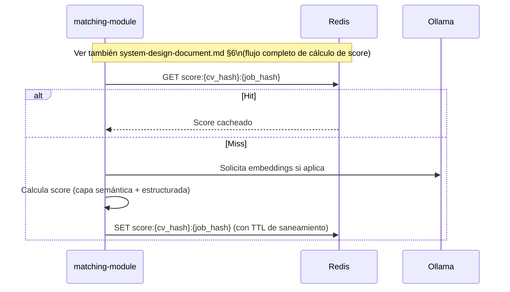
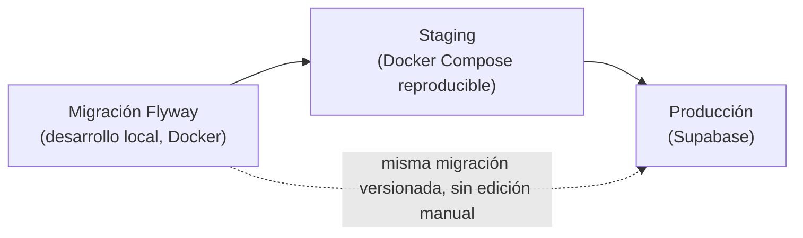

# Integration Design
## Sistema Inteligente de Análisis de Compatibilidad CV-Vacante con CRM de Postulaciones

| Campo | Valor |
|---|---|
| **Estado** | 🟡 En revisión |
| **Versión** | 1.0 |
| **Fecha** | Agosto 2026 |
| **Documento relacionado** | System Design Document, ADR-0002, ADR-0004, ADR-0011, ADR-0012, Data Model |

---

## 1. Propósito del documento

Detallar cómo `matching-module`, `job-module` y módulos relacionados integran con los componentes externos al monolito: Ollama, un proveedor externo de LLM (uso selectivo), Redis, Supabase, y la infraestructura transversal de rate limiting y observabilidad (ADR-0011/0012) — incluyendo el flujo de promoción de migraciones desde desarrollo local hasta producción.

## 2. Integración con Ollama (embeddings + generación)

Ollama tiene, a partir de este alcance, **dos consumidores** dentro del monolito — `matching-module` (score) y `job-module` (sugerencia de vínculo de preguntas de postulación, BR-APPQ-04) — cada uno con su propio adaptador de salida, sin que `job-module` dependa de `matching-module` para usarlo (regla de dependencia hexagonal, `domain-model.md` §5).

| Aspecto | Detalle |
|---|---|
| Modelo de embeddings | El de ADR-0018 (provisional `qwen3-embedding:0.6b`; `nomic-embed-text` v1.5 ya no es el defecto), con `truncate=false` y `num_ctx` explícito, invocado para generar el vector de `candidate_profiles.embedding` y `job_postings.embedding` (`matching-module`), y para comparar semánticamente el texto de una `ApplicationQuestion` contra el catálogo de `profileFieldMapping` (`job-module`, BR-APPQ-04) |
| Entrada y guarda de idempotencia | Se embebe únicamente la **representación canónica sin nombre** del perfil o de la vacante (`02-hld-system-design.md` §4.3). Antes de llamar a Ollama se compara su SHA-256 con `embedding_content_hash`: si no cambió, no se vuelve a llamar (BR-MATCH-03). Se mide el tamaño en tokens antes de enviar; si excede el contexto del modelo se aplica una estrategia registrada y se marca `embedding_truncated` |
| Qué se guarda por vector | `embedding`, `embedding_model`, `embedding_dim`, `embedding_content_hash`, `embedding_truncated` y `embedding_computed_at`, **todo o nada** (`data-model.md` §4.4/§4.6). El modelo forma parte de `algorithm_version` (BR-MATCH-04) |
| Cambio de modelo | Doble escritura al **slot siguiente** (`embedding_next*`), relleno por lotes, índice nuevo `CONCURRENTLY`, calibración y cambio en una transacción corta (`data-model.md` §5.1; el consumidor `embedentity` calcula con ambos modelos mientras dura). Sin `ALTER` en caliente |
| Modelo de generación | `llama3.2`, reservado para necesidades de generación de texto dentro del flujo local por defecto |
| Protocolo | API HTTP local de Ollama, consumida desde un adaptador de salida propio de cada módulo consumidor (`infrastructure/adapter/out/ai/`), nunca invocada directamente desde dominio o aplicación (regla de dependencia hexagonal) |
| Disparo de regeneración de embeddings (`matching-module`) | Al crear o actualizar `CandidateProfile.raw_cv_text`/`ProfessionalProfile` o `JobPosting.description` (eventos `ProfileUpdatedEvent`, `JobPostingUpdatedEvent`, BR-MATCH-03) |
| Disparo de sugerencia de vínculo (`job-module`) | Al guardar una `ApplicationQuestion` de tipo `TEXT` sin `profileFieldMapping` manual (BR-APPQ-04) — llamada puntual en tiempo de configuración, no recurrente por postulación |
| Manejo de falla | Si Ollama no responde: `matching-module` degrada mostrando el último score calculado + aviso (NFR-AVAIL-02); `job-module` omite la sugerencia sin bloquear la creación de la pregunta (queda sin vínculo, como si el reclutador no hubiera pedido sugerencia) |

## 3. Integración con un proveedor externo de LLM (uso selectivo)

Por decisión de ADR-0004, un proveedor externo de LLM de propósito general **no** forma parte de la ruta por defecto del sistema. Su integración, cuando se active para un caso selectivo de alto valor concreto, debe:

- Implementarse como un adaptador de salida alternativo bajo el mismo puerto de aplicación que el adaptador de Ollama (permitiendo intercambiarlos sin tocar dominio/aplicación).
- Activarse únicamente detrás de un feature flag, nunca como dependencia obligatoria para el cálculo del score (BR-MATCH-01 debe poder resolverse completamente con Ollama).
- Cumplir las mismas restricciones de manejo de PII que el resto del sistema (BR-DATA-01) antes de enviar cualquier dato de perfil o vacante fuera del entorno local — ver `security-architecture.md` y `threat-model-stride.md`.

Los criterios concretos para decidir cuándo un caso califica como "selectivo de alto valor" no están definidos aún (ver Preguntas abiertas de ADR-0004); este documento no los asume.

## 4. Integración con Redis (cache de scores + rate limiting, ADR-0011)

Redis tiene, a partir de este alcance, **dos usos independientes** dentro del mismo proceso: cache de scores (`matching-module`, ya existente) y almacenamiento de buckets de Bucket4j para rate limiting (transversal a todo el sistema, ADR-0011) — dos namespaces de clave distintos sobre la misma instancia, sin que uno dependa del otro.

| Aspecto | Detalle |
|---|---|
| Clave de cache (scores) | `score:{cv_hash}:{job_hash}` — hash del contenido relevante del perfil y de la vacante, no de sus identificadores, para que un cambio de contenido invalide naturalmente la clave |
| Valor cacheado | Score + desglose explicable completo (mismo payload que se persiste en `compatibility_scores.breakdown`) |
| Invalidación | No hay expiración por tiempo como mecanismo primario de frescura: BR-MATCH-03 exige recalculo ante cambio real de datos, lo cual cambia el hash y por tanto la clave; se aplica adicionalmente un TTL largo de saneamiento para evitar acumulación indefinida de claves obsoletas |
| Objetivo de rendimiento | Score visible en ≤ 2 segundos con cache hit (NFR-PERF-01) |
| Clave de bucket (rate limiting) | `ratelimit:{policy}:{accountId\|ip}` — namespace separado del de scores, sin colisión posible (ADR-0011) |
| Objetivo de rendimiento (rate limiting) | Decisión de permitir/rechazar en ≤ 200ms (NFR-SEC-06), antes de ejecutar cualquier lógica de negocio del endpoint |

## 5. Integración con Supabase (producción)

| Aspecto | Detalle |
|---|---|
| Rol | PostgreSQL gestionado en producción, con extensión `pgvector` habilitada (ADR-0002) |
| Migraciones | Flyway aplica las mismas migraciones versionadas usadas en Docker local; nunca se modifica el esquema manualmente en Supabase (`data-model.md` §2) |
| Flujo de promoción | 1) Migración desarrollada y probada en Docker local → 2) Aplicada en staging (Docker Compose reproducible, `roadmap-and-release-plan.md` §5) → 3) Aplicada en Supabase como parte del pipeline de despliegue, nunca manualmente vía consola de Supabase |
| Conexión | Vía cadena de conexión gestionada como secreto (ver `security-architecture.md`, gestión de secretos), nunca hardcodeada en el repositorio |
| Rollback | Despliegue de la versión anterior de la aplicación y, si el esquema ya cambió, una migración que lo corrige (solo hacia adelante, sin `undo`; ADR-0027), sin cambios de esquema irreversibles sin plan documentado (`roadmap-and-release-plan.md` §5) |

## 6. Almacenamiento de archivos (CV y preguntas de postulación tipo `FILE_UPLOAD`)

| Aspecto | Detalle |
|---|---|
| Datos que requieren almacenamiento de binarios | CV cargado del candidato (`CandidateProfile`), respuestas de tipo `FILE_UPLOAD` a `ApplicationQuestion`/`ApplicationFollowUpRequest` (BR-APPQ-01, BR-FUP-01) |
| Qué se persiste en PostgreSQL | Solo la referencia (`answer_value: {"fileUrl", "fileName"}`, `data-model.md` §4.16), nunca el binario en una columna de base de datos |
| Backend de almacenamiento | **Resuelto por el ADR-0021** (aprobado el 26-nov-2026): almacén S3, SeaweedFS en desarrollo (enmienda 1 del ADR) y Supabase Storage en producción, con escaneo ClamAV y URLs firmadas de 5 minutos, el mismo mecanismo para el CV y las respuestas de archivo |
| Validación antes de almacenar | Tipo MIME y tamaño máximo (NFR-SEC-05), igual criterio que la carga de CV (`threat-model-stride.md` §3.2) |

## 7. Integración con el stack de observabilidad (ADR-0012)

| Aspecto | Detalle |
|---|---|
| Exposición de métricas | Cada módulo expone sus métricas (técnicas y de negocio) vía Micrometer, agregadas por Actuator en `/actuator/prometheus` de la aplicación — un único endpoint de scrape para todo el monolito, no uno por módulo |
| Scrape | Prometheus, corriendo como servicio en `docker-compose`, hace polling periódico de `/actuator/prometheus` (intervalo a definir, ver Preguntas abiertas) |
| Visualización | Grafana consulta Prometheus como datasource; dashboards provisionados como código (JSON versionado en `infra/docker/grafana/`), no configurados manualmente en la UI de Grafana |
| Alertas | Reglas de Prometheus evaluadas localmente, notificadas vía Alertmanager al canal configurado (ver Preguntas abiertas) |
| Correlación con logs | `traceId` presente tanto en las métricas (como label, donde aplique) como en los logs estructurados (NFR-OBS-01), permitiendo pasar de una alerta de métrica a los logs de la request específica que la disparó |

## 8. Preguntas abiertas

- ¿Cuál es el TTL de saneamiento concreto para las claves de Redis, dado que la invalidación primaria depende del cambio de hash y no de expiración?
- ¿Supabase se usa también para el ambiente de staging, o staging corre contra una instancia Postgres self-hosted separada de producción?
- ¿Qué mecanismo de feature flag gobierna la activación del adaptador de LLM externo selectivo (sección 3) — el mismo mecanismo transversal mencionado como pregunta abierta en `system-design-document.md` §9?
- ¿Cuál es el backend concreto de almacenamiento de archivos (sección 6)? Determina si se requiere una nueva integración con un proveedor externo (p. ej. S3-compatible) no contemplada en el stack original.
- ¿Con qué intervalo hace scrape Prometheus (sección 7)? Determina la resolución temporal de las métricas y el retraso máximo de detección de una alerta.
- ¿Qué canal concreto usa Alertmanager para notificar (sección 7)? Misma pregunta abierta de ADR-0012.
- ¿Qué umbral de similitud semántica dispara la sugerencia de vínculo de BR-APPQ-04 (sección 2)? Misma pregunta abierta que en `domain-model.md` §8.
