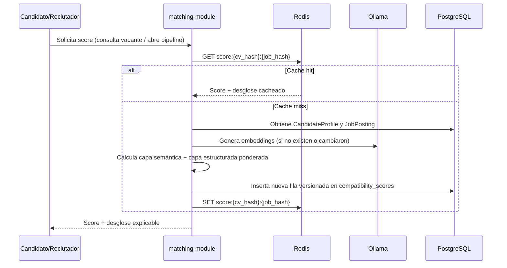
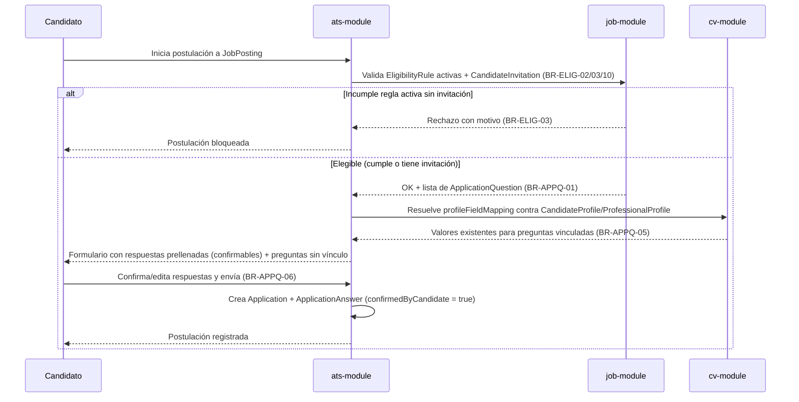

# System Design Document
## Sistema Inteligente de Análisis de Compatibilidad CV-Vacante con CRM de Postulaciones

| Campo | Valor |
|---|---|
| **Estado** | 🟡 En revisión |
| **Versión** | 1.0 |
| **Fecha** | Agosto 2026 |
| **Documentos relacionados** | Domain Model, Data Model, NFR & Quality Attributes, ADRs 0001-0013 (0009 retirado — ver §5), Integration Design, API Contract Overview |

---

## 1. Problema

Candidatos postulan sin saber su compatibilidad real con una vacante, y reclutadores reciben volúmenes altos de postulaciones sin un criterio objetivo y explicable para priorizar (ver PRD-MVP §2). El sistema debe calcular y explicar, para ambos lados, un score de compatibilidad que se mantenga actualizado y sea auditable, dentro de las restricciones de un desarrollador único y un marco de tiempo de tesis de ~5-6 meses (`project-charter.md` §7).

## 2. Objetivos

- Calcular un score de compatibilidad bidireccional, explicable por dimensión, entre `CandidateProfile` y `JobPosting` (BR-MATCH-01, BR-MATCH-02).
- Mantener el score sincronizado con el estado actual de los datos, sin recalculo programado por lotes (BR-MATCH-03).
- Aislar visibilidad de scores según rol y propiedad de datos (BR-VIS-01 a 08).
- Ofrecer generación de CV de marca para reclutadores sin acoplar esa función al CV propio del candidato (BR-CVGEN-01 a 03).
- Permitir al reclutador definir excepciones de elegibilidad por vacante (país, autorización de trabajo, nivel académico, experiencia, modalidad, disponibilidad, idioma, reubicación, expectativa salarial) que bloquean o solo ocultan la vacante, con bypass explícito por invitación directa (BR-ELIG-01 a 13, ADR-0007).
- Gobernar el ciclo de vida completo de una vacante con una máquina de estados (`DRAFT→PUBLISHED⇄CLOSED→ARCHIVED→DELETED`), incluyendo archivado automático y temporizadores de transición opcionales y encadenables (BR-JOB-03, BR-JOB-06 a 20).
- Recolectar información cualitativa adicional del candidato al postular, evitando repetir datos ya declarados en su perfil mediante detección híbrida (manual + sugerencia por similitud semántica) (BR-APPQ-01 a 09, BR-FUP-01 a 05).
- Soportar cuentas con capacidades no excluyentes de candidato y reclutador, sobre un núcleo de perfil profesional compartido (BR-ACCT-01 a 08, ADR-0008).
- Cumplir los NFR de rendimiento, disponibilidad y seguridad definidos en `nfr-quality-attributes.md` con una infraestructura operable por una sola persona.

## 3. No-objetivos

Ver PRD-MVP §4: integraciones con ATS externos, app móvil nativa, videoentrevistas, soporte multi-idioma, prevención avanzada de fraude, y reglas de elegibilidad basadas en categorías protegidas (edad, género) quedan explícitamente fuera del diseño de esta fase.

## 4. Arquitectura de alto nivel

El sistema es un **monolito modular** (ADR-0001): un único desplegable Spring Boot compuesto por módulos con límites de dominio estrictos (`auth`, `cv`, `job`, `matching`, `ats`, `tracker`, `shared-kernel`), cada uno organizado internamente en slices verticales por caso de uso, siguiendo DDD + arquitectura hexagonal (ver `domain-model.md` y `coding-standards.md` §2).

```mermaid
flowchart TB
    subgraph Client["Cliente"]
        Browser["Navegador\n(Thymeleaf + HTMX,\nsin SPA — ADR-0005)"]
    end

    subgraph App["Aplicación (monolito modular, Spring Boot 4.1)"]
        Auth[auth-module]
        CV[cv-module]
        Job[job-module]
        Matching[matching-module]
        ATS[ats-module]
        Tracker[tracker-module]
        Shared[shared-kernel]
    end

    subgraph Data["Datos e infraestructura"]
        PG[("PostgreSQL 17\n+ pgvector — ADR-0002, ADR-0028")]
        Redis[("Redis 7\ncache de scores +\nrate limiting — ADR-0011")]
        Ollama["Ollama\n(embeddings ADR-0018, llama3.2)"]
        Supabase[("Supabase\n(Postgres gestionado, prod)")]
    end

    subgraph Obs["Observabilidad — ADR-0012"]
        Prom[("Prometheus")]
        Grafana["Grafana"]
        Alert["Alertmanager"]
    end

    Browser -->|HTTP + HTMX fragments\n+ JWT RS256 (Clavaris)| App
    Auth --> PG
    Auth --> Redis
    CV --> PG
    Job --> PG
    Matching --> PG
    Matching --> Redis
    Matching --> Ollama
    Job --> Ollama
    ATS --> PG
    Tracker --> PG
    App -->|rate limiting, todo endpoint| Redis
    PG -.->|Flyway, mismo esquema| Supabase
    App -->|/actuator/prometheus| Prom
    Prom --> Grafana
    Prom --> Alert
```

Más allá del diagrama de infraestructura, el mapa de dependencias entre módulos (ver `domain-model.md` §5) creció respecto al diseño original de solo `matching` como cliente de `cv`/`job`: `job` es ahora también cliente de `cv` (datos de elegibilidad y del `RecruiterProfile` público, ADR-0008), `ats` es cliente directo tanto de `job` (validación de elegibilidad, desglose de reglas, `ApplicationQuestion`, `CandidateInvitation`) como de `cv` (prellenado de `ApplicationAnswer` desde el perfil). La regla de dependencia unidireccional se mantiene: ningún módulo de dominio (`cv`, `job`) depende nunca de los módulos de orquestación (`matching`, `ats`).

### 4.1 Frontend

Thymeleaf + HTMX, renderizado del lado del servidor, sin framework SPA (ADR-0005). Justificado por la restricción de desarrollador único: evita duplicar lógica de validación cliente/servidor y reduce superficie de mantenimiento.

### 4.2 Persistencia

PostgreSQL 17 con extensión `pgvector` para embeddings semánticos (ADR-0002), en vez de una base de datos vectorial dedicada. Flyway como única fuente de verdad del esquema, aplicado igual en Docker local y Supabase en producción (ver `data-model.md` §2).

### 4.3 Caching

Redis 7 cachea scores de compatibilidad ya calculados (`score:{cv_hash}:{job_hash}`), evitando recomputar contra Ollama en cada consulta (NFR-PERF-01). El detalle de invalidación vive en `integration-design.md`.

### 4.4 IA / NLP

Ollama corre localmente y provee el modelo de embeddings de ADR-0018 (capa semántica; provisional `qwen3-embedding:0.6b`) y `llama3.2` (generación de texto donde aplique). Un LLM externo de propósito general se reserva para casos selectivos de alto valor, fuera de la ruta por defecto (ADR-0004) — el diseño no depende de su disponibilidad para operar.

### 4.5 Generación de documentos

CVs de candidato y CVs de marca de reclutador se generan con Thymeleaf (plantillas HTML) + openhtmltopdf, en vez de LaTeX (ADR-0006), manteniendo el stack 100% Java.

### 4.6 Procesos programados (batches)

`job-module` requiere dos procesos periódicos, ambos candidatos a implementarse como `@Scheduled` dentro del propio proceso Spring Boot (sin infraestructura de cron externa, consistente con la restricción de desarrollador único — decisión final pendiente, ver Preguntas abiertas):

| Proceso | Responsabilidad | Regla de negocio |
|---|---|---|
| `ArchiveExpiredClosedJobPostingsUseCase` | Recorre vacantes `CLOSED` cuyo `closed_at + archivalDelayDays` ya venció y las transiciona a `ARCHIVED` | BR-JOB-06 |
| `ExecuteScheduledJobPostingTransitionsUseCase` | Recorre `JobPostingScheduledTransition` en estado `PENDING` con `scheduledAt` vencido, valida `fromStatus` y ejecuta o marca `SKIPPED` | BR-JOB-12 a 20 |

Ambos leen y escriben exclusivamente dentro del agregado `JobPosting` (entidades hijas `EligibilityRule`, `CandidateInvitation`, `JobPostingScheduledTransition`, `ApplicationQuestion` — ver `domain-model.md` §3), sin dependencia de Ollama ni de otros módulos, por lo que no comparten el riesgo de disponibilidad de la sección 8 asociado a Ollama.

### 4.7 Autenticación, autorización y versionado de API

JWT RS256 emitido y rotado por **Clavaris** (proveedor de identidad externo, repositorio separado) como único mecanismo de autenticación de todo el sistema — JobSeeker valida, nunca emite. Todo endpoint HTTP vive bajo `/api/v1/...` (versionado por URI, `api-contract-overview.md` §4) y está documentado en el spec OpenAPI agregado generado por `springdoc-openapi` (ADR-0010) desde el primer endpoint de la Ola 1 — la documentación de API nunca es una tarea diferida a "cuando el módulo esté listo".

### 4.8 Rate limiting

Bucket4j sobre Redis (ADR-0011), aplicado como filtro transversal a todo endpoint (`/api/v1/...` y fragmentos HTMX `/app/...`), con límites configurables por política (no hardcodeados) — reutiliza la instancia de Redis ya presente para cache de scores, sin infraestructura adicional.

### 4.9 Observabilidad

Actuator + Micrometer + Prometheus + Grafana + Alertmanager, todos autohospedados vía `docker-compose` (ADR-0012), más logging estructurado JSON con `traceId` correlacionable entre módulos. Cubre métricas técnicas y de negocio, dashboards versionados como código, y alertas ligadas a los NFR ya definidos (`nfr-quality-attributes.md` §8) — reemplaza el alcance original de solo health checks + logs (NFR-OBS-01/02).

## 5. Alternativas consideradas y rechazadas

| Decisión | Alternativa rechazada | Referencia |
|---|---|---|
| Monolito modular | Microservicios | ADR-0001 |
| pgvector | Base de datos vectorial dedicada (p. ej. Pinecone, Weaviate) | ADR-0002 |
| Scoring híbrido (semántico + reglas ponderadas) | Scoring puramente semántico | ADR-0003 |
| Ollama local por defecto, LLM externo solo selectivo | LLM externo como ruta por defecto | ADR-0004 |
| Thymeleaf + HTMX | SPA (React/Vue) | ADR-0005 |
| Thymeleaf + openhtmltopdf | LaTeX | ADR-0006 |
| Modelo genérico/extensible (`ruleType` + `criteria` jsonb) para reglas de elegibilidad y preguntas de postulación | Columnas fijas por tipo de regla/pregunta | ADR-0007 |
| Cuenta multi-rol con `ProfessionalProfile` compartido | Rol único cambiable, o cuentas completamente separadas por rol | ADR-0008 |
| Identidad delegada a Clavaris (proveedor OIDC externo, RS256) en vez de que JobSeeker emita su propio JWT | JWT HS256 propio (diseño original, retirado); token único sin refresh; BCrypt | histórico — ver `data-model.md` §4.1 |
| OpenAPI agregado, code-first vía `springdoc-openapi`, desde la Ola 1 | OpenAPI diferido por módulo; contract-first con YAML manual; documento separado por módulo | ADR-0010 |
| Rate limiting con Bucket4j sobre Redis, configurable | Límite en memoria sin Redis; rate limiting a nivel de infraestructura (API Gateway); límites hardcodeados | ADR-0011 |
| Observabilidad autohospedada (Actuator + Micrometer + Prometheus + Grafana) | OpenTelemetry completo con colector de trazas distribuidas; plataforma gestionada (Datadog/New Relic) | ADR-0012 |

## 6. Flujo de cálculo de score (referencia de diseño)



### 6.1 Flujo de postulación (elegibilidad + preguntas de postulación)

Referencia de diseño para el caso de uso que crea una `Application` — orquestado por `ats-module`, cliente de `job-module` y `cv-module` (sección 4):



## 7. Plan operativo

- **CI/CD:** GitHub Actions, trunk-based development, sin ramas de larga vida (`git-workflow.md`).
- **Containerización:** Docker desde el día uno; `docker-compose` para desarrollo local con Postgres, Redis y Ollama como servicios.
- **Ambientes:** desarrollo local → staging (Docker Compose reproducible) → validación con cohorte USAC (`roadmap-and-release-plan.md` §5).
- **Observabilidad:** endpoints `/actuator/health/{modulo}` por módulo (NFR-OBS-02), logging estructurado con request-id trazable sin exponer PII (NFR-OBS-01, BR-DATA-01), métricas Prometheus + dashboards Grafana + alertas Alertmanager (NFR-OBS-03/04/05, ADR-0012).
- **Seguridad transversal desde la Ola 1:** integración como cliente OIDC de Clavaris, rate limiting (ADR-0011) y documentación OpenAPI validada en CI (ADR-0010) se implementan como infraestructura base del primer milestone, no como tareas incrementales de cada módulo posterior.
- **Despliegue gradual:** cada milestone se valida en staging antes de habilitarse para la cohorte (feature flags para funcionalidad incompleta, no ramas largas).

## 8. Riesgos de diseño

| Riesgo | Impacto | Mitigación |
|---|---|---|
| Ollama no disponible o lento en el entorno de validación | Degradación de UX, scores no actualizados | Degradación controlada: mostrar último score + aviso (NFR-AVAIL-02) |
| Volumen de datos de validación mayor al estimado (NFR-SCAL-02) | Tiempos de matching fuera de SLA | pgvector con índices ivfflat/hnsw; cache Redis reduce recomputo |
| Complejidad de mantener límites hexagonales estrictos con un solo desarrollador | Erosión de la arquitectura bajo presión de tiempo | Checklist de Definition of Done (`definition-of-done.md`) valida la regla de dependencia en cada PR |
| Pesos de la capa estructurada mal calibrados al inicio | Precisión de matching por debajo de 0.85 | Pesos configurables, no hardcodeados (BR-MATCH-05); calibración continua con tráfico real (Ola 3, `roadmap-and-release-plan.md` §5) |
| Alcance de `job-module` creció significativamente tras el diseño inicial (elegibilidad, invitación, máquina de estados, temporizador, preguntas de postulación) sin ajuste de cronograma | El milestone de vacantes puede exceder su duración original, presionando el resto del roadmap | Ver `roadmap-and-release-plan.md` §3 y §7 (riesgo de alcance ahora explícito y con fases redistribuidas) |
| Dos procesos `@Scheduled` nuevos (archivado, transiciones programadas — sección 4.6) sin ejecución fiable en un entorno de desarrollador único (p. ej. la app no corre 24/7 en el ambiente de validación) | Vacantes que debieron archivarse/publicarse automáticamente quedan desactualizadas hasta el siguiente arranque | Los batches recorren por condición (`closed_at`/`scheduled_at` vencidos), no por "tick" exacto — se auto-corrigen en la siguiente ejecución, sin pérdida de datos, solo con retraso |
| Sugerencia de vínculo por IA para preguntas de postulación (BR-APPQ-04) con baja precisión (falsos positivos/negativos de similitud semántica) | Reclutador acepta un vínculo incorrecto, o el sistema nunca sugiere un vínculo obvio | Mitigado por diseño: la sugerencia siempre requiere confirmación explícita del reclutador (nunca se aplica sola); el umbral de similitud queda como pregunta abierta a calibrar (ver `domain-model.md` §8) |
| Modelo de cuenta multi-rol (ADR-0008) introduce superficie de autorización nueva (una cuenta con ambas capacidades) | Riesgo de fuga de privilegios entre la capacidad de reclutador y la de candidato de una misma cuenta si la autorización no distingue el contexto de la acción | BR-ACCT-04 exige tratamiento idéntico a una cuenta de un solo rol; ver refuerzo en `security-architecture.md` §6 y `threat-model-stride.md` §3.1 |
| Stack de observabilidad (ADR-0012) suma tres servicios operados por un desarrollador único (Prometheus, Grafana, Alertmanager) además de Postgres/Redis/Ollama ya existentes | Sobrecarga operativa; riesgo de que la observabilidad misma quede desactualizada o caída sin que nadie lo note | Todos autohospedados vía `docker-compose` (sin licencias ni SLA externo que gestionar); dashboards versionados como código para no depender de configuración manual perdida ante un reinicio |
| Infraestructura transversal completa en la Ola 1 (integración OIDC con Clavaris, OpenAPI/CI, rate limiting, observabilidad — ADR-0010 a 0012) amplía su duración respecto a una versión básica | La Ola 1 puede exceder su duración estimada, con efecto en cascada sobre las olas siguientes | Ver `roadmap-and-release-plan.md` §6 (costo ya incorporado a la versión final del cronograma, decisión deliberada de negocio) |
| La Ola 1 de JobSeeker depende de que Clavaris (proyecto externo) tenga listo su núcleo de login/tokens primero | Bloqueo cruzado entre dos roadmaps no coordinados formalmente | Ver `roadmap-and-release-plan.md` §11 — riesgo explícito, sin mitigación resuelta todavía |

Ver Risk Register del protocolo de tesis para el detalle completo de riesgos académicos (referenciado, no duplicado, en `roadmap-and-release-plan.md` §7).

## 9. Preguntas abiertas

- ¿El módulo `shared-kernel` se empaqueta como módulo Maven/Gradle separado dentro del monorepo, o como código fuente compartido sin límite de build independiente?
- ¿Se requiere un mecanismo de feature flag basado en configuración (p. ej. Spring profiles) o una librería dedicada (p. ej. Unleash) desde el inicio, o se pospone hasta que exista la primera funcionalidad incompleta que lo necesite?
- ¿Los dos batches de la sección 4.6 corren como un único `@Scheduled` combinado o como procesos independientes? (misma pregunta abierta de `data-model.md` §6)
- ¿El stack de observabilidad (sección 4.9, ADR-0012) corre también en producción, o su alcance se limita a desarrollo/staging? Misma pregunta abierta de ADR-0012.
- ¿Qué ruleset de linting valida el spec OpenAPI en CI (sección 4.7, ADR-0010)?
- ¿Los valores concretos de las políticas de rate limiting (sección 4.8, ADR-0011) se calibran antes del cierre de la Ola 1 o se ajustan empíricamente con tráfico real en la Ola 3 (`roadmap-and-release-plan.md` §5)?
