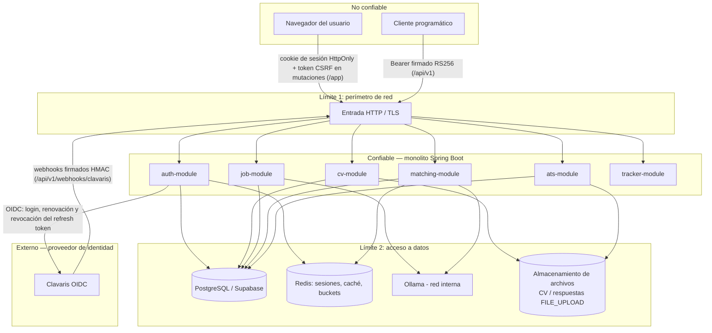

# Threat Model — STRIDE
## Sistema Inteligente de Análisis de Compatibilidad CV-Vacante con CRM de Postulaciones

| Campo | Valor |
|---|---|
| **Estado** | 🟡 En revisión |
| **Versión** | 1.1 — §2, §3.1, §4 y §5 actualizados según ADR-0020 (aprobado el 18-nov-2026) |
| **Fecha** | Agosto 2026 · actualizado en noviembre 2026 |
| **Documentos relacionados** | Security Architecture (§2), NFR & Quality Attributes, Business Rules, ADR-0020, `architecture-review-2026-11/06-spike-contrato-clavaris.md` |

---

## 1. Propósito del documento

Aplicar el modelo STRIDE (Spoofing, Tampering, Repudiation, Information Disclosure, Denial of Service, Elevation of Privilege) a los módulos de mayor exposición de riesgo: `auth-module` (identidad, ahora multi-rol), `cv-module` (PII), `matching-module` (lógica de negocio diferenciadora), `job-module` (screening, ciclo de vida, elegibilidad) y `ats-module` (pipeline, preguntas de postulación). Los controles concretos que mitigan cada amenaza viven en `security-architecture.md`; este documento identifica y prioriza.

## 2. Límites de confianza (trust boundaries)

## 3. Análisis STRIDE por módulo

### 3.1 `auth-module`

JobSeeker no guarda credenciales ni emite tokens: es cliente OIDC de Clavaris. Las amenazas sobre contraseñas, hashing y MFA pertenecen al modelo de amenazas de Clavaris; aquí se tratan las de la **integración** y de las tres superficies de ADR-0020 (web con sesión, API Bearer y webhooks).

| Categoría | Amenaza | Mitigación (ver security-architecture.md) |
|---|---|---|
| Spoofing | Token JWT falsificado o de otra aplicación de la misma organización (todas comparten clave de firma) presentado en `/api/v1` | Firma RS256 contra el JWKS de Clavaris, `iss` y `exp`, y un **validador propio de `aud`** con lista de audiencias (el decodificador por defecto no lo valida) (§2.3) |
| Spoofing | Robo o fijación de la sesión web | Cookie `__Host-`, `HttpOnly`, `Secure`, `SameSite=Lax`; rotación del ID al autenticar; caducidad por inactividad (30 min) y absoluta (8 h); los tokens de Clavaris no llegan al navegador (§2.2) |
| Spoofing | Evento falso en el receptor de webhooks, o reenvío de uno válido | Solo se acepta con firma HMAC válida y marca de tiempo dentro de 300 s, comprobada **antes** de interpretar el cuerpo; deduplicación por `Clavaris-Event-Id` con restricción única (§2.4) |
| Tampering | Alteración de un JWT para escalar de candidato a reclutador | Firma criptográfica; además las capacidades **no se leen del token**: se resuelven desde la base local en cada petición (BR-ACCT-04, §2.5) |
| Tampering / Elevation of Privilege | **CSRF:** un sitio externo hace que el navegador de la víctima envíe una petición mutante a `/app` con su cookie de sesión | Token CSRF obligatorio en toda ruta mutante, adjuntado por HTMX como `X-CSRF-TOKEN`; `SameSite=Lax`; CSP estricta sin `unsafe-inline`. Prueba obligatoria: todas las rutas mutantes de `/app/**` responden 403 sin token (`NFR-SEC-08`, en `nfr-quality-attributes.md` §5; criterio #16 del `definition-of-done.md`) |
| Tampering | Eventos de webhook desordenados que dejan el espejo local en un estado incorrecto (p. ej. una reactivación vieja tras un borrado) | Orden por la tupla `(occurredAt, event_id)`; `account.deleted` es terminal y gana siempre (verificado bajo concurrencia, dossier addendum 4) |
| Repudiation | Un usuario niega haber realizado una acción (p. ej. publicar/cerrar una vacante) | Logging estructurado con `traceId` y `accountId` por request (NFR-OBS-01), sin exponer PII |
| Information Disclosure | Exposición del **refresh token** de Clavaris (vale 30 días) por una filtración de Redis, de un volcado o de los logs | Cifrado en reposo con AES-GCM y clave propia rotable (`kid`), solo en la sesión del servidor y nunca en logs; la revocación en Clavaris ya funciona (TD-SEC-100), de modo que el logout lo revoca |
| Information Disclosure | PII del cuerpo de un webhook (correo, nombre, teléfono) en logs, errores o en el *outbox* | No se registra; se reduce a identificadores antes de persistir (ADR-0016, decisión 11); BR-DATA-01 |
| Information Disclosure | El spec OpenAPI agregado (ADR-0010) documenta la superficie completa de endpoints, útil para reconocimiento si queda expuesto sin control en producción | Swagger UI sin restricción solo en desarrollo/staging; protegida detrás de autenticación en producción (`security-architecture.md` §12) |
| Denial of Service | Fuerza bruta contra credenciales | **Ya no es responsabilidad de JobSeeker:** el formulario de login vive en Clavaris, que aplica su propio límite (NFR-SEC-07 se traslada allí). En JobSeeker, límite por IP sobre el inicio del flujo, el *callback* de login y la creación de sesiones (ADR-0011) |
| Denial of Service | Inundación del receptor de webhooks con peticiones no firmadas o de gran tamaño | Límite de tamaño del cuerpo, *rate limit* por IP, y comprobación de firma antes de cualquier procesamiento costoso |
| Denial of Service | Abuso de cualquier endpoint por volumen de requests (scraping, saturación de cómputo) | Rate limiting transversal por `accountId`/IP en todo endpoint (ADR-0011, `api-contract-overview.md` §10) |
| Denial of Service (auto-infligido) | Dos peticiones simultáneas de una misma sesión renuevan el refresh token a la vez: Clavaris interpreta **robo de token** y revoca la familia, cerrando la sesión del usuario legítimo | Cerrojo por sesión alrededor de toda renovación; con varias instancias, relectura del token desde Redis dentro del cerrojo y TTL del cerrojo mayor que la renovación (probado: 8/8 y 24/24 con cerrojo; 7 fallos sin él) |
| Denial of Service | Caída de Clavaris: cierra la sesión de todos los usuarios al fallar la prueba de vida | Margen de **2 h** cuando Clavaris no responde (decidido el 19-nov-2026) y límite absoluto de 8 h; el login nuevo sigue dependiendo de Clavaris. Es seguro mantenerlo porque durante la caída nadie puede suspender cuentas (medido) |
| Denial of Service | Clavaris colgado (no caído): sin tiempos de espera, el cliente por defecto no termina y las peticiones de la sesión se bloquean detrás del cerrojo, agotando los hilos del servidor | Tiempos de espera obligatorios (2 s / 10 s) y caché negativa de fallos (30–60 s); medido: ≥ 45 s sin respuesta con el cliente por defecto |
| Denial of Service (auto-infligido) | Un tiempo agotado en la renovación: Clavaris procesa la petición y rota el token pero la respuesta se pierde; el siguiente intento se interpreta como robo y mata la sesión | Con la ventana de reutilización de Clavaris (ADR-0046, 30 s, fijada por el operador) un **reintento único y cercano** recupera la sesión (medido); fuera de la ventana, o tras una caída larga, la sesión se cierra y el usuario inicia sesión de nuevo, sin tratarlo como incidente. Con conexión rechazada o 502 el token no se consume y la sesión se recupera. La ventana ensancha la carrera de un ladrón con el token viejo hasta esos 30 s (si el cliente ya usó el sucesor, sigue revocando todo) |
| Elevation of Privilege | Un candidato intenta acceder a endpoints exclusivos de reclutador manipulando las capacidades declaradas en el request | Autorización validada server-side contra `accounts.is_candidate_enabled`/`is_recruiter_enabled` persistidas, nunca confiando en el valor enviado por el cliente (NFR-SEC-03) |
| Elevation of Privilege | **Usuario suspendido o borrado en Clavaris conserva acceso:** Clavaris invalida sus propios tokens pero no la sesión de JobSeeker | Prueba de vida con refresh token cada ≤ 10 min (una suspensión se detecta como `invalid_grant`; verificado en 0,5 s), invalidación inmediata de sesiones por el webhook `account.suspended`/`account.deleted` y límite absoluto de 8 h. Los webhooks pueden perderse, por eso no son la única barrera |
| Elevation of Privilege | Una cuenta multi-rol (ADR-0008) usa su capacidad de reclutador para obtener una ventaja indebida actuando como candidato — p. ej. autopostularse a su propia vacante, o que el caso de uso de postulación consulte incorrectamente `is_recruiter_enabled` de la misma cuenta para relajar una validación de candidato | Cada caso de uso valida únicamente la capacidad que le corresponde (BR-ACCT-04, `security-architecture.md` §6); autopostulación bloqueada explícitamente por regla de dominio (BR-ACCT-05), no solo por ausencia de UI para hacerlo |

**Riesgo residual aceptado:** el *access token* de Clavaris ya emitido sigue siendo válido hasta 5 minutos tras revocarse (Clavaris no lo revoca), y un usuario suspendido conserva acceso a la web hasta el margen de la prueba de vida si Clavaris no responde. Ambos están acotados por la vida del token y el límite absoluto de sesión.

### 3.2 `cv-module` (datos PII)

| Categoría | Amenaza | Mitigación |
|---|---|---|
| Spoofing | Un actor sube un CV suplantando la identidad de otro candidato | Carga de CV asociada exclusivamente a la cuenta autenticada (`account_id`), no a un identificador enviado por el cliente |
| Tampering | Modificación no autorizada del perfil de otro candidato | Autorización por propiedad: solo el dueño del `CandidateProfile` puede editarlo (BR-CAND-02 implica edición propia, no de terceros) |
| Repudiation | Negación de haber cargado un CV específico que luego generó consecuencias en un proceso de selección | Auditoría de `updated_at` y eventos `ProfileUpdatedEvent` con `traceId` |
| Information Disclosure | Exposición de datos de contacto o CV completo a un reclutador sin relación de postulación, o filtración vía logs/errores | Visibilidad de perfil completo limitada a: el propio candidato, y reclutadores solo en el contexto de una postulación real a su vacante (extensión de BR-VIS-01/02 aplicada a datos de perfil, no solo al score) |
| Denial of Service | Carga masiva de archivos de CV de gran tamaño para agotar almacenamiento/cómputo de extracción de texto | Límite de tamaño de archivo y tipo MIME validado antes de procesar |
| Elevation of Privilege | Un reclutador intenta administrar plantillas de marca de otro reclutador | Aislamiento por `recruiter_account_id` en `recruiter_templates` (BR-CVGEN-01) |

### 3.3 `matching-module`

| Categoría | Amenaza | Mitigación |
|---|---|---|
| Spoofing | N/A directo — módulo no expone identidad propia, hereda la del solicitante autenticado | — |
| Tampering | Manipulación del `algorithm_version` o del `breakdown` para falsificar un score más favorable | `compatibility_scores` es append-only, calculado server-side; el cliente nunca envía el score, solo lo consulta |
| Repudiation | N/A — el score es un artefacto calculado por el sistema, no una declaración del usuario | — |
| Information Disclosure | Un reclutador consulta el score de un candidato en una vacante de otro reclutador (violación directa de BR-VIS-03) | Autorización valida que el `job_posting_id` consultado pertenece al `recruiter_account_id` del solicitante, en cada request, no solo en la UI (NFR-SEC-03) |
| Information Disclosure | Un reclutador consulta un candidato sugerido (BR-VIS-04) que desactivó su descubribilidad, por una condición de carrera o caché desactualizado entre el cambio de `discoverable` y la consulta de sugerencias | El filtro `discoverable = true` se evalúa en el momento de la consulta, no se cachea junto con el resultado de sugerencia (ver `CandidateDiscoverabilityChangedEvent` en `domain-model.md` §6) |
| Information Disclosure | Una cuenta específica (p. ej. el empleador actual del candidato, o un conocido que también usa la plataforma como candidato) ve que el candidato está `OPEN_TO_WORK` sin que el candidato lo desee | Mitigado por la lista de exclusión manual (BR-CAND-05, BR-VIS-06, `security-architecture.md` §8.4) — el candidato oculta el estado a cuentas específicas, sin restricción de rol. **Riesgo residual aceptado:** el sistema no infiere automáticamente ninguna relación (el candidato debe excluir manualmente), y la exclusión es por cuenta individual, no por empresa completa |
| Information Disclosure | El estado `OPEN_TO_WORK` de un candidato se filtra a una cuenta excluida que actúa como reclutador, a través del boost de orden en el listado de sugeridos (aparece consistentemente arriba aunque no se muestre el badge) | El filtro de exclusión (BR-MATCH-09) se aplica en la misma consulta que genera el orden, no solo en el renderizado del badge — una cuenta excluida nunca recibe el boost de prioridad |
| Denial of Service | Solicitudes masivas de recálculo de score (bypass de cache) para saturar Ollama | Rate limiting sobre el flujo de recalculo forzado; cache Redis reduce carga en el camino normal |
| Denial of Service | Scraping masivo de perfiles descubribles vía la consulta de sugerencia de candidatos (BR-MATCH-06), simulando publicar vacantes falsas para extraer PII de candidatos a gran escala | Rate limiting y límite de resultados (top-N) por consulta de sugerencia; validación de que la vacante esté realmente activa y publicada (BR-JOB-02) antes de habilitar sugerencias sobre ella |
| Elevation of Privilege | Un candidato intenta consultar el desglose de score de otro candidato en la misma vacante | Autorización valida que `cv_profile_id` corresponde a la cuenta autenticada cuando el solicitante tiene rol candidato (BR-VIS-01) |

### 3.4 `job-module` (elegibilidad, invitación, ciclo de vida, preguntas de postulación)

| Categoría | Amenaza | Mitigación |
|---|---|---|
| Tampering | Un reclutador manipula el `job_posting_id` en el request para crear/editar una `EligibilityRule`, `ApplicationQuestion` o `JobPostingScheduledTransition` sobre una vacante que no le pertenece | Control de propiedad server-side idéntico al de `security-architecture.md` §7, aplicado a cada entidad hija del agregado `JobPosting` (§8.5) |
| Tampering | Un candidato manipula el request de postulación para marcar `confirmed_by_candidate = true` sobre una respuesta que nunca vio, o para omitir una regla de elegibilidad incumplida | La validación de elegibilidad (BR-ELIG-02/03) y la exigencia de confirmación (BR-APPQ-06) se recalculan server-side en cada envío, nunca se confía en un flag enviado por el cliente |
| Repudiation | Un reclutador niega haber invitado a un candidato pese a una regla de elegibilidad incumplida, tras un resultado de contratación cuestionado | `CandidateInvitation.invited_by_account_id` + `created_at` como registro auditable append-only (no se sobrescribe, `data-model.md` §4.13) |
| Information Disclosure | Un candidato distinto al invitado intenta ver/usar una `CandidateInvitation` ajena para hacer bypass de elegibilidad en su propia postulación | El bypass de BR-ELIG-10 se evalúa por el par exacto `(candidateProfileId, jobPostingId)` autenticado, nunca por un identificador de invitación enviado por el cliente |
| Information Disclosure | El mensaje de rechazo por elegibilidad (BR-ELIG-03) expone más criterio del que el reclutador quería hacer público (p. ej. rangos salariales internos vía `criteria`) | Ver pregunta abierta de `security-architecture.md` §11 sobre nivel de detalle del mensaje — no resuelta en este documento |
| Denial of Service | Creación masiva de `EligibilityRule`/`ApplicationQuestion` sobre una misma vacante para degradar el tiempo de validación de postulación | Límite razonable por vacante (NFR-SCAL-03) validado en la capa de aplicación, no solo esperado como buena práctica del reclutador |
| Elevation of Privilege | Un reclutador sin capacidad `RECRUITER` activa (deshabilitada tras crear la vacante) sigue pudiendo transicionar su estado o crear invitaciones | Cada acción revalida la capacidad activa en el momento de ejecutarse (§6 de `security-architecture.md`), no solo en el momento de creación de la vacante |

### 3.5 `ats-module` (pipeline, respuestas de postulación, follow-up)

| Categoría | Amenaza | Mitigación |
|---|---|---|
| Tampering | Un reclutador edita el `answer_value` de una `ApplicationAnswer` ya enviada por el candidato, para alterar el historial de lo que realmente respondió | `ApplicationAnswer` es de solo lectura para el reclutador — ningún caso de uso de `ats-module` expone edición de respuestas ajenas, solo lectura y la creación de `ApplicationFollowUpRequest` como canal separado |
| Information Disclosure | Un reclutador consulta respuestas (`ApplicationAnswer`) de una postulación a una vacante de otro reclutador | Mismo control de propiedad de la sección 7 de `security-architecture.md`, aplicado a `application_answers` vía `application_id → job_posting_id` |
| Denial of Service | Un reclutador envía un volumen excesivo de `ApplicationFollowUpRequest` sobre la misma postulación para saturar al candidato o el sistema de notificaciones | Límite por postulación — ver pregunta abierta ya señalada en `prd-mvp.md` §9 |
| Elevation of Privilege | Un reclutador usa `ApplicationFollowUpRequest` para introducir, de facto, un nuevo requisito bloqueante después de recibida la postulación (evadiendo que BR-ELIG solo se configura antes) | BR-FUP-05 lo prohíbe explícitamente a nivel de regla de negocio: no responder un follow-up nunca afecta estado ni elegibilidad — cualquier caso de uso que condicionara el pipeline a una respuesta de follow-up sería un defecto |

## 4. Priorización de riesgos

| Amenaza | Probabilidad | Impacto | Prioridad |
|---|---|---|---|
| Elevation of Privilege — acceso cruzado entre reclutadores (BR-VIS-03) | Media | Alto (viola aislamiento de datos, núcleo del modelo de negocio B2B) | **Alta** |
| Denial of Service — scraping masivo de perfiles vía sugerencia de candidatos (BR-MATCH-06) | Media | Alto (exposición de PII a gran escala, dado que la descubribilidad es opt-out por defecto) | **Alta** |
| Information Disclosure — candidato sugerido pese a haber desactivado su descubribilidad | Baja | Alto (viola control explícito del usuario, BR-DATA-03) | **Alta** |
| Information Disclosure — `OPEN_TO_WORK` visible a una cuenta excluida (falla del filtro de BR-VIS-06) | Baja | Alto (viola control explícito del usuario, mismo peso que BR-DATA-03) | **Alta** |
| Information Disclosure — mismo empleador con múltiples cuentas de reclutador evade la exclusión (limitación de alcance, no falla de implementación) | Media (depende de cuántos empleadores tengan varias cuentas) | Medio (requiere acción deliberada del empleador para evadir, no es automático) | Media |
| Tampering — manipulación de JWT para escalar rol/capacidad (las capacidades no se leen del token) | Baja | Alto | **Alta** |
| Elevation of Privilege — usuario suspendido o borrado en Clavaris conserva acceso a la web (sesión no ligada a los tokens de Clavaris) | Media | Alto | **Alta** |
| Tampering / Elevation of Privilege — CSRF contra rutas mutantes de `/app` | Media | Alto | **Alta** |
| Spoofing — token de otra aplicación de la misma organización aceptado por falta de validación de `aud` | Baja | Alto | Media |
| Denial of Service (auto-infligido) — renovación concurrente del refresh token que revoca la familia y cierra la sesión | Alta sin cerrojo | Medio | Media (mitigada) |
| Elevation of Privilege — cuenta multi-rol usa su capacidad de reclutador para obtener ventaja como candidato (autopostulación, bypass de validación) | Media (superficie nueva introducida por ADR-0008) | Alto (viola BR-ACCT-04/05, principio de trato idéntico entre capacidades) | **Alta** |
| Tampering — reclutador crea/edita `EligibilityRule`, `ApplicationQuestion` o transición programada sobre vacante ajena | Baja | Alto (viola aislamiento de datos, mismo peso que BR-VIS-03) | **Alta** |
| Elevation of Privilege — `ApplicationFollowUpRequest` usado para imponer un requisito bloqueante después de la postulación | Media | Medio (afecta confianza del candidato en el proceso, no compromete datos) | Media |
| Denial of Service — fuerza bruta de login (responsabilidad de Clavaris; JobSeeker solo limita el callback) | Media | Medio | Media |
| Denial of Service — recalculo masivo de score | Baja | Medio | Media |
| Denial of Service — creación masiva de reglas/preguntas por vacante | Baja | Bajo-Medio (degradación de rendimiento, no exposición de datos) | Media |

## 5. Preguntas abiertas

- ¿Qué valores concretos (umbral, ventana de tiempo) tiene el límite por IP sobre el *callback* de login y la creación de sesiones (ADR-0011)? El mecanismo ya está decidido; los valores no. La fuerza bruta de credenciales corresponde a Clavaris.
- ~~¿Qué margen se tolera cuando Clavaris no responde?~~ **Resuelta el 19-nov-2026: 2 horas** (ADR-0020).
- BR-VIS-04 ya cubre explícitamente el score y desglose de candidatos sugeridos sin postulación; queda pendiente si el reclutador también ve datos de contacto directo (email, teléfono) del candidato sugerido, o si esos datos permanecen ocultos hasta que exista una postulación real o una acción explícita del candidato (p. ej. responder a un contacto del reclutador) — la decisión tomada hasta ahora cubrió el nivel de detalle del *score*, no de los datos de contacto crudos.
- ¿Cuál es el mecanismo de detección de carga de CV malicioso (p. ej. archivos con macros, PDFs con payloads) más allá de validación de tipo MIME y tamaño? Aplica igual a archivos cargados como respuesta `FILE_UPLOAD` (BR-APPQ-01).
- ¿Cuál es el límite concreto de `ApplicationFollowUpRequest` por postulación (sección 3.5), y quién lo define — constante de sistema o configurable por reclutador?
- ¿El nivel de detalle del mensaje de rechazo por elegibilidad (sección 3.4) se decide junto con esta amenaza, o queda deliberadamente como trade-off producto (transparencia para el candidato vs. exposición de la configuración de screening del reclutador) sin resolución de seguridad única?
