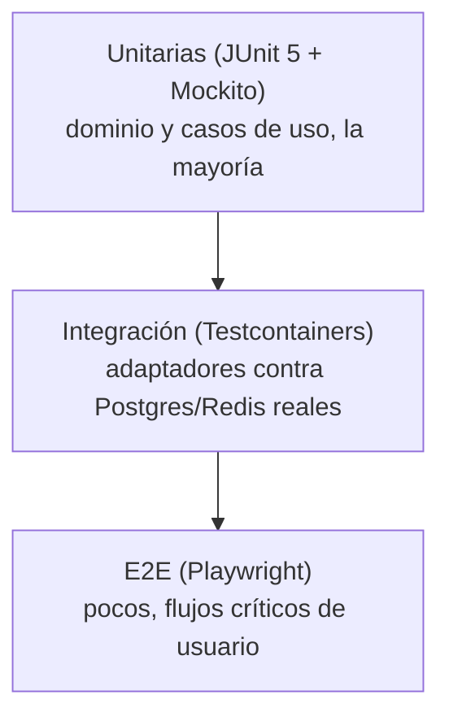

# Test Strategy
## Sistema Inteligente de Análisis de Compatibilidad CV-Vacante con CRM de Postulaciones

| Campo | Valor |
|---|---|
| **Estado** | 🟡 En revisión |
| **Versión** | 1.0 |
| **Fecha** | Agosto 2026 |
| **Documentos relacionados** | NFR & Quality Attributes, Coding Standards, Definition of Done |

---

## 1. Propósito del documento

Definir la pirámide de pruebas, los objetivos de cobertura y el tooling que garantizan NFR-MAINT-01 (cobertura ≥ 80% en lógica de negocio) sin depender de pruebas manuales para validar reglas de negocio (BR-XXX).

## 2. Pirámide de pruebas

| Nivel | Qué prueba | Qué NO prueba | Proporción esperada |
|---|---|---|---|
| Unitarias | `domain/` (entidades, value objects, servicios de dominio puros) y `application/usecase/` con puertos mockeados | Persistencia real, HTTP real, Ollama real | Mayoría de la suite |
| Integración | Adaptadores de `infrastructure/` contra dependencias reales vía Testcontainers (Postgres con pgvector, Redis) | Flujo completo de UI | Cantidad moderada, uno por adaptador crítico |
| E2E | Flujos de usuario completos vía Playwright contra la aplicación desplegada en un ambiente de prueba | Casos límite de lógica de negocio (cubiertos ya a nivel unitario) | Pocos, solo flujos críticos (registro→postulación→score visible; publicación de vacante→pipeline) |

## 3. Cobertura objetivo

- **≥ 80% de cobertura de líneas/ramas en lógica de negocio** (`domain/` y `application/usecase/` de cada módulo) — NFR-MAINT-01.
- No se exige el mismo umbral sobre `infrastructure/` (adaptadores, configuración), donde el valor de una prueba unitaria es menor que el de una prueba de integración.
- La cobertura se mide por módulo, no solo de forma agregada, para evitar que un módulo bien cubierto oculte a otro por debajo del umbral.

## 4. Tooling

| Herramienta | Uso |
|---|---|
| JUnit 5 | Framework base de pruebas unitarias e integración |
| Mockito | Dobles de prueba para puertos de salida en pruebas unitarias de casos de uso |
| Testcontainers | Levantar PostgreSQL (con `pgvector`) y Redis reales y efímeros para pruebas de integración de adaptadores |
| Playwright | Automatización de flujos E2E contra Thymeleaf + HTMX renderizado |
| JaCoCo (propuesto) | Medición de cobertura para verificar el umbral de NFR-MAINT-01 en CI — **pendiente de confirmación** como herramienta exacta |

## 5. Qué se prueba por capa (regla de la arquitectura hexagonal)

- **`domain/`**: pruebas unitarias puras, sin mocks de framework (no hay nada que mockear — sin dependencias externas por regla de arquitectura, ver `coding-standards.md` §2).
- **`application/usecase/`**: pruebas unitarias con los puertos de salida (`*Port`) mockeados, verificando la orquestación del caso de uso, no la implementación del adaptador.
- **`infrastructure/adapter/out/persistence/`**: pruebas de integración con Testcontainers, verificando que el mapeo JPA y las queries realmente cumplen el contrato del puerto.
- **`infrastructure/adapter/out/ai/`**: pruebas de integración contra una instancia real o simulada de Ollama (a definir: instancia real en CI vs. mock de contrato — ver Preguntas abiertas).
- **`infrastructure/adapter/in/web/`**: pruebas de integración de controladores (`@WebMvcTest` o equivalente) verificando contratos de `api-contract-overview.md` (formato de error, códigos de estado).

## 6. Trazabilidad de pruebas a reglas de negocio

Toda prueba que valide una regla de negocio (BR-XXX) referencia su ID en el nombre del método de prueba o en un comentario, siguiendo el estándar de comentarios de `coding-standards.md` §5 (referenciar el ID, no repetir la regla completa). Ejemplo: `shouldRejectDuplicateActiveApplication_BR_TRACK_01()`.

## 7. Pruebas de rendimiento

Los escenarios de NFR-PERF-01 a 03 (score en ≤ 2s con cache, pipeline en ≤ 3s, PDF en ≤ 4s) requieren pruebas de carga/rendimiento fuera de la pirámide funcional estándar. **Pendiente de definición**: herramienta (p. ej. Gatling, k6) y frecuencia de ejecución (por release vs. continua).

## 8. Consideraciones de prueba para funcionalidad con estado y procesos programados

El alcance de `job-module` (máquina de estados, temporizador, elegibilidad) y el modelo de cuenta multi-rol (ADR-0008) introducen categorías de prueba que no cubre la pirámide estándar de la sección 2:

- **Máquina de estados de `JobPosting` (BR-JOB-03, 06 a 20):** pruebas unitarias de dominio parametrizadas que cubran cada transición válida y, explícitamente, cada transición **inválida** (p. ej. `ARCHIVED → PUBLISHED` debe rechazarse) — una tabla de transiciones es más mantenible que un test por escenario individual.
- **Procesos programados (`ArchiveExpiredClosedJobPostingsUseCase`, `ExecuteScheduledJobPostingTransitionsUseCase`, `system-design-document.md` §4.6):** el caso de uso se prueba unitariamente inyectando un reloj (`Clock`) controlable, nunca dependiendo de `Instant.now()` real ni de esperar tiempo real en la suite; una prueba de integración separada valida que el `@Scheduled` efectivamente invoca el caso de uso en el intervalo configurado.
- **Encadenamiento de transiciones programadas (BR-JOB-19/20):** casos de prueba específicos para el rechazo de orden cronológico inconsistente entre transiciones encadenadas, y para el `SKIPPED` cuando el `fromStatus` ya no coincide al ejecutar.
- **Detección híbrida de preguntas de postulación (BR-APPQ-04):** el adaptador de sugerencia por embeddings se prueba de integración con un stub de contrato (mismo criterio que Ollama, sección 8 original ahora numerada 9), pero el caso de uso que decide si aplicar la sugerencia se prueba unitariamente con el puerto mockeado, verificando que la sugerencia nunca se autoaplica sin confirmación del reclutador (BR-APPQ-04).
- **Autorización multi-rol (BR-ACCT-04):** matriz de pruebas de autorización que cubra, para cada caso de uso sensible a capacidad, una cuenta con solo `CANDIDATE`, solo `RECRUITER`, y ambas — verificando explícitamente que tener la capacidad no evaluada por ese caso de uso no altera el resultado (p. ej. una cuenta con `RECRUITER` además de `CANDIDATE` no debe recibir trato distinto al postular).

## 9. Validación del SQL (ADR-0027)

Ningún cambio de esquema llega a `main` sin pasar por cuatro capas, porque un error de SQL se paga en producción (datos corruptos o escrituras bloqueadas). Cada capa detecta algo distinto:

| Capa | Qué detecta | Dónde corre |
|---|---|---|
| Ejecutar todas las migraciones desde cero en Postgres 17 con pgvector (`MigrationsIntegrationTest`) | Errores de sintaxis y de semántica reales; el esquema resultante (claves primarias, zonas horarias) y su comportamiento (restricciones, `SKIP LOCKED`) | `ci-backend` (`mvn verify`, Testcontainers) |
| Convenciones del ADR-0027 (`MigrationRules`, con pruebas negativas) | Nombre, módulo dueño, propiedad de las tablas, orden de claves foráneas, índices sin bloqueo | `ci-backend` |
| Inmutabilidad (`scripts/check-migration-immutability.sh`, con sus pruebas) | Que alguien edite, renombre o borre una migración ya publicada | `repo-checks`, comparando con la rama base |
| Linter de seguridad (squawk, `.squawk.toml`) | Bloqueos, cambios que rompen a la aplicación en marcha y operaciones destructivas | `repo-checks` |

Aparte, `scripts/smoke-test-jar.sh` arranca el jar ejecutable contra Postgres 17 y comprueba la salud y las migraciones: las pruebas usan su propio classpath y no ven un problema de empaquetado (una dependencia con alcance `test` dejó fuera del jar a `spring-tx` y el jar no arrancaba con todas las pruebas en verde).

Cada capa tiene su prueba negativa: se comprobó que una migración con una columna inexistente rompe el build, que una operación peligrosa falla en squawk y que cada infracción de convención y de inmutabilidad se detecta.

## 10. Preguntas abiertas

- ¿Las pruebas de integración de `infrastructure/adapter/out/ai/` corren contra una instancia real de Ollama en CI, o se valida el contrato con un stub/mock de la API HTTP de Ollama para no depender de un modelo local pesado en el pipeline? Aplica igual al adaptador de sugerencia de vínculo de `job-module` (BR-APPQ-04).
- ¿Qué herramienta de pruebas de carga se adopta para validar los NFR de rendimiento (sección 7)?
- ¿JaCoCo es la herramienta definitiva de medición de cobertura, o se evaluó alguna alternativa?
- ¿Los procesos programados (sección 8) se prueban de extremo a extremo en el nivel E2E (Playwright, avanzando el reloj del sistema en un ambiente de prueba), o queda fuera del alcance de E2E por ser lógica de backend sin interacción de usuario?
